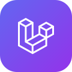
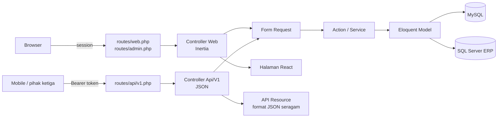

<p align="center">
  
</p>

<h1 align="center">Starter MVC</h1>

<p align="center">
  <strong>Dashboard web + REST API dalam satu project Laravel</strong>
</p>

<p align="center">
  
  
  
  
  
  
  
  
  
</p>

<!--
  SCREENSHOT — hapus tanda komentar ini setelah file gambar ada di docs/images/.
  Gambar otomatis mengikuti mode terang/gelap GitHub pembaca.

<p align="center">
  <picture>
    <source media="(prefers-color-scheme: dark)" srcset="docs/images/dashboard-dark.png">
    
  </picture>
</p>
-->

---

Starter kit aplikasi bisnis yang menyatukan **dashboard web** dan **REST API untuk mobile/integrasi** dalam satu project Laravel. Business logic ditulis sekali (Form Request → Action/Service → Model → Resource), lalu dipakai bersama oleh halaman admin dan endpoint `/api/v1`.

Sudah tersedia: autentikasi lengkap (termasuk 2FA dan token multi-device), role & permission yang diatur dari UI, menu dinamis, data table server-side, dan **CRUD generator** yang menghasilkan kode Laravel + React (termasuk REST API-nya) untuk tabel MySQL maupun tabel ERP di SQL Server.

---

## Daftar Isi

- [Fitur Utama](#fitur-utama)
- [Tampilan & UI](#tampilan--ui)
- [Tech Stack & Library](#tech-stack--library)
- [Arsitektur](#arsitektur)
- [Persyaratan](#persyaratan)
- [Instalasi](#instalasi)
- [Akun Demo](#akun-demo)
- [Perintah yang Sering Dipakai](#perintah-yang-sering-dipakai)
- [REST API](#rest-api)
- [Struktur Folder](#struktur-folder)
- [Testing & Kualitas Kode](#testing--kualitas-kode)
- [Dokumentasi](#dokumentasi)

---

## Fitur Utama

### Autentikasi & keamanan

- Login, register, lupa password, verifikasi email, dan **Two-Factor Authentication** (TOTP + recovery code) lewat Laravel Fortify.
- **Token API multi-device** (Sanctum): daftar device aktif, logout per device atau semua device, token otomatis dicabut saat password diganti atau akun dinonaktifkan, token punya masa berlaku, dan ada rate limiting.
- Akun bisa **dinonaktifkan** tanpa dihapus.
- URL admin bersih: filter disimpan di session, dan id memakai **ULID** sehingga tidak bisa ditebak.

### Otorisasi (RBAC)

- Role & permission berbasis `spatie/laravel-permission`, ditegakkan lewat **Policy** di server, bukan sekadar disembunyikan di React.
- **Matriks Access Control** (permission × role) yang langsung tersimpan saat diklik.
- RBAC API memakai permission yang sama dengan web, ditambah `api.access` per role sebagai pintu masuk.

### Menu dinamis

- Menu **sidebar dashboard** dan **navbar website** disimpan di database dan dikelola dari *Administration → Menus*.
- Submenu (2 tingkat), ikon, urutan **drag & drop**, dan visibilitas per role.
- **Pratinjau sidebar per role** ("View as staff") lengkap dengan alasan kenapa sebuah menu tersembunyi.

### CRUD generator

- Membuat migration, Model, Factory, Policy, Form Request, Controller, halaman React, dan feature test, baik dari form menu maupun dari terminal.
- Mendukung **tabel baru** atau **tabel yang sudah ada** (termasuk tabel ERP di SQL Server).
- **Master–detail**: satu header dengan hingga 5 tabel detail, disimpan dalam satu transaksi.
- Opsi **REST API**: bisa digenerate bersamaan, API saja, atau ditambahkan ke modul yang sudah ada.
- Hasilnya adalah kode biasa yang bisa dibaca, diubah, dan di-commit. Generator hanya aktif di environment development.

### Modul contoh

| Modul | Yang didemonstrasikan |
| --- | --- |
| **Users / Roles / Permissions** | CRUD lengkap dengan pola arsitektur project |
| **Kategori** | Satu business logic, dua interface (web + API) |
| **Produk** | Search, filter, sort, cursor pagination, PATCH, import Excel, ekspor Excel & PDF |
| **Kwitansi** | Hasil CRUD generator (master–detail, MySQL) |
| **Messages** | Hasil CRUD generator untuk tabel ERP SQL Server (`msg` → `msg_det`) |
| **Dashboard** | Statistik nyata yang hanya dihitung bila user berhak melihatnya |

---

## Tampilan & UI

UI dibangun dengan **shadcn/ui** (komponen Radix UI + Tailwind CSS v4) yang sudah disesuaikan supaya konsisten di semua halaman.

<!--
  GALERI — hapus tanda komentar ini setelah file gambar ada di docs/images/.

| Login | Dashboard |
| --- | --- |
|  |  |
| **Data table (Produk)** | **Manajemen menu (drag & drop)** |
|  |  |
| **Access Control** | **CRUD generator** |
|  |  |
-->

### Sistem desain

| Aspek | Detail |
| --- | --- |
| **Warna brand** | Indigo, didefinisikan sebagai *design token* `oklch()` di [`resources/css/app.css`](resources/css/app.css). Ganti satu variabel, maka seluruh aplikasi ikut berubah. |
| **Token status** | `success` (hijau) dan `warning` (kuning), tersedia sebagai class Tailwind (`bg-success`, `text-warning`). |
| **Font** | Plus Jakarta Sans (dimuat lewat Bunny Fonts) |
| **Tema** | Light, Dark, dan System. Bisa diganti dari tombol di header atau dari *Settings → Appearance*. Tidak ada kedipan putih saat halaman dimuat dalam mode gelap. |
| **Ikon** | Lucide (juga dipakai untuk ikon menu dinamis) |
| **Format** | Tanggal dalam format Indonesia (`10 Nov 2026`, `3 hari yang lalu`) |

### Layout

- **Dashboard:** sidebar yang bisa diciutkan, header dengan breadcrumb, toggle tema, dan menu user. Di layar kecil sidebar berubah menjadi *sheet*.
- **Halaman auth:** layout dua kolom dengan panel gradien brand.
- **Website publik:** landing page dengan navbar yang diambil dari menu database.
- **Settings:** Profile, Security (password & 2FA), dan Appearance.

### Pola halaman admin

Setiap halaman admin memakai komponen yang sama, jadi modul baru (termasuk hasil generator) otomatis tampil seragam:

```
┌──────────────────────────────────────────────────────────┐
│ [ikon] Produk                                            │  ← PageHeader
│        Kelola katalog produk.                            │
├──────────────────────────────────────────────────────────┤
│ [+ Tambah]  [ Cari...        ]  [Filter ▾]  [25 / hal ▾] │  ← toolbar
├────┬───────────────┬──────────┬──────────┬───────────────┤
│ ⋯  │ NAMA ↑        │ KATEGORI │ STATUS   │ DIBUAT        │  ← DataTable
├────┼───────────────┼──────────┼──────────┼───────────────┤
│ ⋯  │ Kopi Arabika  │ Minuman  │ ● Aktif  │ 3 hari lalu   │
├────┴───────────────┴──────────┴──────────┴───────────────┤
│                                  ‹  1  2  3  ›           │  ← Pagination
└──────────────────────────────────────────────────────────┘
```

- Kolom aksi `⋯` ada di paling kiri, dan tombol **Tambah** berada di kiri kolom pencarian.
- Sort, search (dengan debounce), filter, dan pagination diproses **di server** (TanStack Table v9).
- Tersedia komponen siap pakai: `PageHeader`, `DataTable`, `RowActions`, `StatusBadge`, `UserIdentity`/`UserAvatar`, `EmptyState`, `ConfirmDialog`, `Pagination`, serta notifikasi toast (Sonner) dari flash message Laravel.
- Hook `useCan()` untuk menampilkan tombol sesuai permission, yang juga tetap dicek ulang oleh Policy di server.

---

## Tech Stack & Library

### Backend

| Library | Versi | Kegunaan |
| --- | --- | --- |
| [Laravel](https://laravel.com) | 13 | Framework utama |
| PHP | 8.3 | Runtime |
| [Inertia.js (Laravel)](https://inertiajs.com) | 3 | Menghubungkan controller Laravel dengan halaman React tanpa membuat API terpisah |
| [Laravel Fortify](https://laravel.com/docs/fortify) | 1.x | Backend autentikasi web (login, register, 2FA, reset password) |
| [Laravel Sanctum](https://laravel.com/docs/sanctum) | 4 | Session web dan Bearer token untuk API |
| [Laravel Wayfinder](https://github.com/laravel/wayfinder) | 0.1 | Route Laravel di-generate menjadi fungsi TypeScript yang type-safe |
| [spatie/laravel-permission](https://spatie.be/docs/laravel-permission) | 8 | Role & permission |
| [dedoc/scramble](https://scramble.dedoc.co) | 0.13 | Dokumentasi OpenAPI otomatis (`/docs/api`) |
| [phpoffice/phpspreadsheet](https://phpspreadsheet.readthedocs.io) | 5 | Import dan ekspor Excel |
| [barryvdh/laravel-dompdf](https://github.com/barryvdh/laravel-dompdf) | 3 | Ekspor PDF |

### Frontend

| Library | Versi | Kegunaan |
| --- | --- | --- |
| [React](https://react.dev) + [TypeScript](https://www.typescriptlang.org) | 19 / 5 | UI, dengan React Compiler aktif |
| [@inertiajs/react](https://inertiajs.com) | 3 | Routing halaman, form, dan shared props |
| [Tailwind CSS](https://tailwindcss.com) | 4 | Styling berbasis utility class dan design token |
| [shadcn/ui](https://ui.shadcn.com) + [Radix UI](https://www.radix-ui.com) | – | Komponen aksesibel (dialog, dropdown, select, sidebar, dll.) |
| [TanStack Table](https://tanstack.com/table) | 9 | Data table server-side |
| [dnd-kit](https://dndkit.com) | 6 | Drag & drop untuk urutan menu |
| [Lucide React](https://lucide.dev) | – | Ikon |
| [Sonner](https://sonner.emilkowal.ski) | 2 | Notifikasi toast |
| [Vite+](https://viteplus.dev) | 1.4 | Build tool, linter, dan formatter (`vp`) |

### Database & tooling

| Komponen | Kegunaan |
| --- | --- |
| **MySQL 8.4** (InnoDB) | Database aplikasi: users, roles, menus, data non-kritikal |
| **SQL Server** (opsional) | Koneksi kedua `wmsreports` untuk data ERP, butuh ekstensi `pdo_sqlsrv` |
| **Pest 4** | Unit test dan feature test |
| **Larastan (PHPStan)** | Analisis statis PHP |
| **Laravel Pint** | Formatter kode PHP |
| **k6** | Load test (folder `k6/`) |
| **pnpm** | Package manager JavaScript |

---

## Arsitektur



- **Satu business logic, dua interface.** Validasi, aturan bisnis, dan otorisasi tidak pernah diduplikasi antara web dan API.
- Controller API berada di `app/Http/Controllers/Api/V1/`, sedangkan controller web di `app/Http/Controllers/<Fitur>/`.
- Semua response API memakai format JSON yang seragam, baik untuk sukses maupun error. Error 500 tidak membocorkan detail server.

---

## Persyaratan

- PHP **8.3** dengan ekstensi standar Laravel (`pdo_mysql`, `mbstring`, `openssl`, `gd`, `zip`, …)
- Composer 2
- Node.js 22+ dan **pnpm**
- MySQL 8.4 (konfigurasi default memakai port **3308**, sesuaikan di `.env`)
- *(Opsional)* SQL Server + ekstensi `pdo_sqlsrv` untuk modul ERP

## Instalasi

```bash
git clone https://github.com/<akun>/starter-mvc.git
cd starter-mvc

# 1. Dependensi
composer install
pnpm install

# 2. Environment
cp .env.example .env
php artisan key:generate
#    → atur DB_HOST, DB_PORT, DB_DATABASE, DB_USERNAME, DB_PASSWORD di .env

# 3. Database + data demo
php artisan migrate --seed

# 4. Jalankan semua proses development (server Laravel, Vite, dll.) sekaligus
composer dev
```

Buka `http://localhost:8000`.

> Di Windows, pastikan `C:\Windows\System32` ada di `PATH` supaya `composer dev` bisa berjalan.

**Koneksi ERP (opsional):** isi variabel `WMSREPORTS_DB_*` di `.env`, lalu cek koneksinya dengan `php artisan wmsreports:check`.

## Akun Demo

Akun berikut dibuat oleh seeder. Password semua akun: `password`.

| Email | Role |
| --- | --- |
| `admin@example.com` | admin |
| `staff@example.com` | staff |
| `customer@example.com` | customer |

> Ganti atau hapus akun demo ini sebelum dipakai di production.

## Perintah yang Sering Dipakai

| Perintah | Fungsi |
| --- | --- |
| `composer dev` | Menjalankan semua proses development |
| `pnpm build` | Build aset production |
| `php artisan make:crud` | CRUD generator dari terminal (`--api`, `--api-only`) |
| `php artisan crud:api <tabel>` | Menambahkan REST API ke modul hasil generator |
| `php artisan crud:remove <tabel>` | Menghapus modul hasil generator |
| `php artisan make:ulid-migration` | Menambahkan kolom ULID ke tabel |
| `php artisan wmsreports:check` | Mengecek koneksi SQL Server ERP |

## REST API

- Base URL: `/api/v1`, dengan autentikasi `Authorization: Bearer <token>`
- Dokumentasi interaktif (OpenAPI, Scramble): **`/docs/api`**
- Token didapat dari `POST /api/v1/auth/login` (dibatasi 5 percobaan per menit untuk tiap kombinasi email + IP). Role user harus memiliki permission `api.access`.

## Struktur Folder

```
app/
├── Actions/            Business logic per fitur (dipakai web & API)
├── Console/Commands/   make:crud, crud:api, crud:remove, wmsreports:check, …
├── Enums/              RoleName, PermissionName, MenuLocation
├── Exceptions/         BusinessException + renderer error API
├── Http/
│   ├── Controllers/    Api/V1/ (JSON) · <Fitur>/ (Inertia)
│   ├── Requests/       Form Request (validasi bersama)
│   └── Resources/      API Resource (bentuk JSON)
├── Policies/           Otorisasi per model
└── Services/           Crud (generator), Catalog (import/ekspor), …
resources/
├── css/app.css         Design token & tema
└── js/
    ├── components/     ui/ (shadcn) · admin/ (form modul) · data-table/
    ├── hooks/          useCan, useAppearance, useTableQuery, …
    ├── layouts/        app (sidebar/header) · auth · settings
    └── pages/          admin/ · auth/ · settings/ · dashboard · welcome
routes/                 web · admin · settings · api/v1 · generated
docs/                   Dokumentasi belajar per fitur (Bahasa Indonesia)
k6/                     Skenario load test
```

## Testing & Kualitas Kode

```bash
composer test         # Pint (cek format) + PHPStan + Pest
composer lint         # Merapikan format PHP
pnpm check            # Lint & format frontend
pnpm types:check      # Cek tipe TypeScript
composer ci:check     # Semua pengecekan di atas (dipakai GitHub Actions)
```

Test memakai database MySQL terpisah, lihat `phpunit.xml`.

## Dokumentasi

Setiap fitur punya catatan belajar sendiri: konsep, file yang terlibat, langkah pembuatan, dan alasan di balik keputusan desainnya.

- **[Panduan Belajar & urutan baca →](docs/PANDUAN-BELAJAR.md)**
- [Analisis & rancangan arsitektur](docs/00-arsitektur/tahap-01-analisis-arsitektur.md)
- [Tampilan & sistem tema UI](docs/fitur/04c-tampilan-dan-tema-ui.md)
- [CRUD generator](docs/fitur/08d-crud-generator.md)
- [Deploy ke production](docs/fitur/09-deploy-production.md)

### Roadmap

- [x] Auth web & API, RBAC, menu dinamis, data table, CRUD generator, integrasi ERP, generator REST API
- [ ] Optimasi query & index
- [ ] Checkout & database transaction
- [ ] Raw SQL & stored procedure
- [ ] Redis cache, queue & background job
- [ ] Load test k6 & Laravel Octane

## Lisensi

[MIT](https://opensource.org/licenses/MIT)
