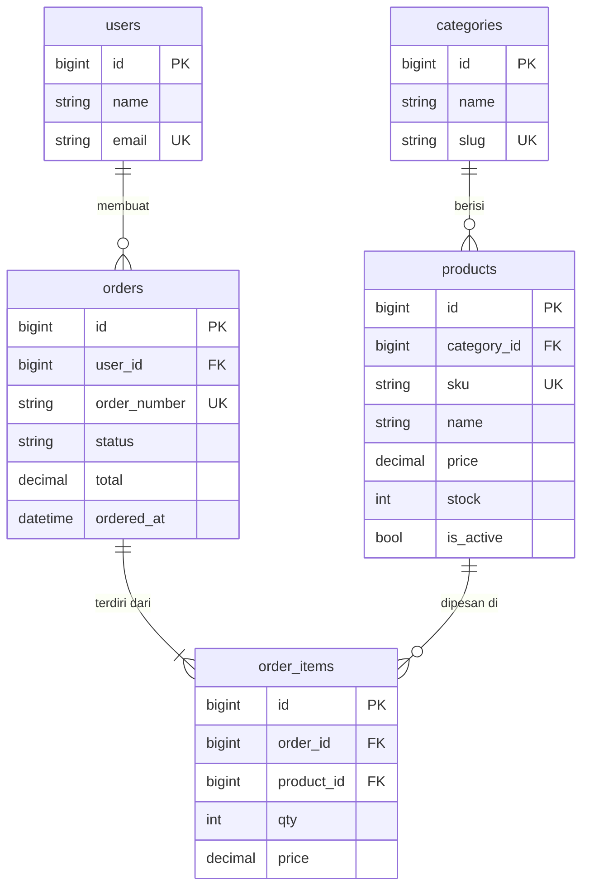
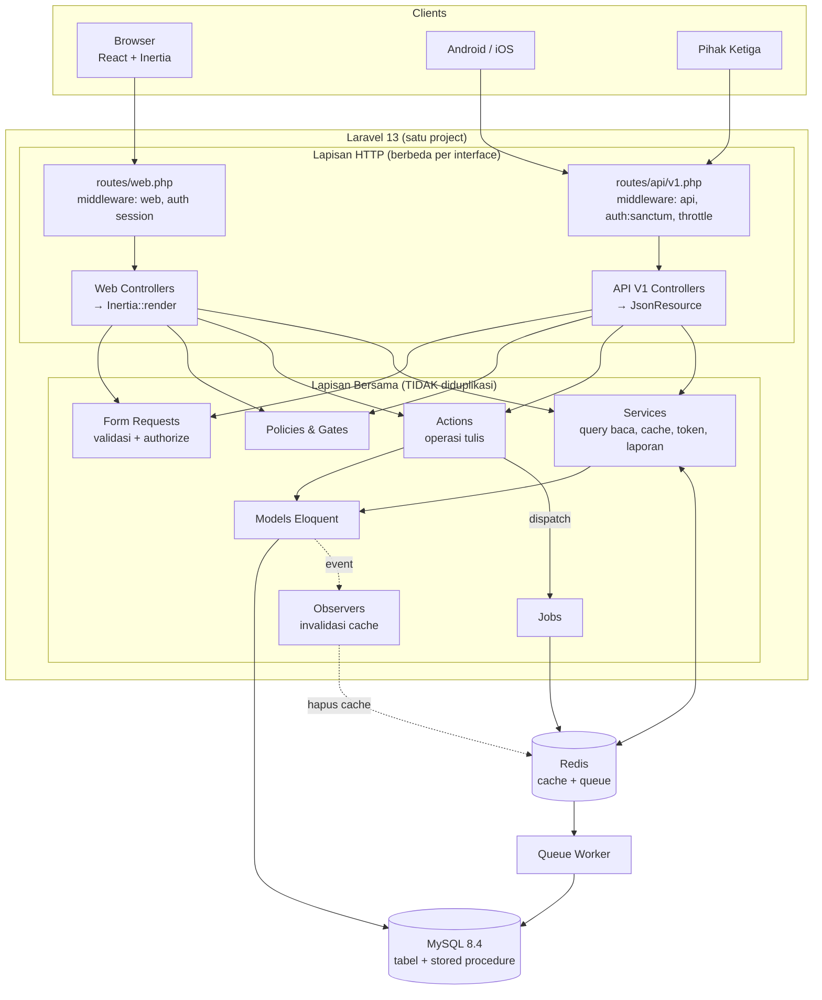
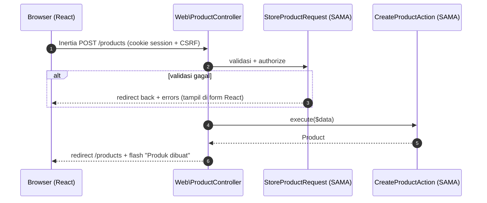
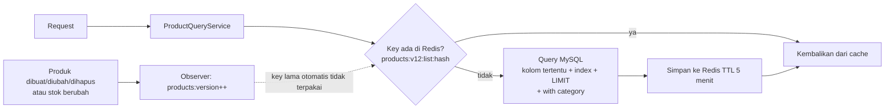
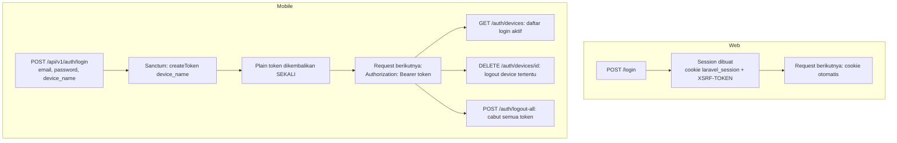
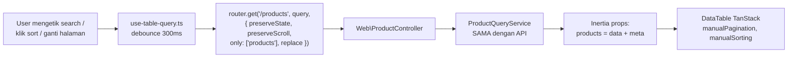

# Tahap 1 — Analisis Kebutuhan & Rancangan Arsitektur

> Status: **Disetujui**. Tahap 4 selesai.
>
> **Penyesuaian saat implementasi (Tahap 4):**
>
> - Form Request katalog diletakkan di `app/Http/Requests/Catalog/` (dipakai Web & API), controller web katalog di `Controllers/Admin/`.
> - Endpoint GET katalog bersifat **publik**: tamu hanya melihat produk aktif; token opsional dikenali lewat `$request->user('sanctum')`.
> - Parameter filter produk memakai format `filter[...]`, misalnya `filter[status]=active` (bukan `filter[is_active]`).
> - TanStack Table yang terpasang adalah **v9** (API berbeda dari v8). Lihat [08-data-table-react.md](../fitur/08-data-table-react.md).
> - Halaman web memakai ulang API Resource (`ProductResource`, `CategoryResource`) untuk membentuk data tabel.
>
> **Penyesuaian saat implementasi (Tahap 3):**
>
> - Permission **hanya dibuat untuk fitur yang sudah ada** (`users.*`, `roles.*`). Permission Kategori/Produk/Pesanan/Laporan ditambahkan di tahapnya masing-masing.
> - Tambahan kolom `users.is_active` (nonaktifkan akun tanpa menghapus) dan login API mewajibkan kode **2FA** bila user mengaktifkannya.
> - `BusinessException` dan `ApiResponse` (format sukses) dibuat lebih awal karena dibutuhkan. Format error API seragam tetap dikerjakan di Tahap 4.
> - Registrasi lewat API belum dibuat (di luar cakupan Tahap 3). Registrasi web otomatis memberi role `customer`.
>
> **Penyesuaian saat implementasi (Tahap 2):**
>
> - Starter kit terbaru memakai **Inertia 3, Fortify** (backend auth web), dan **Wayfinder** (route Laravel → fungsi TypeScript).
> - Controller web **tidak** dipindah ke `Controllers/Web/`. Konvensinya: API di `Controllers/Api/V1/`, web di `Controllers/<Fitur>/` (alasan: [01-instalasi-dan-struktur.md](../fitur/01-instalasi-dan-struktur.md#langkah-9--kerangka-folder)).
> - MySQL WAMP default-nya MyISAM, jadi engine **InnoDB dipaksa** di `config/database.php`. MySQL 8.4 berjalan di port **3308**.

---

## 1. Ringkasan Kebutuhan

| Area               | Kebutuhan                                                                                          | Catatan                                           |
| ------------------ | -------------------------------------------------------------------------------------------------- | ------------------------------------------------- |
| Interface          | Web (Inertia + React + **TypeScript**) **dan** REST API (`/api/v1`) dalam **satu** project Laravel | Business logic dipakai bersama, tidak diduplikasi |
| Klien API          | Android, iOS, integrasi pihak ketiga                                                               | Butuh token, versioning, dokumentasi              |
| Database           | **MySQL 8.4**: Eloquent, Query Builder, Raw SQL, Stored Procedure                                  |                                                   |
| Cache & Queue      | Redis (dipasang menyusul, lihat 6.5)                                                               |                                                   |
| Auth               | Sanctum: session untuk Web, Bearer token untuk mobile                                              | Multi-device, revoke token                        |
| Otorisasi          | Role & Permission, Policy, Gate                                                                    |                                                   |
| Dokumentasi        | OpenAPI / Swagger                                                                                  |                                                   |
| Pengujian performa | k6 (10 / 50 / 100 / 500 VU)                                                                        | Klaim performa hanya berdasarkan hasil uji        |
| Pembelajaran       | Satu file dokumentasi per fitur/proses                                                             | Folder `docs/`                                    |

### Domain contoh: Toko sederhana (Katalog & Pesanan)

Domain ini dipilih karena setiap teknik yang ingin dipelajari punya kasus nyata di dalamnya:



| Fitur                                              | Teknik yang didemonstrasikan                                                  | Tahap |
| -------------------------------------------------- | ----------------------------------------------------------------------------- | ----- |
| Auth API (login, logout, daftar device, revoke)    | Sanctum token, multi-device, rate limit login                                 | 3     |
| Role & permission (`admin`, `staff`, `customer`)   | Gate, Policy, permission                                                      | 3     |
| **Manajemen User** (Web)                           | CRUD user + memilih role, proteksi akun sendiri                               | 3     |
| **Manajemen Role & Permission** (Web)              | CRUD role + matriks checkbox permission, role sistem dikunci                  | 3     |
| **CRUD Kategori** (Web + API)                      | Fitur CRUD **paling dasar**, cocok sebagai bahan belajar pertama              | 4     |
| **CRUD Produk** (Web + API)                        | Action dipakai bersama, relasi + eager loading, Resource, Policy              | 4     |
| Daftar produk: filter / sort / search / pagination | Index, FULLTEXT, cursor pagination, mencegah N+1                              | 5     |
| Katalog produk publik                              | **Redis cache** + invalidasi (dibaca jauh lebih sering daripada diubah)       | 6     |
| **Checkout pesanan**                               | **DB transaction**, `lockForUpdate` (stok tidak boleh minus), idempotency key | 5     |
| **Laporan penjualan** (per hari/kategori)          | **Raw SQL + Stored Procedure**                                                | 5     |
| Export laporan ke CSV                              | **Queue job**: retry, failure handling, idempotency                           | 7     |
| Email invoice setelah checkout                     | Queue job sederhana                                                           | 7     |

Data uji: seeder **±100.000 produk** dan **±300.000 pesanan**, agar efek index, pagination, dan cache benar-benar terukur di k6.

---

## 2. Pilihan Teknologi & Alasannya

| Komponen          | Pilihan                                                                                 | Alasan                                                            | Alternatif yang tidak dipilih                                                      |
| ----------------- | --------------------------------------------------------------------------------------- | ----------------------------------------------------------------- | ---------------------------------------------------------------------------------- |
| Framework         | **Laravel 13.x**                                                                        | Versi stabil terbaru, butuh PHP ≥ 8.3 (lokal: 8.5)                | Laravel 12: masih didukung, tetapi project baru sebaiknya mulai dari versi terbaru |
| Web UI            | **Laravel React Starter Kit** (Inertia + React + **TypeScript** + Tailwind + shadcn/ui) | Halaman login/register/reset password sudah jadi                  | Membuat dari nol: lebih lama tanpa nilai tambah                                    |
| Tabel data (Web)  | **TanStack Table** + komponen **shadcn/ui Data Table**, mode _server-side_              | Lihat [bagian 6.10](#610-menampilkan-data-di-react)               | AG Grid, MUI DataGrid                                                              |
| Grafik laporan    | **Recharts** (via shadcn/ui Charts)                                                     | Sudah satu ekosistem dengan shadcn/ui                             | Chart.js: bagus, tetapi tidak menyatu dengan komponen yang ada                     |
| Database          | **MySQL 8.4** (sudah ada di WAMP)                                                       | Mendukung stored procedure, FULLTEXT, CTE, window function        | MariaDB: sintaks SP dan fungsi JSON sedikit berbeda                                |
| Redis client      | **predis/predis**                                                                       | Ekstensi `phpredis` belum terpasang di PHP Windows                | phpredis **disarankan di production** (Linux). Cukup ganti `REDIS_CLIENT`          |
| Auth              | **Laravel Sanctum**                                                                     | Satu paket untuk session Web dan token mobile                     | Passport: OAuth2 penuh, terlalu berat untuk saat ini                               |
| Role & Permission | **spatie/laravel-permission**                                                           | Standar de-facto, permission di-cache, terintegrasi dengan `Gate` | Buat sendiri: membuang waktu, rawan bug                                            |
| Dokumentasi API   | **dedoc/scramble**                                                                      | OpenAPI dibuat otomatis dari Form Request & Resource              | l5-swagger: anotasi panjang, mudah tidak sinkron dengan kode                       |
| Testing           | **Pest**                                                                                | Sintaks ringkas, mudah dibaca pemula                              |                                                                                    |
| Load test         | **k6**                                                                                  | Script JavaScript, metrik P95/P99 bawaan                          | JMeter: berat, berbasis GUI                                                        |
| Monitoring query  | **Laravel Pulse** (+ `DB::listen` saat uji)                                             | Mencatat slow query & endpoint lambat                             | Telescope: **dimatikan** saat load test                                            |

### Hal yang sengaja TIDAK dipakai (menghindari overengineering)

| Pola                                | Alasan                                                                                                                    |
| ----------------------------------- | ------------------------------------------------------------------------------------------------------------------------- |
| **Repository Pattern**              | Eloquent sudah merupakan abstraksi data. Repository di atas Eloquent biasanya hanya meneruskan method tanpa nilai tambah. |
| **Interface untuk setiap Service**  | Hanya dibuat bila memang ada lebih dari satu implementasi.                                                                |
| **DTO untuk setiap request**        | `$request->validated()` sudah berisi data yang tervalidasi.                                                               |
| **Modular / DDD per folder domain** | Struktur standar Laravel lebih mudah dipelajari.                                                                          |
| **TanStack Query / Redux di Web**   | Inertia sudah menangani pengambilan data & state halaman. Library state tambahan akan menduplikasi perannya.              |

---

## 3. Arsitektur Berlapis

### 3.1 Prinsip utama

> **Controller hanya "penerjemah"** antara HTTP dan business logic.
> Web Controller menerjemahkan ke **Inertia response**, API Controller ke **JSON response**.
> Keduanya memanggil **Action/Service yang sama**.

### 3.2 Diagram komponen



### 3.3 Tanggung jawab tiap lapisan

| Lapisan           | Boleh                                                                      | Tidak boleh                            |
| ----------------- | -------------------------------------------------------------------------- | -------------------------------------- |
| **Route**         | Memetakan URL ke controller, memasang middleware                           | Berisi logika                          |
| **Middleware**    | Auth, throttle, memaksa `Accept: application/json`                         | Business logic                         |
| **Form Request**  | Validasi input, `authorize()`, normalisasi input                           | Query berat, menyimpan data            |
| **Controller**    | Request → Action/Service → response                                        | Query kompleks, transaksi, kirim email |
| **Policy / Gate** | Memutuskan "boleh/tidak"                                                   | Mengubah data                          |
| **Action**        | **Satu use-case tulis** (mis. `PlaceOrderAction`), transaksi, dispatch job | Mengenal HTTP (`Request`/response)     |
| **Service**       | Logika baca yang dipakai ulang, cache, laporan, token                      | Mengenal HTTP                          |
| **Model**         | Relasi, cast, scope, `$fillable`                                           | Business logic lintas model            |
| **API Resource**  | Membentuk JSON                                                             | Query (memakai `whenLoaded`)           |
| **Job**           | Pekerjaan berat di background, idempotent                                  | Bergantung pada state request          |
| **Observer**      | Reaksi terhadap event model (invalidasi cache)                             | Logika bisnis utama                    |

**Kenapa Action dan Service dipisah?**

- **Action** = _kata kerja_, satu class satu tugas, dengan method `execute()`. Contoh: `CreateProductAction`, `PlaceOrderAction`.
- **Service** = kumpulan operasi baca yang saling berkaitan. Contoh: `ProductQueryService::paginate($filters)`, `SalesReportService::daily($from, $to)`.

---

## 4. Diagram Alur Request

### 4.1 Alur API: `POST /api/v1/orders` (checkout, kasus paling kompleks)

```mermaid
sequenceDiagram
    autonumber
    participant C as Mobile App
    participant MW as Middleware<br/>(ForceJson, auth:sanctum, throttle)
    participant FR as PlaceOrderRequest
    participant CT as Api\V1\OrderController
    participant A as PlaceOrderAction
    participant DB as MySQL
    participant O as ProductObserver
    participant R as Redis
    participant Q as Queue

    C->>MW: POST /api/v1/orders<br/>Bearer token + Idempotency-Key
    MW->>MW: validasi token, cek rate limit
    alt token invalid
        MW-->>C: 401 UNAUTHENTICATED
    end
    MW->>FR: request
    FR->>FR: authorize() + rules() (items, qty)
    alt validasi gagal
        FR-->>C: 422 VALIDATION_ERROR
    end
    FR->>CT: validated data
    CT->>A: execute($user, $items, $idempotencyKey)
    A->>DB: BEGIN
    A->>DB: SELECT ... FROM products WHERE id IN (...) FOR UPDATE
    alt stok kurang
        A->>DB: ROLLBACK
        A-->>C: 409 CONFLICT "Stok tidak cukup"
    end
    A->>DB: INSERT orders, order_items; UPDATE products SET stock = stock - qty
    A->>DB: COMMIT
    DB-->>O: event "updated" (after commit)
    O->>R: naikkan versi cache katalog
    A->>Q: dispatch SendInvoiceEmailJob (after commit)
    A-->>CT: Order
    CT-->>C: 201 { success, message, data: OrderResource }
```

### 4.2 Alur Web: form "Tambah Produk" (business logic sama dengan API)



Perbedaan Web dan API **hanya di awal dan akhir**: cara autentikasi dan bentuk response.

### 4.3 Alur baca dengan cache: `GET /api/v1/products?search=kopi&sort=-price`



### 4.4 Autentikasi: Web vs Mobile



---

## 5. Struktur Folder (rancangan)

Yang ditandai ★ adalah tambahan kita. Selebihnya bawaan Laravel atau starter kit.

```
starter-mvc/
├── app/
│   ├── Actions/ ★                       # Use-case TULIS, dipakai Web & API
│   │   ├── Category/{Create,Update,Delete}CategoryAction.php
│   │   ├── Product/{Create,Update,Delete}ProductAction.php
│   │   └── Order/PlaceOrderAction.php
│   ├── Services/ ★                      # Logika BACA & layanan teknis
│   │   ├── Product/ProductQueryService.php   # filter/sort/search/paginate + cache
│   │   ├── Report/SalesReportService.php     # raw SQL & stored procedure
│   │   └── Auth/TokenService.php             # issue/list/revoke token
│   ├── Enums/ ★
│   │   ├── RoleName.php                 # admin, staff, customer
│   │   ├── PermissionName.php           # products.create, orders.view, ...
│   │   └── OrderStatus.php              # pending, paid, cancelled
│   ├── Exceptions/
│   │   ├── BusinessException.php ★      # mis. stok tidak cukup → 409
│   │   └── ApiExceptionRenderer.php ★   # semua error API → JSON standar
│   ├── Http/
│   │   ├── Controllers/
│   │   │   ├── Settings/                # web, bawaan starter kit
│   │   │   ├── Catalog/, Admin/, ... ★  # web per fitur → Inertia::render (lihat catatan Tahap 2)
│   │   │   │   ├── CategoryController.php
│   │   │   │   ├── ProductController.php
│   │   │   │   ├── OrderController.php
│   │   │   │   └── SalesReportController.php
│   │   │   └── Api/V1/ ★                # → JSON
│   │   │       ├── Auth/{Auth,Device}Controller.php
│   │   │       ├── CategoryController.php
│   │   │       ├── ProductController.php
│   │   │       ├── OrderController.php
│   │   │       └── SalesReportController.php
│   │   ├── Middleware/ForceJsonResponse.php ★
│   │   ├── Requests/ ★                  # DIPAKAI BERSAMA Web & API
│   │   │   ├── Category/{Store,Update}CategoryRequest.php
│   │   │   ├── Product/{Index,Store,Update}ProductRequest.php
│   │   │   ├── Order/PlaceOrderRequest.php
│   │   │   └── Api/V1/Auth/LoginRequest.php  # khusus API (device_name)
│   │   └── Resources/V1/ ★
│   │       └── {Category,Product,Order,OrderItem,Device}Resource.php
│   ├── Jobs/ ★
│   │   ├── SendInvoiceEmailJob.php
│   │   └── ExportSalesReportJob.php
│   ├── Models/{User,Category,Product,Order,OrderItem}.php
│   ├── Observers/{Category,Product}Observer.php ★
│   ├── Policies/{Category,Product,Order}Policy.php ★
│   └── Support/ ★
│       ├── ApiResponse.php              # helper response sukses standar
│       └── CacheKey.php                 # satu tempat untuk key & TTL cache
├── bootstrap/app.php                    # routing, middleware, exception
├── database/
│   ├── migrations/
│   ├── seeders/
│   │   ├── RolePermissionSeeder.php ★
│   │   ├── CatalogSeeder.php ★          # ±100rb produk
│   │   └── OrderSeeder.php ★            # ±300rb pesanan
│   └── sql/procedures/ ★
│       └── sp_sales_report.sql
├── resources/js/
│   ├── components/data-table/ ★         # DataTable reusable (TanStack + shadcn)
│   ├── hooks/use-table-query.ts ★       # sinkronisasi filter/sort/page ↔ URL
│   ├── types/ ★                         # tipe TS: Product, Paginated<T>, ...
│   └── pages/
│       ├── categories/{Index,Create,Edit}.tsx ★
│       ├── products/{Index,Create,Edit}.tsx ★
│       ├── orders/{Index,Show}.tsx ★
│       └── reports/Sales.tsx ★
├── routes/
│   ├── web.php
│   ├── api.php                          # hanya memuat prefix versi
│   └── api/v1.php ★
├── tests/Feature/{Api/V1,Web}/ ★
├── k6/ ★
│   ├── lib/config.js
│   ├── scenarios/{smoke,load-10,load-50,load-100,stress-500}.js
│   └── results/
└── docs/ ★
```

### Routing & versioning

```php
// routes/api.php: hanya "pintu masuk" versi
Route::prefix('v1')->name('api.v1.')->group(base_path('routes/api/v1.php'));
```

Versi baru (`v2`) hanya dibuat jika ada **breaking change** pada kontrak JSON. Controller `V2` boleh memanggil Action yang sama.

---

## 6. Keputusan Teknis per Area

### 6.1 Autentikasi & otorisasi (Tahap 3)

| Keputusan       | Detail                                                                                                                                                                                                  |
| --------------- | ------------------------------------------------------------------------------------------------------------------------------------------------------------------------------------------------------- |
| Guard           | Web: `web` (session). API: `sanctum` (Bearer token).                                                                                                                                                    |
| Multi-device    | Setiap login membuat token baru bernama `device_name`; `last_used_at` dicatat.                                                                                                                          |
| Revoke          | Logout device ini / device tertentu / semua device. Saat password diganti, semua token dicabut.                                                                                                         |
| Masa berlaku    | `sanctum.expiration` (mis. 30 hari) + `sanctum:prune-expired` dijadwalkan harian.                                                                                                                       |
| Role/permission | `admin` (semua), `staff` (kelola kategori/produk, lihat pesanan & laporan), `customer` (lihat katalog, checkout, lihat pesanan **miliknya sendiri**). Policy memeriksa **permission**, bukan nama role. |
| Super admin     | `Gate::before` → admin lolos semua pemeriksaan.                                                                                                                                                         |
| UI kelola akses | Lihat [bagian 6.11](#611-ui-manajemen-role--permission).                                                                                                                                                |
| Rate limit      | `api`: 60 req/menit per user/IP. `login`: 5/menit per email+IP. `checkout`: 10/menit per user.                                                                                                          |
| Mass assignment | `$fillable` eksplisit; controller hanya memakai `$request->validated()`; `Model::shouldBeStrict()` aktif di local.                                                                                      |

### 6.2 Format response standar (Tahap 4)

**Sukses (single):**

```json
{
    "success": true,
    "message": "Produk berhasil dibuat.",
    "data": {
        "id": 15,
        "sku": "KOP-001",
        "name": "Kopi Arabika 250g",
        "price": "85000.00",
        "stock": 40,
        "category": { "id": 2, "name": "Minuman" }
    }
}
```

**Sukses (list + pagination):**

```json
{
    "success": true,
    "message": "OK",
    "data": [{ "id": 1, "name": "..." }],
    "meta": {
        "current_page": 1,
        "per_page": 15,
        "total": 100000,
        "last_page": 6667
    },
    "links": { "first": "...", "prev": null, "next": "...", "last": "..." }
}
```

**Error:**

```json
{
    "success": false,
    "message": "Stok tidak cukup untuk produk KOP-001.",
    "code": "CONFLICT",
    "errors": null
}
```

| HTTP | `code`               | Kapan                                                              |
| ---- | -------------------- | ------------------------------------------------------------------ |
| 200  | —                    | GET/PUT/PATCH berhasil                                             |
| 201  | —                    | POST membuat resource                                              |
| 204  | —                    | DELETE berhasil (tanpa body)                                       |
| 400  | `BAD_REQUEST`        | JSON rusak                                                         |
| 401  | `UNAUTHENTICATED`    | Token tidak ada / kedaluwarsa                                      |
| 403  | `FORBIDDEN`          | Tidak punya izin                                                   |
| 404  | `NOT_FOUND`          | Resource / route tidak ada                                         |
| 405  | `METHOD_NOT_ALLOWED` | Method HTTP salah                                                  |
| 409  | `CONFLICT`           | Aturan bisnis dilanggar (stok kurang, kategori masih punya produk) |
| 422  | `VALIDATION_ERROR`   | Validasi gagal                                                     |
| 429  | `TOO_MANY_REQUESTS`  | Rate limit (+ header `Retry-After`)                                |
| 500  | `SERVER_ERROR`       | Error tak terduga, **tanpa** stack trace saat `APP_DEBUG=false`    |

### 6.3 Query list: pagination, filter, sort, search

```
GET /api/v1/products?search=kopi&filter[category_id]=2&filter[is_active]=1
                    &filter[price_min]=10000&sort=-price&per_page=20&page=2
```

| Keputusan                                                  | Alasan                                                                       |
| ---------------------------------------------------------- | ---------------------------------------------------------------------------- |
| Filter & sort pakai **whitelist** di `IndexProductRequest` | Mencegah sort/filter dengan kolom sembarang                                  |
| `per_page` maksimum 100                                    | Mencegah klien meminta data terlalu banyak                                   |
| Default `paginate()` (offset)                              | Tabel admin Web butuh total halaman                                          |
| Opsional `?cursor=` → `cursorPaginate()`                   | Infinite scroll mobile: tanpa `COUNT(*)` & `OFFSET` besar                    |
| Search: FULLTEXT pada `name`, prefix `LIKE` pada `sku`     | `LIKE '%kopi%'` tidak memakai index. Perbedaannya akan **diukur** di Tahap 9 |
| Index komposit, mis. `(category_id, is_active, price)`     | Disesuaikan dengan pola filter yang paling sering dipakai                    |

**Format query string yang sama dipakai oleh Web** (halaman produk di React), sehingga `IndexProductRequest` & `ProductQueryService` benar-benar dipakai bersama.

### 6.4 Database (Tahap 5)

| Kapan pakai                     | Alat                                      | Contoh di project                         |
| ------------------------------- | ----------------------------------------- | ----------------------------------------- |
| CRUD biasa, relasi              | **Eloquent** + `select([...])` + `with()` | CRUD kategori & produk                    |
| Update atomik, agregasi         | **Query Builder**                         | `decrement('stock')`, ringkasan dashboard |
| Query laporan kompleks          | **Raw SQL** dengan binding                | Produk terlaris (window function)         |
| Logika laporan berat di sisi DB | **Stored Procedure**                      | `sp_sales_report(from, to, group_by)`     |

- SP disimpan di `database/sql/procedures/*.sql` dan dipasang lewat migration (`DB::unprepared`), jadi tetap masuk version control dan bisa di-rollback.
- Test memakai **MySQL** (`starter_mvc_test`), bukan SQLite, karena SQLite tidak mendukung SP & FULLTEXT.
- `Model::preventLazyLoading()` aktif di local/testing, sehingga N+1 langsung terdeteksi.
- Checkout: `DB::transaction()` + `lockForUpdate()` agar dua pembeli tidak bisa mengambil stok terakhir yang sama. Job & invalidasi cache memakai **after commit**.
- Harga di `order_items` **disalin** saat checkout, supaya perubahan harga produk tidak mengubah pesanan lama.
- Uang memakai `DECIMAL(15,2)`, bukan `FLOAT`.

### 6.5 Cache Redis (Tahap 6)

- **Sampai Redis terpasang**, `CACHE_STORE=database` dan `QUEUE_CONNECTION=database`. Kode tidak berubah saat pindah ke Redis, cukup ganti `.env`. Redis **wajib** sudah terpasang sebelum Tahap 6.
- **Format key:** `{domain}:v{versi}:{jenis}:{identitas}`, mis. `products:v12:list:9f86d0…`.
- **Invalidasi:** _versioned key_. Observer menaikkan `products:version`, sehingga key lama tidak terpakai dan habis sendiri oleh TTL.
- **TTL** dipusatkan di `App\Support\CacheKey`.
- **Tidak di-cache:** token, data pesanan milik customer di key bersama, dan response yang bergantung pada izin tanpa memasukkan role ke dalam key.
- `Cache::flexible()` (_stale-while-revalidate_) untuk laporan yang mahal dihitung.
- Database Redis dipisah: cache dan queue tidak saling menghapus.

### 6.6 Queue (Tahap 7)

- Job menetapkan `$tries`, `$backoff` (mis. `[10, 60, 300]`), `$timeout`, dan `failed()`.
- **Idempotency:** `ShouldBeUnique`, middleware `WithoutOverlapping`, dan penanda di DB (mis. `orders.invoice_sent_at`) agar retry tidak mengirim invoice dua kali.
- **Checkout idempotent:** header `Idempotency-Key` dari mobile disimpan (unique). Jika request yang sama terkirim ulang karena koneksi putus, server mengembalikan order yang sudah ada, bukan membuat order baru.
- Gagal permanen → `failed_jobs`, dicoba ulang dengan `php artisan queue:retry`.
- Windows: `php artisan queue:work`. Horizon hanya untuk Linux production.

### 6.7 Dokumentasi API (Tahap 8)

Scramble menghasilkan OpenAPI 3.1 dari route, Form Request, dan Resource → `/docs/api` + ekspor `openapi.json` (untuk Swagger UI/Postman).

### 6.8 Pengujian performa (Tahap 9)

- Target berikut adalah **hipotesis yang akan diuji, bukan klaim**: `GET /products` (cache hit) P95 < 200 ms, error rate < 1% pada 50 VU, di mesin yang spesifikasinya dicatat.
- Setiap skenario diuji **sebelum** dan **sesudah** optimasi. Hasil mentah k6 disimpan di `k6/results/`.
- Skenario checkout dengan banyak VU sekaligus menguji `lockForUpdate`: stok tidak boleh minus.
- Angka dari WAMP Windows **tidak mewakili** production Linux. Perbandingan sebelum vs sesudah di mesin yang sama tetap valid.

### 6.9 Laravel Octane (Tahap 10)

Swoole tidak berjalan di Windows, jadi evaluasi kemungkinan besar dilakukan di Linux (Docker/WSL/VPS). Sejak Tahap 2 kode dijaga agar tidak menyimpan state request di singleton atau static property.

### 6.10 Menampilkan data di React

**Pilihan: TanStack Table (headless) + komponen Data Table shadcn/ui, mode server-side.**



| Kebutuhan                                   | Solusi                                                                                                                                                              |
| ------------------------------------------- | ------------------------------------------------------------------------------------------------------------------------------------------------------------------- |
| Tabel admin (produk, pesanan)               | TanStack Table + shadcn/ui Data Table                                                                                                                               |
| Pagination / sort / filter                  | **Server-side**: data 100rb baris tidak mungkin dikirim semua ke browser. TanStack diset `manualPagination` & `manualSorting`, sedangkan datanya dari Inertia props |
| State filter                                | Disimpan di **URL query string**, sehingga bisa di-bookmark, tombol Back berfungsi, dan halaman tetap sama saat di-refresh                                          |
| Hanya memuat data tabel saat filter berubah | Inertia **partial reload** (`only: ['products']`)                                                                                                                   |
| Data lambat (grafik laporan)                | Inertia **deferred props**, sehingga halaman tampil dulu dan grafik menyusul                                                                                        |
| Grafik laporan penjualan                    | Recharts (shadcn/ui Charts)                                                                                                                                         |
| Form                                        | `useForm` Inertia atau komponen `<Form>` dari Inertia, plus komponen form shadcn/ui                                                                                 |

**Kenapa bukan alternatif lain?**

| Alternatif                          | Alasan tidak dipilih                                                                                                                    |
| ----------------------------------- | --------------------------------------------------------------------------------------------------------------------------------------- |
| AG Grid                             | Sangat lengkap, tetapi berat dan fitur pentingnya (server-side row model) berbayar                                                      |
| MUI DataGrid                        | Memakai design system Material, bertabrakan dengan Tailwind/shadcn                                                                      |
| TanStack Query / SWR / axios di Web | Inertia sudah mengambil data lewat controller. Menambah fetch sendiri berarti dua cara mengambil data dan dua tempat validasi           |
| Memanggil `/api/v1` dari React Web  | Web memakai session, sedangkan API untuk token/mobile. Menggabungkannya mengaburkan batas keamanan dan menghilangkan keuntungan Inertia |

### 6.11 UI Manajemen Role & Permission

Ada tiga menu admin. Ketiganya hanya tersedia di Web, dan Action-nya bisa dipakai oleh API jika kelak dibutuhkan.

| Menu            | Bisa apa                                                                                      | Permission yang dibutuhkan        |
| --------------- | --------------------------------------------------------------------------------------------- | --------------------------------- |
| **Users**       | Daftar (Data Table), tambah, edit, nonaktifkan, pilih role, cabut semua token login user      | `users.view/create/update/delete` |
| **Roles**       | Daftar role + jumlah user, tambah, ubah nama, hapus, **matriks checkbox permission** per role | `roles.view/create/update/delete` |
| **Permissions** | **Hanya baca**: daftar permission dikelompokkan per modul beserta keterangannya               | `roles.view`                      |

```
┌ Edit Role: staff ───────────────────────────────────────────┐
│ Nama role: [ staff            ]                             │
│                                                             │
│ Modul        Lihat   Tambah   Ubah   Hapus                  │
│ Kategori      [x]     [x]     [x]     [ ]                   │
│ Produk        [x]     [x]     [x]     [ ]                   │
│ Pesanan       [x]     [ ]     [x]     [ ]                   │
│ Laporan       [x]      —       —       —   [x] Export       │
│ Users         [ ]     [ ]     [ ]     [ ]                   │
│ Roles         [ ]     [ ]     [ ]     [ ]                   │
│                                        [Batal] [Simpan]     │
└─────────────────────────────────────────────────────────────┘
```

**Kenapa permission tidak bisa dibuat atau dihapus dari UI?**
Permission adalah "kunci" yang **diperiksa oleh kode** (`$user->can('products.delete')` di Policy). Permission baru yang dibuat dari UI tidak akan diperiksa oleh kode mana pun, sehingga tidak ada efeknya. Sebaliknya, menghapus permission yang dipakai kode akan membuat fitur itu tertutup untuk semua orang kecuali admin.

Karena itu, daftar permission didefinisikan di `App\Enums\PermissionName` dan disinkronkan ke database dengan `php artisan db:seed --class=RolePermissionSeeder` (aman dijalankan berulang). Yang dikelola dari UI adalah **role dan isinya**, dan memang itu yang sehari-hari berubah.

**Aturan pengaman (di Action, bukan hanya di UI):**

| Aturan                                                                          | Alasan                                                                                                           |
| ------------------------------------------------------------------------------- | ---------------------------------------------------------------------------------------------------------------- |
| Role `admin` tidak bisa dihapus, diganti nama, atau dikurangi permission-nya    | Mencegah semua orang terkunci dari sistem                                                                        |
| Role `customer` tidak bisa dihapus                                              | Dipakai saat registrasi                                                                                          |
| Role yang masih dipakai user tidak bisa dihapus (409)                           | Mencegah user tiba-tiba kehilangan akses                                                                         |
| Admin tidak bisa menghapus akunnya sendiri atau melepas role admin dari dirinya | Mencegah admin terakhir hilang                                                                                   |
| Perubahan role/permission langsung berlaku                                      | spatie mengosongkan cache permission otomatis. Token mobile tetap valid, tetapi izinnya mengikuti role yang baru |

**Untuk mobile:** `GET /api/v1/auth/me` mengembalikan `roles` dan `permissions` milik user, sehingga aplikasi bisa menyembunyikan menu yang tidak diizinkan. Server **tetap** memeriksa ulang setiap request.

Komponen tambahan:

```
app/Actions/User/{Create,Update,Delete}UserAction.php
app/Actions/Role/{Create,Update,Delete}RoleAction.php     # update = nama + syncPermissions
app/Http/Controllers/Web/Admin/{User,Role,Permission}Controller.php
app/Http/Requests/Admin/{Store,Update}{User,Role}Request.php
app/Policies/{User,Role}Policy.php
resources/js/pages/admin/users/{Index,Create,Edit}.tsx
resources/js/pages/admin/roles/{Index,Create,Edit}.tsx
resources/js/pages/admin/permissions/Index.tsx
resources/js/components/permission-matrix.tsx
resources/js/hooks/use-can.ts          # sembunyikan tombol/menu sesuai permission
```

Permission user yang sedang login dikirim ke React lewat _shared props_ Inertia (`auth.permissions`). Komponen bisa memakai `can('products.create')` untuk menyembunyikan tombol. Ini hanya untuk tampilan, karena pemeriksaan sebenarnya tetap dilakukan di Policy.

---

## 7. Konfigurasi Lingkungan (rencana)

```dotenv
APP_ENV=local
DB_CONNECTION=mysql
DB_DATABASE=starter_mvc
CACHE_STORE=database        # → redis di Tahap 6
QUEUE_CONNECTION=database   # → redis di Tahap 7
SESSION_DRIVER=database
REDIS_CLIENT=predis         # production Linux: phpredis
SANCTUM_TOKEN_EXPIRATION=43200   # menit (30 hari)
```

---

## 8. Strategi Testing (berjalan di setiap tahap)

- Setiap endpoint API punya Feature test: sukses, 401, 403, 422, 404.
- Setiap Action punya test langsung, tanpa HTTP. `PlaceOrderAction` juga diuji untuk kasus stok habis.
- Test berjalan di database MySQL terpisah (`starter_mvc_test`).
- Endpoint list punya assertion jumlah query, untuk mendeteksi N+1 secara otomatis.

---

## 9. Peta Tahapan & Dokumentasi yang Dihasilkan

| Tahap | Output kode                                                                                          | Dokumentasi belajar                                                                                                          |
| ----- | ---------------------------------------------------------------------------------------------------- | ---------------------------------------------------------------------------------------------------------------------------- |
| 1     | —                                                                                                    | `00-arsitektur/tahap-01-analisis-arsitektur.md` (ini)                                                                        |
| 2     | Install Laravel + starter kit, folder, routing v1, ForceJson                                         | `fitur/01-instalasi-dan-struktur.md`, `fitur/02-routing-dan-versioning.md`                                                   |
| 3     | Sanctum token, multi-device, role/permission, policy, rate limit, **UI Users / Roles / Permissions** | `fitur/03-auth-api-token.md`, `fitur/04-role-permission-policy.md`, `fitur/04b-ui-manajemen-akses.md`                        |
| 4     | ApiResponse, error handler, CRUD Kategori & Produk (Web + API), DataTable React                      | `fitur/05-standar-response-error.md`, `fitur/06-crud-kategori.md`, `fitur/07-crud-produk.md`, `fitur/08-data-table-react.md` |
| 5     | Index, filter/sort/search, checkout + transaksi, raw SQL, SP, seeder                                 | `fitur/09-optimasi-query.md`, `fitur/10-checkout-transaksi.md`, `fitur/11-raw-sql-stored-procedure.md`                       |
| 6     | Cache Redis + invalidasi                                                                             | `fitur/12-redis-cache.md`                                                                                                    |
| 7     | Job invoice & export CSV                                                                             | `fitur/13-queue-job.md`                                                                                                      |
| 8     | Scramble                                                                                             | `fitur/14-dokumentasi-api.md`                                                                                                |
| 9     | Script k6 + laporan                                                                                  | `fitur/15-load-test-k6.md`, `k6/results/LAPORAN.md`                                                                          |
| 10    | Evaluasi Octane                                                                                      | `fitur/16-laravel-octane.md`                                                                                                 |

---

## 10. Keputusan yang Sudah Disetujui

| #   | Keputusan       | Hasil                                                                                                      |
| --- | --------------- | ---------------------------------------------------------------------------------------------------------- |
| 1   | Bahasa frontend | **TypeScript**                                                                                             |
| 2   | Redis           | **Menyusul**. Sementara memakai driver `database`; wajib terpasang sebelum Tahap 6                         |
| 3   | Database        | **MySQL 8.4**                                                                                              |
| 4   | Library         | `spatie/laravel-permission`, `dedoc/scramble`, `predis/predis`: **disetujui**                              |
| 5   | Bahasa          | Dokumentasi Bahasa Indonesia, kode Bahasa Inggris: **disetujui**                                           |
| 6   | Domain contoh   | **Toko sederhana** (Kategori, Produk, Pesanan, Laporan): _menunggu konfirmasi_                             |
| 7   | Tabel data Web  | **TanStack Table + shadcn/ui Data Table**, server-side, state di URL                                       |
| 8   | UI kelola akses | Menu **Users**, **Roles** (CRUD + matriks permission), **Permissions** (hanya baca): _menunggu konfirmasi_ |
