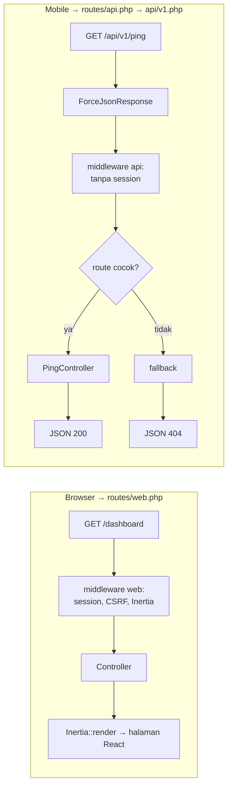

# 02 — Routing Web vs API & Versioning `/api/v1`

> Tahap: 2 · Dibuat: 2026-11-10 · Status: selesai

## 1. Tujuan

Memisahkan jalur **Web** (session, halaman Inertia) dan **API** (stateless, JSON), lalu menyiapkan **versioning** API agar aplikasi mobile versi lama tetap berfungsi saat API berkembang.

## 2. Konsep yang Perlu Dipahami

### Middleware group `web` vs `api`

Laravel punya dua "paket" middleware bawaan:

|                  | Group `web` (`routes/web.php`) | Group `api` (`routes/api.php`)            |
| ---------------- | ------------------------------ | ----------------------------------------- |
| Prefix URL       | tidak ada                      | otomatis `/api`                           |
| Session & cookie | **Ya**                         | **Tidak** (stateless)                     |
| CSRF protection  | **Ya**                         | Tidak (tidak ada cookie yang bisa dicuri) |
| Identitas user   | Cookie session                 | Header `Authorization: Bearer <token>`    |
| Response         | Halaman Inertia / redirect     | JSON                                      |

**Stateless** artinya server tidak "mengingat" klien di antara request. Setiap request API harus membawa tokennya sendiri. Ini cocok untuk mobile dan mudah di-scale, karena request bisa dilayani server mana pun.

### Kenapa API perlu versi?

Aplikasi mobile yang sudah terpasang di HP user **tidak bisa dipaksa update**. Jika hari ini field `price` diganti menjadi `price_amount`, aplikasi versi lama langsung rusak.

Dengan versioning:

- `/api/v1/...` tetap mengembalikan bentuk lama.
- `/api/v2/...` dibuat **hanya** saat ada _breaking change_ (field dihapus/diganti nama, tipe berubah).
- Menambah field baru **bukan** breaking change, jadi cukup di v1.

## 3. File yang Terlibat

| File                                             | Peran                                                    |
| ------------------------------------------------ | -------------------------------------------------------- |
| `bootstrap/app.php`                              | Mendaftarkan file route & middleware group               |
| `routes/api.php`                                 | Pintu masuk: memetakan prefix `v1` → `routes/api/v1.php` |
| `routes/api/v1.php`                              | Semua endpoint versi 1                                   |
| `app/Http/Controllers/Api/V1/PingController.php` | Endpoint cek kesehatan API                               |
| `app/Http/Middleware/ForceJsonResponse.php`      | Memastikan API selalu menjawab JSON                      |
| `tests/Feature/Api/V1/RoutingTest.php`           | Automated test untuk semua hal di atas                   |

## 4. Langkah Pembuatan

### Langkah 1 — Pintu masuk versi: `routes/api.php`

```php
<?php

use Illuminate\Support\Facades\Route;

Route::prefix('v1')
    ->name('api.v1.')
    ->group(base_path('routes/api/v1.php'));
```

| Bagian                  | Fungsi                                                                                                                  |
| ----------------------- | ----------------------------------------------------------------------------------------------------------------------- |
| `prefix('v1')`          | Semua URL di file v1 diawali `v1` → menjadi `/api/v1/...` (`/api` dari group api)                                       |
| `name('api.v1.')`       | Semua **nama** route diawali `api.v1.`, misalnya `api.v1.ping`. Nama route web (`dashboard`) dan API tidak akan bentrok |
| `group(base_path(...))` | Route-nya ditulis di file terpisah, sehingga setiap versi punya file sendiri                                            |

Saat v2 dibutuhkan kelak, cukup tambahkan:

```php
Route::prefix('v2')->name('api.v2.')->group(base_path('routes/api/v2.php'));
```

### Langkah 2 — Route versi 1: `routes/api/v1.php`

```php
<?php

use App\Http\Controllers\Api\V1\PingController;
use Illuminate\Support\Facades\Route;

Route::get('ping', PingController::class)->name('ping');

Route::fallback(function () {
    return response()->json([
        'success' => false,
        'message' => 'Endpoint not found.',
        'code' => 'NOT_FOUND',
        'errors' => null,
    ], 404);
});
```

- **`Route::get('ping', PingController::class)`**: karena controller hanya punya satu method (`__invoke`), cukup sebut nama class-nya.
- **`Route::fallback`**: menangkap semua URL di bawah `/api/v1/` yang tidak cocok dengan route mana pun. Klien mendapat JSON 404 dengan format standar, bukan halaman HTML "404 Not Found". Format error lengkap dibangun di Tahap 4.

### Langkah 3 — Controller: `app/Http/Controllers/Api/V1/PingController.php`

```bash
php artisan make:controller Api/V1/PingController --invokable
```

```php
<?php

namespace App\Http\Controllers\Api\V1;

use App\Http\Controllers\Controller;
use Illuminate\Http\JsonResponse;

class PingController extends Controller
{
    public function __invoke(): JsonResponse
    {
        return response()->json([
            'success' => true,
            'message' => 'pong',
            'data' => [
                'version' => 'v1',
                'server_time' => now()->toIso8601String(),
            ],
        ]);
    }
}
```

**Namespace `Api\V1`**: controller API diberi folder versi. Jika v2 butuh bentuk response berbeda, kita buat `Api\V2\...Controller` tanpa menyentuh v1. Kedua versi tetap memanggil Action/Service yang sama.

Kegunaan endpoint ping:

- Aplikasi mobile mengecek apakah server bisa dihubungi.
- Load balancer/monitoring memastikan aplikasi hidup.
- **k6 smoke test** di Tahap 9 sebagai baseline: endpoint tanpa database, untuk mengukur overhead framework murni.

### Langkah 4 — Middleware `ForceJsonResponse`

```bash
php artisan make:middleware ForceJsonResponse
```

```php
<?php

namespace App\Http\Middleware;

use Closure;
use Illuminate\Http\Request;
use Symfony\Component\HttpFoundation\Response;

class ForceJsonResponse
{
    public function handle(Request $request, Closure $next): Response
    {
        $request->headers->set('Accept', 'application/json');

        return $next($request);
    }
}
```

**Masalah yang diselesaikan:** Laravel memilih bentuk response error berdasarkan header `Accept`. Jika klien lupa mengirim `Accept: application/json`:

| Situasi        | Tanpa middleware                       | Dengan middleware |
| -------------- | -------------------------------------- | ----------------- |
| Validasi gagal | **302 redirect** ke halaman sebelumnya | 422 + JSON error  |
| Belum login    | **302 redirect** ke `/login`           | 401 + JSON        |
| Error server   | Halaman HTML                           | JSON              |

Aplikasi mobile tidak bisa memproses redirect ke halaman login, jadi middleware ini mencegah bug yang membingungkan di sisi klien.

### Langkah 5 — Mendaftarkan middleware: `bootstrap/app.php`

```php
->withRouting(
    web: __DIR__.'/../routes/web.php',
    api: __DIR__.'/../routes/api.php',       // ditambahkan oleh install:api
    commands: __DIR__.'/../routes/console.php',
    health: '/up',
)
->withMiddleware(function (Middleware $middleware): void {
    // ... middleware web bawaan starter kit ...

    $middleware->api(prepend: [
        ForceJsonResponse::class,
    ]);
})
```

- `api(prepend: [...])` memasang middleware **hanya** di group `api`, sehingga halaman web tidak terpengaruh.
- `prepend` (di depan, bukan `append`) dipakai supaya header `Accept` sudah diubah **sebelum** middleware lain (auth, throttle) berjalan dan mungkin melempar error.

> **Catatan Laravel 11+:** Tidak ada lagi `app/Http/Kernel.php`. Semua pengaturan middleware, routing, dan exception ada di `bootstrap/app.php`.

## 5. Alur Request



## 6. Cara Mencoba

Lihat semua route API:

```bash
php artisan route:list --path=api
```

```
GET|HEAD  api/v1/ping .................. api.v1.ping › Api\V1\PingController
GET|HEAD  api/v1/{fallbackPlaceholder} . api.v1.
```

Dengan curl atau Postman:

```bash
curl http://localhost:8000/api/v1/ping
# {"success":true,"message":"pong","data":{"version":"v1","server_time":"..."}}

curl http://localhost:8000/api/v1/tidak-ada
# {"success":false,"message":"Endpoint not found.","code":"NOT_FOUND","errors":null}
```

Automated test (`tests/Feature/Api/V1/RoutingTest.php`):

```bash
php artisan test --filter=RoutingTest
```

| Test                                          | Yang dibuktikan                                    |
| --------------------------------------------- | -------------------------------------------------- |
| menjawab ping di /api/v1/ping                 | Route & controller bekerja, struktur JSON sesuai   |
| memberi nama route dengan prefix api.v1.      | `route('api.v1.ping')` menghasilkan `/api/v1/ping` |
| mengembalikan JSON 404                        | Fallback bekerja                                   |
| tetap menjawab JSON walau tanpa header Accept | ForceJsonResponse bekerja                          |
| tidak memakai session/cookie                  | Route API benar-benar stateless                    |

## 7. Kesalahan Umum & Cara Mengatasinya

| Gejala                                                      | Penyebab                                                                                      | Solusi                                                                              |
| ----------------------------------------------------------- | --------------------------------------------------------------------------------------------- | ----------------------------------------------------------------------------------- |
| `/api/v1/ping` → 404                                        | Cache route lama                                                                              | `php artisan route:clear`                                                           |
| API mengembalikan HTML saat error                           | Middleware belum terdaftar / klien memanggil URL web                                          | Cek `bootstrap/app.php`, pastikan URL diawali `/api/`                               |
| Response API "asing" (pesan/format bukan milik project ini) | Perintah `artisan serve` dijalankan dari folder project lain, atau port dipakai aplikasi lain | Pastikan terminal berada di folder project. Cek `php artisan route:list --path=api` |
| Nama route bentrok (`Route [x] already defined`)            | Nama route API sama dengan web                                                                | Selalu pakai prefix nama `api.v1.`                                                  |
| Menaruh route API di `web.php`                              | Route mendapat session + CSRF, sehingga POST dari mobile ditolak 419                          | Route API **selalu** di `routes/api/v1.php`                                         |

## 8. Latihan

1. Tambahkan endpoint `GET /api/v1/time` yang hanya mengembalikan waktu server. Beri nama `api.v1.time`, lalu buat test-nya.
2. Hapus sementara `ForceJsonResponse` dari `bootstrap/app.php`, lalu jalankan `php artisan test --filter=RoutingTest`. Test mana yang gagal, dan kenapa?
3. Buat `routes/api/v2.php` dengan `ping` yang mengembalikan `version: v2`. Pastikan `/api/v1/ping` tetap mengembalikan `v1`. (Hapus lagi setelah selesai, karena v2 belum dibutuhkan.)

## 9. Referensi

- Routing: https://laravel.com/docs/routing
- Middleware: https://laravel.com/docs/middleware
- API (install:api, Sanctum): https://laravel.com/docs/sanctum
