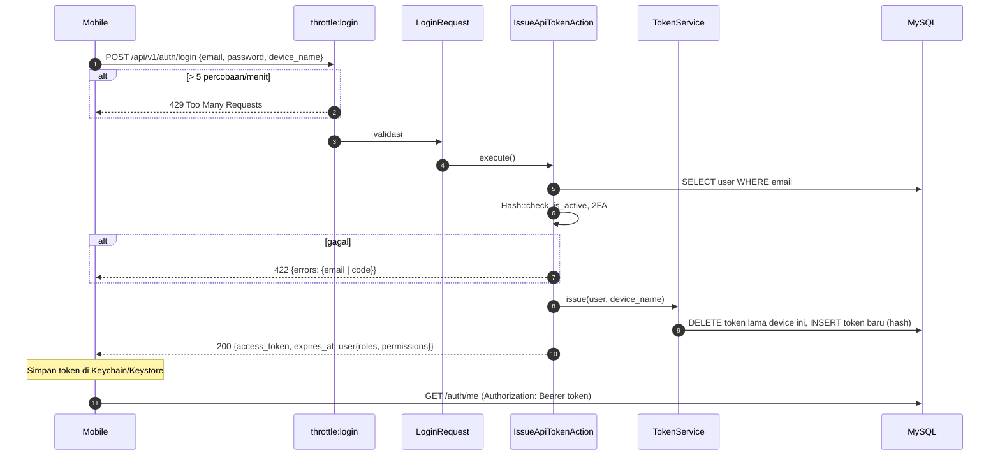

# 03 — Autentikasi API dengan Token Sanctum (Multi-Device)

> Tahap: 3 · Dibuat: 2026-11-10 · Status: selesai

## 1. Tujuan

Aplikasi mobile tidak memakai cookie session seperti browser. Mobile login sekali, menerima **token**, lalu mengirim token itu di setiap request. Fitur ini membuat:

- Login API yang mengembalikan Bearer token, termasuk dukungan **2FA**.
- **Multi-device**: satu user bisa login di HP, tablet, dan aplikasi lain sekaligus, masing-masing dengan token sendiri.
- Daftar device aktif, logout satu device, logout semua device.
- Pencabutan token otomatis saat password diganti atau akun dinonaktifkan.
- Masa berlaku token & pembersihan token kedaluwarsa.
- Rate limiting.

## 2. Konsep yang Perlu Dipahami

### Session (web) vs Token (mobile)

|                               | Web (session)            | Mobile (token)                         |
| ----------------------------- | ------------------------ | -------------------------------------- |
| Setelah login, server memberi | Cookie `laravel_session` | String token, mis. `3\|xY9k...`        |
| Disimpan di                   | Browser (otomatis)       | Aplikasi (Keychain/Keystore)           |
| Dikirim lewat                 | Cookie (otomatis)        | Header `Authorization: Bearer <token>` |
| Guard Laravel                 | `web`                    | `sanctum`                              |

### Bagaimana Sanctum menyimpan token?

```
Token yang diterima mobile :  3|xY9kP2...          ← "3" = id baris, sisanya = rahasia
Yang disimpan di database  :  id=3, token=sha256(xY9kP2...)
```

Database hanya menyimpan **hash**. Jika database bocor, penyerang tetap tidak bisa memakai token tersebut. Konsekuensinya: token mentah **hanya bisa dilihat sekali**, yaitu di response login.

### Rate limiting

Membatasi jumlah request dalam satu waktu, untuk mencegah tebak-tebakan password (brute force) dan penyalahgunaan API.

| Limiter | Batas           | Kunci                        |
| ------- | --------------- | ---------------------------- |
| `login` | 5 kali / menit  | email + IP                   |
| `api`   | 60 kali / menit | id user (jika login) atau IP |

## 3. File yang Terlibat

| File                                                       | Peran                                                          |
| ---------------------------------------------------------- | -------------------------------------------------------------- |
| `app/Models/User.php`                                      | Trait `HasApiTokens` (Sanctum), kolom `is_active`              |
| `database/migrations/..._add_is_active_to_users_table.php` | Kolom status aktif/nonaktif                                    |
| `app/Http/Requests/Api/V1/Auth/LoginRequest.php`           | Validasi email, password, `device_name`, kode 2FA              |
| `app/Actions/Auth/IssueApiTokenAction.php`                 | Logika login: cek password, status aktif, 2FA, lalu buat token |
| `app/Services/Auth/TokenService.php`                       | Membuat, mendaftar, dan mencabut token/session                 |
| `app/Http/Controllers/Api/V1/Auth/AuthController.php`      | Endpoint login, me, logout, logout-all                         |
| `app/Http/Controllers/Api/V1/Auth/DeviceController.php`    | Endpoint daftar & cabut device                                 |
| `app/Http/Resources/V1/UserResource.php`                   | Bentuk JSON user                                               |
| `app/Http/Resources/V1/DeviceResource.php`                 | Bentuk JSON device                                             |
| `app/Observers/UserObserver.php`                           | Cabut token otomatis saat password/status berubah              |
| `app/Support/ApiResponse.php`                              | Format response sukses `{success, message, data}`              |
| `app/Providers/AppServiceProvider.php`                     | Rate limiter `api`                                             |
| `config/sanctum.php`                                       | Masa berlaku token                                             |
| `routes/api/v1.php`                                        | Daftar endpoint                                                |
| `routes/console.php`                                       | Jadwal hapus token kedaluwarsa                                 |
| `tests/Feature/Api/V1/AuthTest.php`                        | 20 automated test                                              |

## 4. Langkah Pembuatan

### Langkah 1 — Siapkan model User

```php
use Laravel\Sanctum\HasApiTokens;

#[Fillable(['name', 'email', 'password', 'is_active'])]
#[ObservedBy(UserObserver::class)]
class User extends Authenticatable implements MustVerifyEmail
{
    use HasApiTokens, HasFactory, HasRoles, Notifiable, TwoFactorAuthenticatable;
    // ...
}
```

- `HasApiTokens` memberi method `createToken()` dan relasi `tokens()`.
- `#[ObservedBy]` (atribut PHP 8) mendaftarkan Observer tanpa perlu menulis di service provider.

Kolom `is_active` ditambahkan lewat migration:

```bash
php artisan make:migration add_is_active_to_users_table
```

```php
$table->boolean('is_active')->default(true)->after('password');
```

> **Kenapa nonaktifkan, bukan hapus?** Menghapus user juga menghilangkan riwayatnya (misalnya pesanan). Menonaktifkan hanya mencegah login.

### Langkah 2 — Masa berlaku token: `config/sanctum.php`

```php
'expiration' => (int) env('SANCTUM_TOKEN_EXPIRATION', 43200), // menit = 30 hari
```

Token kedaluwarsa otomatis ditolak (401), tetapi barisnya masih ada di database. Pembersihan dijadwalkan di `routes/console.php`:

```php
Schedule::command('sanctum:prune-expired --hours=24')->daily();
```

> Scheduler harus dijalankan: di server lewat cron `* * * * * php artisan schedule:run`, di lokal lewat `php artisan schedule:work`.

### Langkah 3 — Validasi: `LoginRequest`

```bash
php artisan make:request Api/V1/Auth/LoginRequest
```

```php
public function rules(): array
{
    return [
        'email' => ['required', 'string', 'email', 'max:255'],
        'password' => ['required', 'string'],
        'device_name' => ['required', 'string', 'max:100'],
        'code' => ['nullable', 'string', 'max:10'],           // kode 2FA
        'recovery_code' => ['nullable', 'string', 'max:100'], // kode cadangan 2FA
    ];
}
```

`device_name` (mis. "Pixel 8 - Budi") dipakai sebagai nama token, sehingga user bisa mengenali device-nya di daftar device.

### Langkah 4 — Mengelola token: `TokenService`

Semua operasi token dikumpulkan di satu Service:

```php
public function issue(User $user, string $deviceName): NewAccessToken
{
    // Login ulang dari device yang sama → token lama diganti, tidak menumpuk.
    $user->tokens()->where('name', $deviceName)->delete();

    return $user->createToken(
        name: $deviceName,
        expiresAt: now()->addMinutes((int) config('sanctum.expiration')),
    );
}

public function revoke(User $user, int $tokenId): bool
{
    // $user->tokens() → hanya token MILIK user ini yang bisa terhapus.
    return $user->tokens()->whereKey($tokenId)->delete() > 0;
}

public function revokeAll(User $user): int { return $user->tokens()->delete(); }

public function logoutEverywhere(User $user): void
{
    $this->revokeAll($user);
    // + hapus baris session web milik user (SESSION_DRIVER=database)
}
```

> **Keamanan:** `revoke()` memakai `$user->tokens()`, bukan `PersonalAccessToken::find($id)`. Dengan begitu, user A tidak bisa mencabut token user B walaupun menebak ID-nya.

### Langkah 5 — Logika login: `IssueApiTokenAction`

```php
public function execute(array $credentials): array
{
    $user = User::query()->where('email', $credentials['email'])->first();

    if (! $user || ! Hash::check($credentials['password'], $user->password)) {
        throw ValidationException::withMessages(['email' => 'These credentials do not match our records.']);
    }

    if (! $user->is_active) {
        throw ValidationException::withMessages(['email' => 'Your account has been deactivated. ...']);
    }

    if ($user->hasEnabledTwoFactorAuthentication()) {
        $this->verifyTwoFactor($user, $credentials['code'] ?? null, $credentials['recovery_code'] ?? null);
    }

    return ['user' => $user, 'token' => $this->tokens->issue($user, $credentials['device_name'])];
}
```

> **Pembaruan (8h, 2026-11-24):** setelah password & 2FA benar, role user juga harus punya permission
> **`api.access`**. Tanpa itu login ditolak **403** "Your role is not allowed to use the API.", dan token lama
> ikut ditolak di semua endpoint (kecuali logout). Atur per role di halaman Permissions; lihat
> [8h](08h-generator-rest-api-dan-rbac.md).

**Kenapa 2FA juga dicek di API?** Jika user mengaktifkan 2FA di web, tetapi API hanya meminta password, penyerang yang tahu password cukup login lewat API dan 2FA menjadi tidak berguna. Kode 2FA diverifikasi dengan provider milik Fortify (sama dengan login web). Recovery code yang sudah dipakai langsung diganti (`replaceRecoveryCode`), sehingga tidak bisa dipakai dua kali.

**Kenapa pesan "These credentials do not match our records" sama untuk email yang tidak terdaftar?** Agar penyerang tidak bisa mengecek email mana yang terdaftar.

### Langkah 6 — Bentuk JSON: `UserResource`

```bash
php artisan make:resource V1/UserResource
```

```php
return [
    'id' => $this->id,
    'name' => $this->name,
    'email' => $this->email,
    'is_active' => $this->is_active,
    'two_factor_enabled' => $this->hasEnabledTwoFactorAuthentication(),
    'roles' => $this->whenLoaded('roles', fn () => $this->roles->pluck('name')),
    'permissions' => $this->when($this->withPermissions, fn () => /* ... */),
    'created_at' => $this->created_at?->toIso8601String(),
];
```

- Resource adalah **daftar putih**: hanya field yang ditulis di sini yang keluar. Kolom `password` dan `two_factor_secret` tidak pernah tersebut, jadi mustahil ikut terkirim.
- `whenLoaded('roles')`: roles hanya muncul jika sudah di-_eager load_. Resource tidak menjalankan query sendiri, sehingga tidak ada N+1.

### Langkah 7 — Controller tipis

```php
public function login(LoginRequest $request, IssueApiTokenAction $issueToken): JsonResponse
{
    ['user' => $user, 'token' => $token] = $issueToken->execute($request->validated());
    $user->load('roles');

    return ApiResponse::success([
        'token_type' => 'Bearer',
        'access_token' => $token->plainTextToken,   // hanya dikirim SEKALI
        'expires_at' => $token->accessToken->expires_at?->toIso8601String(),
        'user' => UserResource::make($user)->withPermissions()->resolve($request),
    ], 'Logged in successfully.');
}
```

Perhatikan pembagian tugasnya: **validasi** di `LoginRequest`, **logika** di `IssueApiTokenAction`, **bentuk JSON** di `UserResource`, sementara controller hanya merangkai ketiganya.

### Langkah 8 — Pencabutan otomatis: `UserObserver`

```php
public function updated(User $user): void
{
    if ($user->wasChanged('password')) {
        $this->tokens->revokeAll($user);          // semua token mobile dicabut
    }

    if ($user->wasChanged('is_active') && ! $user->is_active) {
        $this->tokens->logoutEverywhere($user);   // token + session web
    }
}
```

**Kenapa di Observer, bukan di controller?** Password bisa berubah dari banyak tempat: halaman pengaturan, reset password lewat email, atau diubah admin. Observer bereaksi terhadap **perubahan data**, dari jalur mana pun, sehingga tidak ada jalur yang terlewat.

### Langkah 9 — Route & rate limit

`routes/api/v1.php`:

```php
Route::prefix('auth')->name('auth.')->group(function () {
    Route::post('login', [AuthController::class, 'login'])
        ->middleware('throttle:login')            // 5x/menit per email+IP
        ->name('login');

    Route::middleware('auth:sanctum')->group(function () {
        Route::get('me', [AuthController::class, 'me'])->name('me');
        Route::post('logout', [AuthController::class, 'logout'])->name('logout');
        Route::post('logout-all', [AuthController::class, 'logoutAll'])->name('logout-all');
        Route::get('devices', [DeviceController::class, 'index'])->name('devices.index');
        Route::delete('devices/{tokenId}', [DeviceController::class, 'destroy'])
            ->whereNumber('tokenId')->name('devices.destroy');
    });
});
```

Limiter `login` **dipakai ulang** dari `FortifyServiceProvider` (limiter yang sama dengan login web), jadi tidak perlu ditulis dua kali. Limiter `api` didefinisikan di `AppServiceProvider` dan dipasang ke semua route API lewat `bootstrap/app.php`:

```php
$middleware->throttleApi();
```

## 5. Alur Request



## 6. Cara Mencoba

Siapkan data demo (password semua akun: `password`):

```bash
php artisan migrate:fresh --seed
```

### Login

```bash
curl -X POST http://localhost:8000/api/v1/auth/login \
  -H "Content-Type: application/json" \
  -d '{"email":"staff@example.com","password":"password","device_name":"Pixel 8"}'
```

```json
{
    "success": true,
    "message": "Logged in successfully.",
    "data": {
        "token_type": "Bearer",
        "access_token": "1|Kp9x...",
        "expires_at": "2026-12-10T16:44:34+00:00",
        "user": {
            "id": 2,
            "name": "Staff Demo",
            "email": "staff@example.com",
            "is_active": true,
            "two_factor_enabled": false,
            "roles": ["staff"],
            "permissions": ["users.view"],
            "created_at": "..."
        }
    }
}
```

### Endpoint lain

| Method & URL                       | Fungsi                                          | Response sukses |
| ---------------------------------- | ----------------------------------------------- | --------------- |
| `GET /api/v1/auth/me`              | Profil + roles + permissions                    | 200             |
| `GET /api/v1/auth/devices`         | Daftar device aktif (`is_current` = device ini) | 200             |
| `DELETE /api/v1/auth/devices/{id}` | Logout device tertentu                          | 204             |
| `POST /api/v1/auth/logout`         | Logout device ini                               | 204             |
| `POST /api/v1/auth/logout-all`     | Logout semua device                             | 204             |

```bash
curl http://localhost:8000/api/v1/auth/me -H "Authorization: Bearer 1|Kp9x..."
```

### Login dengan 2FA

Jika user mengaktifkan 2FA (Settings → Security), login tanpa kode akan ditolak:

```json
{
    "message": "This account uses two-factor authentication. ...",
    "errors": { "code": ["..."] }
}
```

Kirim ulang dengan `"code": "123456"` (dari Google Authenticator) atau `"recovery_code": "..."`.

### Automated test

```bash
php artisan test --filter=AuthTest
```

## 7. Kesalahan Umum & Cara Mengatasinya

| Gejala                                            | Penyebab                                                    | Solusi                                       |
| ------------------------------------------------- | ----------------------------------------------------------- | -------------------------------------------- |
| 401 padahal token benar                           | Lupa prefix `Bearer `, atau token sudah kedaluwarsa/dicabut | Header harus `Authorization: Bearer <token>` |
| 401 setelah ganti password                        | Disengaja: semua token dicabut                              | Login ulang                                  |
| 429 Too Many Requests                             | Melebihi batas rate limit                                   | Tunggu sesuai header `Retry-After`           |
| `Call to undefined method createToken()`          | Trait `HasApiTokens` belum dipasang                         | Tambahkan di model User                      |
| Token menumpuk di `personal_access_tokens`        | Tidak ada pembersihan                                       | Jalankan scheduler (`schedule:work` / cron)  |
| Menyimpan token di SharedPreferences/localStorage | Mudah dicuri aplikasi lain/XSS                              | Gunakan Android Keystore / iOS Keychain      |

## 8. Latihan

1. Login dua kali dengan `device_name` berbeda, lalu panggil `/auth/devices`. Cabut salah satunya, lalu buktikan token itu ditolak (401).
2. Ubah `SANCTUM_TOKEN_EXPIRATION=1` di `.env`, login, tunggu 1 menit, lalu panggil `/auth/me`.
3. Baca `tests/Feature/Api/V1/AuthTest.php` dan cari test yang membuktikan user tidak bisa mencabut token milik orang lain.

## 9. Referensi

- Sanctum API tokens: https://laravel.com/docs/sanctum#api-token-authentication
- Rate limiting: https://laravel.com/docs/routing#rate-limiting
- Eloquent API Resources: https://laravel.com/docs/eloquent-resources
- Observers: https://laravel.com/docs/eloquent#observers
