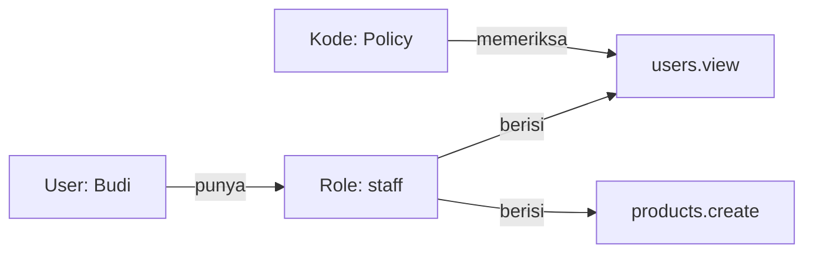
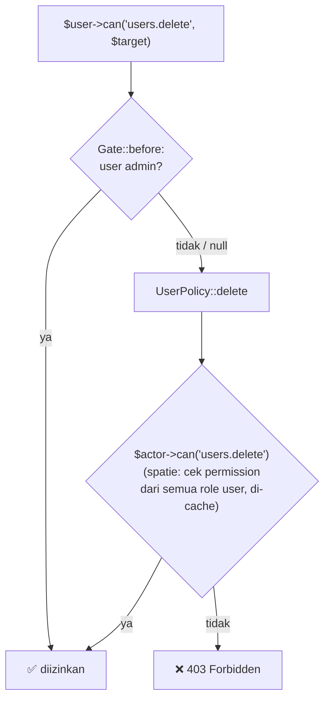

# 04 — Role, Permission, Gate & Policy

> Tahap: 3 · Dibuat: 2026-11-10 · Status: selesai

## 1. Tujuan

Menentukan **siapa boleh melakukan apa**. Autentikasi menjawab "siapa Anda?", sedangkan otorisasi (dokumen ini) menjawab "apa yang boleh Anda lakukan?".

## 2. Konsep yang Perlu Dipahami



| Istilah        | Arti                                       | Contoh                       |
| -------------- | ------------------------------------------ | ---------------------------- |
| **Permission** | Satu izin spesifik yang **diperiksa kode** | `users.delete`               |
| **Role**       | Kumpulan permission, diberikan ke user     | `staff` = {`users.view`}     |
| **Gate**       | Mekanisme Laravel untuk bertanya "boleh?"  | `$user->can('users.delete')` |
| **Policy**     | Class berisi aturan izin untuk satu model  | `UserPolicy::delete()`       |

### Aturan emas: kode memeriksa PERMISSION, bukan ROLE

```php
// ❌ Kaku: jika kelak role "supervisor" juga boleh, kode harus diubah
if ($user->hasRole('admin')) { ... }

// ✅ Fleksibel: cukup centang permission di role "supervisor" lewat UI
if ($user->can('users.delete')) { ... }
```

### Pembagian kerja: spatie vs kode kita

| Disediakan **spatie/laravel-permission**                                | Ditulis **sendiri**                                |
| ----------------------------------------------------------------------- | -------------------------------------------------- |
| Tabel `roles`, `permissions`, `model_has_roles`, `role_has_permissions` | Enum `RoleName` & `PermissionName`                 |
| Trait `HasRoles` (`assignRole`, `syncRoles`, `hasRole`)                 | `RolePermissionSeeder`                             |
| `$role->syncPermissions()`, `getAllPermissions()`                       | `UserPolicy`, `RolePolicy`                         |
| Integrasi dengan Gate (`$user->can('x')` bekerja otomatis)              | `Gate::before` super admin                         |
| Cache permission (otomatis dibersihkan saat berubah)                    | Aturan pengaman di Action                          |
| —                                                                       | UI kelola akses ([04b](04b-ui-manajemen-akses.md)) |

## 3. File yang Terlibat

| File                                                   | Peran                                        |
| ------------------------------------------------------ | -------------------------------------------- |
| `config/permission.php`                                | Konfigurasi spatie (hasil publish)           |
| `database/migrations/..._create_permission_tables.php` | 5 tabel spatie                               |
| `app/Enums/RoleName.php`                               | Role sistem: admin, staff, customer          |
| `app/Enums/PermissionName.php`                         | **Satu-satunya** daftar permission           |
| `database/seeders/RolePermissionSeeder.php`            | Sinkronisasi enum → database                 |
| `app/Policies/UserPolicy.php`, `RolePolicy.php`        | Aturan izin                                  |
| `app/Providers/AppServiceProvider.php`                 | `Gate::before` (super admin), `Gate::policy` |
| `app/Actions/Fortify/CreateNewUser.php`                | Registrasi → role `customer`                 |
| `tests/TestCase.php`                                   | Seed role/permission otomatis di setiap test |

## 4. Langkah Pembuatan

### Langkah 1 — Pasang spatie

```bash
composer require spatie/laravel-permission
php artisan vendor:publish --provider="Spatie\Permission\PermissionServiceProvider"
php artisan migrate
```

Tambahkan trait di `User`:

```php
use Spatie\Permission\Traits\HasRoles;

class User extends Authenticatable
{
    use HasApiTokens, HasFactory, HasRoles, /* ... */;
}
```

### Langkah 2 — Enum role & permission

```bash
php artisan make:enum Enums/RoleName --string
php artisan make:enum Enums/PermissionName --string
```

```php
enum PermissionName: string
{
    case UsersView = 'users.view';
    case UsersCreate = 'users.create';
    case UsersUpdate = 'users.update';
    case UsersDelete = 'users.delete';
    case RolesView = 'roles.view';
    // ...

    public function module(): string { return explode('.', $this->value)[0]; }  // "users"
    public function action(): string { return explode('.', $this->value)[1]; }  // "view"
}
```

**Kenapa Enum, bukan string biasa?**

- Salah ketik `'user.veiw'` tidak ketahuan sampai fitur gagal, sedangkan `PermissionName::UsersVeiw` langsung error di editor.
- Semua permission terlihat di satu file.

> **Aturan project:** permission **hanya ditambahkan bila sudah ada kode yang memeriksanya**. Permission untuk Kategori, Produk, dan Pesanan ditambahkan di tahap saat fitur itu dibuat.

### Langkah 3 — Seeder yang aman dijalankan berulang

```php
public function run(): void
{
    app(PermissionRegistrar::class)->forgetCachedPermissions();

    // 1. Buat permission dari enum (findOrCreate = tidak dobel)
    foreach (PermissionName::cases() as $permission) {
        Permission::findOrCreate($permission->value, 'web');
    }

    // 2. Hapus permission yang sudah tidak ada di enum
    Permission::query()->whereNotIn('name', PermissionName::values())->delete();

    // 3. Role sistem: dibuat bila belum ada (+ permission awal)
    // 4. Admin selalu disinkronkan ke SEMUA permission
}
```

Setiap kali enum diubah:

```bash
php artisan db:seed --class=RolePermissionSeeder
```

Permission yang sudah diatur admin lewat UI untuk role lain **tidak ditimpa**. Seeder hanya mengisi nilai awal saat role pertama kali dibuat.

### Langkah 4 — Policy

```bash
php artisan make:policy UserPolicy --model=User
```

```php
class UserPolicy
{
    public function viewAny(User $actor): bool
    {
        return $actor->can(PermissionName::UsersView);
    }

    public function delete(User $actor, User $target): bool
    {
        return $actor->can(PermissionName::UsersDelete);
    }
    // create, update ...
}
```

- `UserPolicy` **ditemukan otomatis** oleh Laravel (konvensi: model `User` → `Policies\UserPolicy`).
- `RolePolicy` harus **didaftarkan manual**, karena model `Role` milik paket spatie (`Spatie\Permission\Models\Role`), bukan di `App\Models`:

```php
Gate::policy(Role::class, RolePolicy::class);
```

### Langkah 5 — Super admin dengan `Gate::before`

```php
Gate::before(fn (User $user): ?bool => $user->hasRole(RoleName::Admin) ? true : null);
```

- Dijalankan **sebelum** semua Policy/Gate.
- `true` → langsung diizinkan. `null` → lanjut ke pemeriksaan normal.
- **Jangan** mengembalikan `false` untuk non-admin, karena itu akan menolak semua orang.

> **Konsekuensi penting:** admin melewati SEMUA policy. Aturan seperti "admin tidak boleh menghapus dirinya sendiri" tidak bisa ditaruh di Policy. Aturan itu ditaruh di **Action** (lihat [04b](04b-ui-manajemen-akses.md)).

### Langkah 6 — Memakai otorisasi

| Tempat                     | Cara                                                                 | Hasil jika ditolak   |
| -------------------------- | -------------------------------------------------------------------- | -------------------- |
| Form Request               | `return $this->user()->can('create', User::class);` di `authorize()` | 403                  |
| Controller                 | `Gate::authorize('delete', $user);`                                  | 403                  |
| Route                      | `->middleware('can:users.view')`                                     | 403                  |
| React (tampilan saja)      | `can('users.create')` dari hook `useCan`                             | Tombol disembunyikan |
| API mobile (tampilan saja) | Field `permissions` dari `/auth/me`                                  | Menu disembunyikan   |

### Langkah 7 — Role otomatis saat registrasi

`app/Actions/Fortify/CreateNewUser.php`:

```php
return DB::transaction(function () use ($input) {
    $user = User::create([...]);
    $user->assignRole(RoleName::Customer);
    return $user;
});
```

`DB::transaction`: jika pemberian role gagal, pembuatan user juga dibatalkan. Tidak akan ada user "setengah jadi" tanpa role.

### Langkah 8 — Seed role di setiap test

`tests/TestCase.php`:

```php
protected bool $seed = true;
protected string $seeder = RolePermissionSeeder::class;
```

Tanpa ini, test yang memanggil `assignRole('customer')` gagal karena tabel `roles` kosong (database test di-reset setiap test).

## 5. Alur Otorisasi



## 6. Cara Mencoba

```bash
php artisan migrate:fresh --seed
php artisan permission:show        # tabel role × permission dari spatie
php artisan test --filter=RoleManagementTest
```

Coba di `php artisan tinker`:

```php
$staff = User::firstWhere('email', 'staff@example.com');
$staff->getRoleNames();            // ["staff"]
$staff->can('users.view');         // true
$staff->can('users.delete');       // false
User::firstWhere('email', 'admin@example.com')->can('apa.saja');  // true (Gate::before)
```

## 7. Kesalahan Umum & Cara Mengatasinya

| Gejala                                                             | Penyebab                                    | Solusi                                                                               |
| ------------------------------------------------------------------ | ------------------------------------------- | ------------------------------------------------------------------------------------ |
| `There is no role named 'customer'`                                | Seeder belum dijalankan                     | `php artisan db:seed --class=RolePermissionSeeder`                                   |
| Permission baru tidak berpengaruh                                  | Cache permission lama                       | `php artisan permission:cache-reset` (seeder sudah melakukannya)                     |
| Policy `RolePolicy` tidak dipanggil, semua 403                     | Model dari paket, tidak auto-discover       | `Gate::policy(Role::class, RolePolicy::class)`                                       |
| Admin tetap bisa melakukan hal yang "dilarang" di Policy           | `Gate::before` melewati Policy              | Taruh aturan pengaman di Action                                                      |
| `GuardDoesNotMatch`                                                | Role/permission dibuat dengan guard berbeda | Semua dibuat dengan guard `web`. Token Sanctum tetap memakainya karena user-nya sama |
| Memberi permission langsung ke user (`givePermissionTo` pada user) | Anti-pattern: sulit dilacak                 | Berikan permission ke role, role ke user                                             |

## 8. Latihan

1. Tambahkan permission `users.export` di enum, jalankan seeder, lalu lihat hasilnya di menu Permissions.
2. Di tinker, beri role `staff` permission `roles.view`, lalu login sebagai staff dan pastikan menu Roles muncul.
3. Kenapa `Gate::before` harus mengembalikan `null`, bukan `false`? Coba ganti ke `false` dan jalankan test.

## 9. Referensi

- spatie/laravel-permission: https://spatie.be/docs/laravel-permission
- Authorization (Gates & Policies): https://laravel.com/docs/authorization
