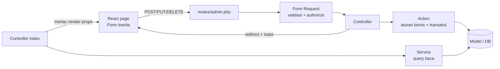
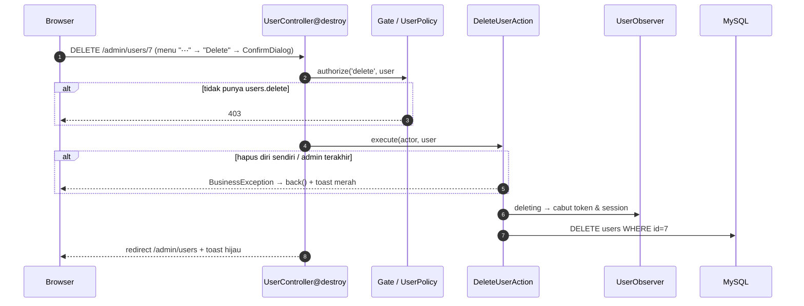

# 04b — UI Manajemen Users, Roles & Permissions

> Tahap: 3 · Dibuat: 2026-11-10 · Status: selesai

## 1. Tujuan

Tiga menu admin agar akses bisa dikelola tanpa menyentuh kode atau database:

| Menu            | URL                  | Fungsi                                                                                        |
| --------------- | -------------------- | --------------------------------------------------------------------------------------------- |
| **Users**       | `/admin/users`       | Daftar (cari, filter role/status, pagination), tambah, edit, nonaktifkan, hapus, logout paksa |
| **Roles**       | `/admin/roles`       | Daftar role, tambah, edit nama & **matriks permission**, hapus                                |
| **Permissions** | `/admin/permissions` | Hanya baca: daftar permission per modul + role yang memilikinya                               |

Ini juga contoh lengkap pertama **CRUD dengan pola arsitektur project**: Route → Form Request → Controller → Action/Service → Model → Inertia/React.

## 2. Konsep yang Perlu Dipahami

### Pola alur CRUD di project ini



### Kenapa aturan pengaman di Action, bukan di Policy?

Admin melewati semua Policy (`Gate::before`). Jadi aturan "admin tidak boleh menghapus dirinya sendiri" **harus** ditaruh di tempat yang tetap dijalankan untuk admin, yaitu Action. Action dipanggil oleh Web dan (kelak) API, sehingga aturannya otomatis berlaku di keduanya.

| Aturan                                             | Di mana                                | Hasil jika dilanggar |
| -------------------------------------------------- | -------------------------------------- | -------------------- |
| Tidak boleh menghapus / menonaktifkan akun sendiri | `DeleteUserAction`, `UpdateUserAction` | 409 / toast error    |
| Admin aktif terakhir tidak boleh hilang            | trait `EnsuresAdminRemains`            | 409 / toast error    |
| Role `admin` dikunci                               | `UpdateRoleAction`                     | 409 / toast error    |
| Role sistem tidak bisa diganti nama/dihapus        | `UpdateRoleAction`, `DeleteRoleAction` | 409 / toast error    |
| Role yang masih dipakai user tidak bisa dihapus    | `DeleteRoleAction`                     | 409 / toast error    |

### `BusinessException`

```php
throw new BusinessException('You cannot delete your own account.');
```

Exception ini tahu cara menampilkan dirinya sendiri (method `render()`):

- Request Web/Inertia → kembali ke halaman sebelumnya + **toast merah**.
- Request JSON (API) → **409 Conflict** `{"success": false, "code": "CONFLICT", ...}`.

## 3. File yang Terlibat

### Backend

| File                                                                     | Peran                                            |
| ------------------------------------------------------------------------ | ------------------------------------------------ |
| `routes/admin.php`                                                       | Semua route `/admin/*`                           |
| `app/Http/Controllers/Admin/UserController.php`                          | CRUD user + logout paksa                         |
| `app/Http/Controllers/Admin/RoleController.php`                          | CRUD role                                        |
| `app/Http/Controllers/Admin/PermissionController.php`                    | Halaman permissions (baca)                       |
| `app/Http/Requests/Admin/IndexUserRequest.php`                           | Whitelist filter `search/role/status/per_page`   |
| `app/Http/Requests/Admin/StoreUserRequest.php` / `UpdateUserRequest.php` | Validasi + authorize                             |
| `app/Http/Requests/Admin/SaveRoleRequest.php`                            | Validasi role (dipakai tambah & ubah)            |
| `app/Services/User/UserQueryService.php`                                 | Query daftar user (filter, eager load, paginate) |
| `app/Actions/User/{Create,Update,Delete}UserAction.php`                  | Logika tulis user                                |
| `app/Actions/User/EnsuresAdminRemains.php`                               | Aturan "minimal satu admin aktif"                |
| `app/Actions/Role/{Create,Update,Delete}RoleAction.php`                  | Logika tulis role                                |
| `app/Exceptions/BusinessException.php`                                   | Error aturan bisnis → 409 / toast                |
| `app/Http/Middleware/HandleInertiaRequests.php`                          | Kirim `auth.roles` & `auth.permissions` ke React |

### Frontend

| File                                                            | Peran                                             |
| --------------------------------------------------------------- | ------------------------------------------------- |
| `resources/js/hooks/use-can.ts`                                 | `can('users.create')` untuk menyembunyikan tombol |
| `resources/js/components/app-sidebar.tsx`                       | Grup menu "Administration" sesuai izin            |
| `resources/js/components/ui/table.tsx`                          | Komponen tabel shadcn/ui                          |
| `resources/js/components/pagination.tsx`                        | Navigasi halaman + pilihan "Rows per page"        |
| `resources/js/components/row-actions.tsx`                       | Tombol "⋯" berisi menu aksi per baris             |
| `resources/js/components/confirm-dialog.tsx`                    | Dialog "Are you sure?"                            |
| `resources/js/components/permission-matrix.tsx`                 | Matriks checkbox modul × aksi                     |
| `resources/js/components/admin/user-form.tsx` / `role-form.tsx` | Form dipakai halaman tambah & edit                |
| `resources/js/pages/admin/users/{index,create,edit}.tsx`        | Halaman Users                                     |
| `resources/js/pages/admin/roles/{index,create,edit}.tsx`        | Halaman Roles                                     |
| `resources/js/pages/admin/permissions/index.tsx`                | Halaman Permissions                               |
| `resources/js/types/admin.ts`                                   | Tipe TypeScript data halaman admin                |

## 4. Langkah Pembuatan (contoh: fitur Users)

### Langkah 1 — Route

```php
// routes/admin.php (di-require dari routes/web.php)
Route::middleware(['auth', 'verified'])->prefix('admin')->name('admin.')->group(function () {
    Route::resource('users', UserController::class)->except('show');
    Route::post('users/{user}/logout-devices', [UserController::class, 'logoutDevices'])
        ->name('users.logout-devices');
    // roles, permissions ...
});
```

`Route::resource` membuat 7 route standar sekaligus (`except('show')` → 6):

| Method | URL                      | Nama                | Controller |
| ------ | ------------------------ | ------------------- | ---------- |
| GET    | /admin/users             | admin.users.index   | index      |
| GET    | /admin/users/create      | admin.users.create  | create     |
| POST   | /admin/users             | admin.users.store   | store      |
| GET    | /admin/users/{user}/edit | admin.users.edit    | edit       |
| PUT    | /admin/users/{user}      | admin.users.update  | update     |
| DELETE | /admin/users/{user}      | admin.users.destroy | destroy    |

### Langkah 2 — Form Request

```bash
php artisan make:request Admin/StoreUserRequest
```

```php
class StoreUserRequest extends FormRequest
{
    use PasswordValidationRules, ProfileValidationRules;   // dipakai ulang dari starter kit

    public function authorize(): bool
    {
        return (bool) $this->user()?->can('create', User::class);   // → UserPolicy::create
    }

    public function rules(): array
    {
        return [
            ...$this->profileRules(),                  // name, email (unique)
            'password' => $this->passwordRules(),      // required, confirmed, aturan kekuatan
            'is_active' => ['boolean'],
            'roles' => ['required', 'array', 'min:1'],
            'roles.*' => ['string', Rule::exists('roles', 'name')],
        ];
    }
}
```

Laravel menjalankan `authorize()` lalu `rules()` **sebelum** method controller dipanggil. Jika gagal, controller tidak pernah tersentuh.

### Langkah 3 — Service untuk query baca

```php
public function paginate(array $filters): LengthAwarePaginator
{
    return User::query()
        ->select(['id', 'name', 'email', 'email_verified_at', 'is_active', 'created_at'])  // bukan SELECT *
        ->with('roles:id,name')                       // eager loading: 1 query untuk semua role
        ->when($filters['search'] ?? null, fn ($q, $s) => $q->where(fn ($q) => $q
            ->where('name', 'like', "{$s}%")->orWhere('email', 'like', "{$s}%")))
        ->when($filters['role'] ?? null, fn ($q, $role) => $q->role($role))   // scope spatie
        ->when($filters['status'] ?? null, fn ($q, $st) => $q->where('is_active', $st === 'active'))
        ->latest('id')
        ->paginate((int) ($filters['per_page'] ?? 10))
        ->withQueryString();                          // link halaman membawa filter
}
```

`->when(nilai, fn)` menjalankan `fn` hanya jika nilainya terisi, sehingga tidak perlu banyak `if`.

### Langkah 4 — Action untuk operasi tulis

```php
class DeleteUserAction
{
    use EnsuresAdminRemains;

    public function execute(User $actor, User $target): void
    {
        if ($actor->is($target)) {
            throw new BusinessException('You cannot delete your own account.');
        }

        $this->ensureNotLastActiveAdmin($target, 'Admin aktif terakhir tidak bisa dihapus.');

        $target->delete();   // token & session dibersihkan UserObserver::deleting()
    }
}
```

Action **tidak tahu apa-apa tentang HTTP**: tidak menerima `Request`, tidak mengembalikan response. Karena itu Action bisa dipanggil dari controller Web, controller API, command artisan, atau test.

### Langkah 5 — Controller

```php
public function store(StoreUserRequest $request, CreateUserAction $createUser): RedirectResponse
{
    $user = $createUser->execute($request->validated());

    Inertia::flash('toast', ['type' => 'success', 'message' => "User {$user->name} berhasil dibuat."]);

    return to_route('admin.users.index');
}

public function destroy(Request $request, User $user, DeleteUserAction $deleteUser): RedirectResponse
{
    Gate::authorize('delete', $user);        // tanpa Form Request → otorisasi manual
    $deleteUser->execute($request->user(), $user);
    // flash + redirect
}
```

- **Dependency injection**: `CreateUserAction $createUser` di parameter diisi otomatis oleh Laravel.
- **Route model binding**: `User $user` diisi otomatis dari `{user}` di URL. Jika ID tidak ada, otomatis 404.
- Hanya `$request->validated()` yang diteruskan (bukan `$request->all()`), sebagai proteksi mass assignment.

### Langkah 6 — Mengirim izin ke React

`HandleInertiaRequests::share()`:

```php
'auth' => [
    'user' => $user?->withoutRelations(),
    'roles' => $user ? $user->getRoleNames()->values() : [],
    'permissions' => $user ? $user->getAllPermissions()->pluck('name')->values() : [],
],
```

Hook `resources/js/hooks/use-can.ts`:

```ts
export function useCan() {
    const { auth } = usePage().props;
    return (permission: string) =>
        auth.roles.includes('admin') || auth.permissions.includes(permission);
}
```

```tsx
const can = useCan();
{
    can('users.create') && <Button>Add user</Button>;
}
```

> Menyembunyikan tombol **bukan** keamanan, karena orang tetap bisa mengirim request langsung. Keamanan dijaga Form Request/Policy di server. Test `menolak staff membuat user` membuktikannya.

### Langkah 7 — Halaman daftar dengan filter di URL

```tsx
router.get(
    admin.users.index.url(),
    { search, role, status },
    {
        only: ['users', 'filters'], // partial reload: hanya data tabel yang diminta ulang
        preserveState: true, // state React (input yang sedang diketik) tidak hilang
        preserveScroll: true,
        replace: true, // tidak menumpuk history browser setiap ketikan
    },
);
```

Pencarian di-_debounce_ 300 ms, sehingga request baru dikirim setelah user berhenti mengetik, bukan pada setiap huruf.

> `admin.users.index.url()` dibuat otomatis oleh **Wayfinder** dari `routes/admin.php`. Jika URL di Laravel berubah, TypeScript ikut berubah.

#### Pilihan jumlah baris per halaman (per page)

Di bagian bawah tabel ada pilihan **Rows per page: 10 / 25 / 50 / 100**. Komponen `Pagination` menerima callback `onPerPageChange`:

```tsx
<Pagination
    page={users}
    onPerPageChange={(perPage) => applyFilters({ per_page: perPage })}
/>
```

- Nilai `per_page` ikut masuk ke URL (`?per_page=25`), sama seperti filter lain.
- `applyFilters` tidak membawa `page`, sehingga mengganti jumlah baris otomatis kembali ke **halaman 1** (halaman 7 dengan 100 baris per halaman mungkin tidak ada).
- Server tetap memvalidasi lewat whitelist di `IndexUserRequest`, yaitu `Rule::in([10, 25, 50, 100])`. Nilai lain seperti `?per_page=100000` ditolak, jadi tidak ada yang bisa membebani database dengan meminta jutaan baris sekaligus. Daftar `PER_PAGE_OPTIONS` di `pagination.tsx` harus sama dengan whitelist ini.

#### Menu aksi "⋯" per baris (`RowActions`)

Kolom aksi tidak menampilkan banyak ikon, cukup satu tombol "⋯" yang membuka menu:

```tsx
const actionsFor = (user: AdminUserRow): RowAction[] => {
    const actions: RowAction[] = [];

    if (can('users.update')) {
        actions.push({
            type: 'link',
            label: 'Edit',
            icon: Pencil,
            href: admin.users.edit(user.id),
        });
    }

    if (can('users.delete')) {
        actions.push({
            type: 'confirm',
            label: 'Delete',
            icon: Trash2,
            destructive: true,
            confirm: {
                title: `Delete ${user.name}?`,
                description: '...',
                confirmLabel: 'Delete',
            },
            onConfirm: (close) =>
                router.visit(UserController.destroy(user.id), {
                    onFinish: close,
                }),
        });
    }

    return actions;
};

<RowActions label={`Actions for ${user.name}`} actions={actionsFor(user)} />;
```

| Tipe aksi | Perilaku                                                                                       |
| --------- | ---------------------------------------------------------------------------------------------- |
| `link`    | Pindah halaman (mis. Edit)                                                                     |
| `confirm` | Membuka dialog konfirmasi dulu (mis. Delete). `destructive: true` → teks merah + dipisah garis |

Aksi yang tidak diizinkan **tidak dimasukkan** ke array (dicek dengan `can()`). Jika array kosong, tombol "⋯" tidak ditampilkan sama sekali.

> **Kenapa dialog dirender di luar dropdown?** Saat item "Delete" dipilih, dropdown menutup dulu, baru dialog terbuka. Jika dialog berada di dalam dropdown, dialog ikut hilang saat dropdown menutup, dan keduanya berebut fokus keyboard. Karena itu `ConfirmDialog` mendukung mode **terkontrol** (`open` + `onOpenChange`) tanpa tombol pemicu.

### Langkah 8 — Form dengan komponen `<Form>` Inertia

```tsx
<Form {...UserController.store.form()}>
    {' '}
    {/* action + method dari Wayfinder */}
    {({ processing, errors }) => (
        <>
            <Input name="name" />
            <InputError message={errors.name} /> {/* error dari Form Request */}
            {roles.map((r) => (
                <input key={r} type="hidden" name="roles[]" value={r} />
            ))}
            <Button disabled={processing}>Simpan</Button>
        </>
    )}
</Form>
```

Checkbox shadcn/ui adalah komponen terkontrol (state React), jadi nilainya dikirim lewat `<input type="hidden">`.

## 5. Alur: Hapus User



## 6. Cara Mencoba

```bash
php artisan migrate:fresh --seed
composer run dev
```

| Login sebagai          | Yang terlihat                                                      |
| ---------------------- | ------------------------------------------------------------------ |
| `admin@example.com`    | Menu Users, Roles, Permissions + semua tombol                      |
| `staff@example.com`    | Menu Users saja, tanpa tombol tambah/edit/hapus                    |
| `customer@example.com` | Tidak ada menu Administrasi. Membuka `/admin/users` langsung → 403 |

Skenario yang perlu dicoba:

1. Sebagai admin, buka Roles → edit `staff` → centang **Roles: Lihat** → simpan. Login sebagai staff, maka menu Roles & Permissions muncul.
2. Coba hapus akun admin sendiri → muncul toast merah.
3. Buat role `gudang-pusat`, tambahkan ke satu user, lalu coba hapus role itu → ditolak karena masih dipakai.
4. Nonaktifkan seorang user → user itu langsung keluar dari semua device dan tidak bisa login.

Automated test:

```bash
php artisan test --filter="UserManagementTest|RoleManagementTest"
```

## 7. Kesalahan Umum & Cara Mengatasinya

| Gejala                                                  | Penyebab                                         | Solusi                                                          |
| ------------------------------------------------------- | ------------------------------------------------ | --------------------------------------------------------------- |
| Import `@/routes/admin` tidak ditemukan                 | File Wayfinder belum dibuat                      | `npm run dev` atau `php artisan wayfinder:generate --with-form` |
| `LazyLoadingViolationException` di daftar user          | Lupa `with('roles')` (strict mode menangkap N+1) | Eager load di Service                                           |
| Checkbox tidak terkirim                                 | Checkbox Radix tidak punya input native          | Kirim lewat `<input type="hidden" name="...[]">`                |
| Status `is_active` tidak tersimpan saat tidak dicentang | Checkbox kosong tidak ikut terkirim              | Hidden input bernilai `0`/`1`                                   |
| Tombol tersembunyi tapi aksi masih bisa lewat Postman   | `useCan` hanya untuk tampilan                    | Pastikan Form Request/Policy memeriksa izin                     |
| Halaman `/admin/...` 403 untuk admin                    | User belum punya role admin                      | `$user->assignRole('admin')` di tinker                          |

## 8. Latihan

1. Tambahkan kolom "Terdaftar" (`created_at`) di tabel Users.
2. Tambahkan filter "Belum verifikasi email". Ingat: tambahkan juga ke whitelist `IndexUserRequest`.
3. Tulis test: staff yang diberi `users.update` bisa mengedit user, tetapi tidak bisa menghapus.

## 9. Referensi

- Resource controllers: https://laravel.com/docs/controllers#resource-controllers
- Form Requests: https://laravel.com/docs/validation#form-request-validation
- Inertia forms: https://inertiajs.com/forms
- Inertia partial reloads: https://inertiajs.com/partial-reloads
- Wayfinder: https://github.com/laravel/wayfinder
