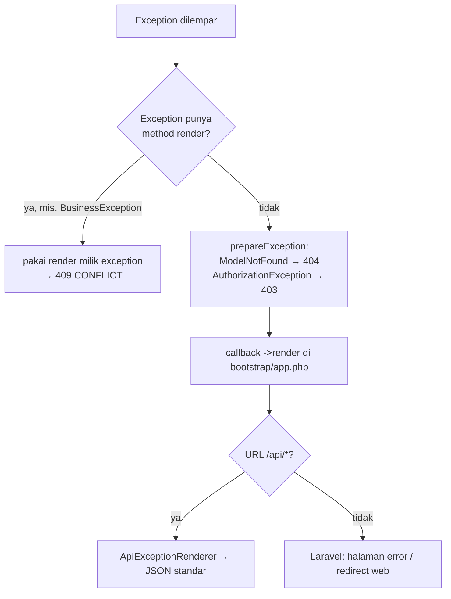

# 05 — Standar Response & Error Handling API

> Tahap: 4 · Dibuat: 2026-11-11 · Status: selesai

## 1. Tujuan

Aplikasi mobile perlu **satu bentuk JSON yang bisa ditebak** untuk semua response, baik sukses maupun gagal. Tanpa standar, developer mobile harus menulis kode khusus untuk setiap endpoint, dan error seperti 500 bisa membocorkan detail server (query SQL, path file).

## 2. Konsep yang Perlu Dipahami

### Bentuk response

**Sukses (satu data):**

```json
{
    "success": true,
    "message": "Product created.",
    "data": { "id": 15, "...": "..." }
}
```

**Sukses (daftar ber-halaman):**

```json
{
    "success": true,
    "message": "OK",
    "data": [{ "id": 1 }, { "id": 2 }],
    "meta": {
        "current_page": 1,
        "per_page": 10,
        "total": 160,
        "last_page": 16,
        "from": 1,
        "to": 10
    },
    "links": { "first": "...", "prev": null, "next": "...", "last": "..." }
}
```

**Error (selalu sama):**

```json
{
    "success": false,
    "message": "The given data was invalid.",
    "code": "VALIDATION_ERROR",
    "errors": { "sku": ["The SKU has already been taken."] }
}
```

### Kenapa ada field `code`?

`message` ditujukan untuk **manusia** dan bisa berubah (diterjemahkan, diperbaiki kalimatnya). `code` ditujukan untuk **program** dan tidak pernah berubah. Aplikasi mobile cukup menulis:

```kotlin
when (error.code) {
    "UNAUTHENTICATED" -> goToLogin()
    "VALIDATION_ERROR" -> showFieldErrors(error.errors)
    "TOO_MANY_REQUESTS" -> retryLater()
}
```

### Daftar kode

| HTTP | `code`               | Kapan                                          |
| ---- | -------------------- | ---------------------------------------------- |
| 401  | `UNAUTHENTICATED`    | Token tidak ada / salah / kedaluwarsa          |
| 403  | `FORBIDDEN`          | Login, tapi tidak punya izin                   |
| 404  | `NOT_FOUND`          | Data atau endpoint tidak ada                   |
| 405  | `METHOD_NOT_ALLOWED` | Method HTTP salah (mis. PATCH ke endpoint GET) |
| 409  | `CONFLICT`           | Aturan bisnis dilanggar (`BusinessException`)  |
| 422  | `VALIDATION_ERROR`   | Validasi gagal, detail per field di `errors`   |
| 429  | `TOO_MANY_REQUESTS`  | Rate limit, ada header `Retry-After`           |
| 500  | `SERVER_ERROR`       | Error tak terduga                              |

## 3. File yang Terlibat

| File                                       | Peran                                                      |
| ------------------------------------------ | ---------------------------------------------------------- |
| `app/Support/ApiResponse.php`              | `success()`, `created()`, `noContent()`, `paginated()`     |
| `app/Exceptions/ApiExceptionRenderer.php`  | Mengubah SEMUA exception di `/api/*` menjadi error standar |
| `app/Exceptions/BusinessException.php`     | Error aturan bisnis → 409 (API) / toast (Web)              |
| `bootstrap/app.php`                        | Mendaftarkan renderer                                      |
| `routes/api/v1.php`                        | Fallback 404 memakai `abort(404, ...)`                     |
| `tests/Feature/Api/V1/ErrorFormatTest.php` | 10 test, satu per jenis error                              |

## 4. Langkah Pembuatan

### Langkah 1 — Helper response sukses

```php
// Controller API
return ApiResponse::success(ProductResource::make($product));                 // 200
return ApiResponse::created(ProductResource::make($product), 'Product created.'); // 201
return ApiResponse::noContent();                                               // 204
return ApiResponse::paginated($paginator, ProductResource::class);             // 200 + meta + links
```

`paginated()` mendukung dua jenis pagination:

|              | `paginate()`                         | `cursorPaginate()`           |
| ------------ | ------------------------------------ | ---------------------------- |
| Query SQL    | `LIMIT 10 OFFSET 990` + `COUNT(*)`   | `WHERE id < 12345 LIMIT 10`  |
| `meta`       | `total`, `last_page`, `current_page` | `next_cursor`, `prev_cursor` |
| Cocok untuk  | Tabel admin (nomor halaman)          | Infinite scroll mobile       |
| Halaman jauh | Makin lambat (OFFSET besar)          | Tetap cepat                  |

### Langkah 2 — Satu renderer untuk semua error

`app/Exceptions/ApiExceptionRenderer.php` (inti):

```php
public function __invoke(Throwable $e, Request $request): ?JsonResponse
{
    if (! $request->is('api/*')) {
        return null;                 // halaman web: biarkan Laravel menangani
    }

    return match (true) {
        $e instanceof ValidationException => $this->respond(422, ..., $e->errors()),
        $e instanceof AuthenticationException => $this->respond(401, 'Unauthenticated.'),
        $e instanceof HttpExceptionInterface => $this->fromHttpException($e),   // 403, 404, 405, 429, ...
        default => $this->serverError($e),                                       // 500
    };
}
```

Didaftarkan di `bootstrap/app.php`:

```php
->withExceptions(function (Exceptions $exceptions): void {
    $exceptions->render(
        fn (Throwable $e, Request $request) => app(ApiExceptionRenderer::class)($e, $request),
    );
})
```

### Langkah 3 — Jangan membocorkan informasi

| Situasi                   | Pesan asli Laravel                                   | Pesan yang dikirim                                      |
| ------------------------- | ---------------------------------------------------- | ------------------------------------------------------- |
| Route model binding gagal | `No query results for model [App\Models\Product] 99` | `Resource not found.`                                   |
| Policy menolak            | `This action is unauthorized.`                       | `You are not allowed to perform this action.`           |
| Error 500 (production)    | `SQLSTATE[42S22]: Column not found ...`              | `An unexpected error occurred. Please try again later.` |

Saat `APP_DEBUG=true` (lokal), response 500 menyertakan field `debug` (class, pesan, file:baris) agar mudah di-debug. Di production field ini **tidak pernah** ada. Hal ini dibuktikan oleh test `500 SERVER_ERROR tanpa detail teknis saat APP_DEBUG=false`.

### Langkah 4 — Urutan proses error di Laravel



### Langkah 5 — Fallback 404

```php
// routes/api/v1.php
Route::fallback(fn () => abort(404, 'Endpoint not found.'));
```

Cukup `abort()`. Pembentukan JSON-nya diurus renderer, jadi tidak ada format yang ditulis dua kali.

## 5. Cara Mencoba

```bash
curl http://localhost:8000/api/v1/products/999999
# {"success":false,"message":"Resource not found.","code":"NOT_FOUND","errors":null}

curl -X POST http://localhost:8000/api/v1/products
# {"success":false,"message":"Unauthenticated.","code":"UNAUTHENTICATED","errors":null}

curl "http://localhost:8000/api/v1/products?sort=password"
# {"success":false,"message":"The selected sort is invalid.","code":"VALIDATION_ERROR","errors":{"sort":[...]}}
```

```bash
php artisan test --filter=ErrorFormatTest
```

## 6. Kesalahan Umum & Cara Mengatasinya

| Gejala                                | Penyebab                                        | Solusi                                                                   |
| ------------------------------------- | ----------------------------------------------- | ------------------------------------------------------------------------ |
| Error API berupa HTML                 | Request bukan ke `/api/*`                       | Pastikan URL diawali `/api/v1/`                                          |
| Pesan 404 menyebut nama class model   | Mengirim `$e->getMessage()` mentah              | Renderer mengganti pesan bila `previous` adalah `ModelNotFoundException` |
| Stack trace terlihat di production    | `APP_DEBUG=true` di server                      | Production **wajib** `APP_DEBUG=false`                                   |
| `BusinessException` di web malah JSON | Request web mengirim `Accept: application/json` | `render()` memeriksa header `X-Inertia`                                  |

## 7. Latihan

1. Tambahkan kode `413 PAYLOAD_TOO_LARGE` ke test (petunjuk: `abort(413)` di route test).
2. Buat endpoint test yang melempar `BusinessException`, lalu pastikan response-nya 409 dengan `code: CONFLICT`.

## 8. Referensi

- Error handling: https://laravel.com/docs/errors
- API Resources: https://laravel.com/docs/eloquent-resources
- Cursor pagination: https://laravel.com/docs/pagination#cursor-pagination
