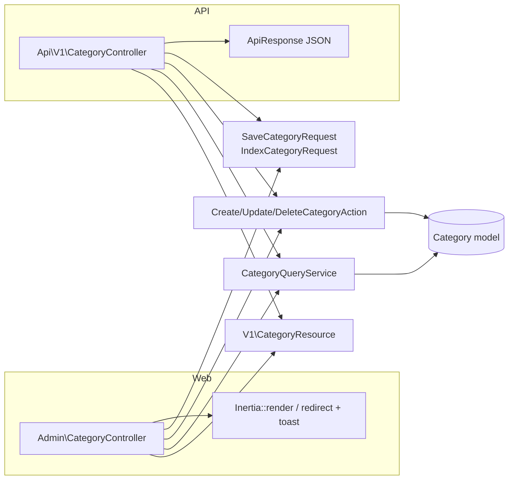

# 06 — CRUD Kategori (Web + API, satu business logic)

> Tahap: 4 · Dibuat: 2026-11-11 · Status: selesai

## 1. Tujuan

Fitur CRUD **paling dasar** dan contoh utama prinsip project ini: **satu business logic, dua interface**. Halaman admin (Inertia) dan endpoint `/api/v1/categories` memakai Form Request, Action, Service, dan Resource yang **sama persis**.

## 2. Konsep yang Perlu Dipahami



| Istilah                    | Penjelasan                                                         |
| -------------------------- | ------------------------------------------------------------------ |
| **Slug**                   | Versi nama yang aman untuk URL: "Personal Care" → `personal-care`  |
| **`prepareForValidation`** | Method Form Request untuk merapikan input **sebelum** divalidasi   |
| **`withCount`**            | Menghitung relasi dengan subquery `COUNT`, tanpa memuat datanya    |
| **`restrictOnDelete`**     | Foreign key yang menolak penghapusan parent yang masih punya child |

## 3. File yang Terlibat

| File                                                  | Peran                                            |
| ----------------------------------------------------- | ------------------------------------------------ |
| `database/migrations/..._create_categories_table.php` | Tabel `categories`                               |
| `app/Models/Category.php`                             | Model + relasi `products()`                      |
| `database/factories/CategoryFactory.php`              | Data palsu untuk test                            |
| `app/Policies/CategoryPolicy.php`                     | Baca: publik. Tulis: permission `categories.*`   |
| `app/Http/Requests/Catalog/SaveCategoryRequest.php`   | Validasi tambah & ubah (Web + API)               |
| `app/Http/Requests/Catalog/IndexCategoryRequest.php`  | Whitelist `search`, `sort`, `per_page`           |
| `app/Actions/Category/*.php`                          | Create / Update / Delete + `GeneratesUniqueSlug` |
| `app/Services/Catalog/CategoryQueryService.php`       | Daftar + pilihan dropdown                        |
| `app/Http/Resources/V1/CategoryResource.php`          | Bentuk JSON (dipakai API **dan** Web)            |
| `app/Http/Controllers/Admin/CategoryController.php`   | Controller Web                                   |
| `app/Http/Controllers/Api/V1/CategoryController.php`  | Controller API                                   |
| `resources/js/pages/admin/categories/*.tsx`           | Halaman React                                    |
| `resources/js/components/admin/category-form.tsx`     | Form (tambah & edit)                             |

## 4. Langkah Pembuatan

### Langkah 1 — Migration & model

```bash
php artisan make:model Category -mf     # model + migration + factory
```

```php
Schema::create('categories', function (Blueprint $table) {
    $table->id();
    $table->string('name', 100);
    $table->string('slug', 120)->unique();
    $table->string('description', 500)->nullable();
    $table->timestamps();
});
```

```php
#[Fillable(['name', 'slug', 'description'])]
class Category extends Model
{
    use HasFactory;

    public function products(): HasMany { return $this->hasMany(Product::class); }
}
```

### Langkah 2 — Permission & Policy

Tambahkan di `App\Enums\PermissionName`:

```php
case CategoriesView = 'categories.view';
case CategoriesCreate = 'categories.create';
case CategoriesUpdate = 'categories.update';
case CategoriesDelete = 'categories.delete';
```

```bash
php artisan db:seed --class=RolePermissionSeeder
```

```php
class CategoryPolicy
{
    public function viewAny(?User $actor): bool { return true; }   // ?User = tamu boleh
    public function create(User $actor): bool { return $actor->can(PermissionName::CategoriesCreate); }
    // update, delete ...
}
```

> **Pembaruan (8h, 2026-11-24):** endpoint kategori kini **wajib token** + `api.access`. Membaca tetap
> tidak butuh `categories.view` (semua user API boleh membaca katalog). Lihat [8h](08h-generator-rest-api-dan-rbac.md).

Karena daftar kategori **publik** untuk API (katalog mobile), halaman admin dijaga tambahan di route:

```php
Route::middleware('can:categories.view')->group(function () {
    Route::resource('categories', CategoryController::class)->except('show');
});
```

### Langkah 3 — Form Request dipakai bersama

```php
class SaveCategoryRequest extends FormRequest
{
    public function authorize(): bool
    {
        $category = $this->route('category');           // ada saat update

        return $category instanceof Category
            ? (bool) $this->user()?->can('update', $category)
            : (bool) $this->user()?->can('create', Category::class);
    }

    protected function prepareForValidation(): void
    {
        // "Kopi Susu " → "kopi-susu" sebelum dicek unique
        if (is_string($this->input('slug')) && trim($this->input('slug')) !== '') {
            $this->merge(['slug' => str($this->input('slug'))->slug()->toString()]);
        }
    }

    public function rules(): array
    {
        return [
            'name' => ['required', 'string', 'max:100'],
            'slug' => ['nullable', 'string', 'max:120', Rule::unique('categories', 'slug')->ignore(...)],
            'description' => ['nullable', 'string', 'max:500'],
        ];
    }
}
```

Satu class menangani **tambah** dan **ubah**. Bedanya hanya `ignore()` pada aturan unique (saat ubah, slug miliknya sendiri tidak dianggap duplikat).

### Langkah 4 — Action

```php
class DeleteCategoryAction
{
    public function execute(Category $category): void
    {
        $productsCount = $category->products()->count();

        if ($productsCount > 0) {
            throw new BusinessException("This category still has {$productsCount} product(s). ...");
        }

        $category->delete();
    }
}
```

**Dua lapis pengaman:**

1. **Action**: pesan error jelas → API 409, Web toast merah.
2. **Database**: foreign key `restrictOnDelete()` di tabel `products`. Jika ada kode lain yang lupa memakai Action, database tetap menolak.

Slug otomatis & unik (`GeneratesUniqueSlug`): "Iced Coffee" → `iced-coffee`, atau `iced-coffee-2` jika sudah dipakai.

### Langkah 5 — Resource dipakai Web & API

```php
class CategoryResource extends JsonResource
{
    public function toArray(Request $request): array
    {
        return [
            'id' => $this->id,
            'name' => $this->name,
            'slug' => $this->slug,
            'description' => $this->whenHas('description'),
            'products_count' => $this->whenCounted('products'),   // hanya jika withCount
            // ...
        ];
    }
}
```

### Langkah 6 — Dua controller, isi hampir sama

```php
// API
public function store(SaveCategoryRequest $request, CreateCategoryAction $createCategory): JsonResponse
{
    return ApiResponse::created(CategoryResource::make($createCategory->execute($request->validated())), 'Category created.');
}

// Web
public function store(SaveCategoryRequest $request, CreateCategoryAction $createCategory): RedirectResponse
{
    $category = $createCategory->execute($request->validated());
    Inertia::flash('toast', ['type' => 'success', 'message' => "Category {$category->name} created."]);

    return to_route('admin.categories.index');
}
```

Perhatikan: **baris yang berisi logika sama persis**. Yang berbeda hanya baris `return`.

## 5. Endpoint API

| Method    | URL                                                           | Auth   | Permission          |
| --------- | ------------------------------------------------------------- | ------ | ------------------- |
| GET       | `/api/v1/categories?search=&sort=-products_count&per_page=25` | Bearer | `api.access`        |
| GET       | `/api/v1/categories/{id}`                                     | Bearer | `api.access`        |
| POST      | `/api/v1/categories`                                          | Bearer | `categories.create` |
| PUT/PATCH | `/api/v1/categories/{id}`                                     | Bearer | `categories.update` |
| DELETE    | `/api/v1/categories/{id}`                                     | Bearer | `categories.delete` |

Sort yang diizinkan: `name`, `products_count`, `created_at` (awali `-` untuk urutan turun).

## 6. Cara Mencoba

```bash
php artisan migrate:fresh --seed     # 8 kategori, 160 produk
composer run dev
```

Web: login sebagai admin → menu **Catalog → Categories**.

```bash
curl "http://localhost:8000/api/v1/categories?sort=-products_count"
```

```bash
php artisan test --filter="CatalogApiTest|CatalogManagementTest"
```

## 7. Kesalahan Umum

| Gejala                                                       | Penyebab                                      | Solusi                                           |
| ------------------------------------------------------------ | --------------------------------------------- | ------------------------------------------------ |
| Customer bisa membuka `/admin/categories`                    | Policy `viewAny` publik                       | Tambah middleware `can:categories.view` di route |
| `SQLSTATE[23000]: Integrity constraint violation` saat hapus | Kategori masih punya produk & Action dilewati | Selalu hapus lewat `DeleteCategoryAction`        |
| Slug duplikat error padahal nama berbeda                     | Slug otomatis bentrok                         | `GeneratesUniqueSlug` menambahkan `-2`, `-3`     |

## 8. Latihan

1. Tambahkan kolom `is_featured` (kategori unggulan) dari migration sampai toggle di form.
2. Buat endpoint `GET /api/v1/categories/{category}/products` yang memakai `ProductQueryService` dengan filter kategori terkunci.
