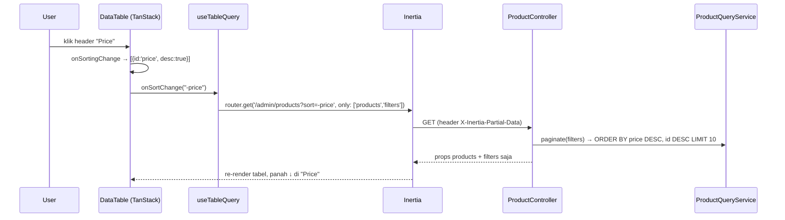

# 08 — Data Table di React (TanStack Table v9 + shadcn/ui)

> Tahap: 4 · Dibuat: 2026-11-11 · Status: selesai

## 1. Tujuan

Satu komponen tabel yang dipakai ulang di halaman **Users**, **Products**, dan **Categories**, dengan perilaku seragam:

- Klik header kolom untuk sort (↑ / ↓).
- Search dengan debounce, filter dropdown, dan pilihan baris per halaman.
- Semua state (search, filter, sort, halaman) tersimpan di **URL**.
- Pemrosesan data di **server**, bukan di browser.

## 2. Konsep yang Perlu Dipahami

### Headless table

TanStack Table adalah library **headless**: ia hanya mengurus **logika** (state sort, daftar header, baris), sedangkan **tampilan** sepenuhnya milik kita (komponen `Table` shadcn/ui + Tailwind).

### Server-side, bukan client-side

|                              | Client-side           | Server-side (dipakai di sini) |
| ---------------------------- | --------------------- | ----------------------------- |
| Data yang dikirim ke browser | **Semua** baris       | Hanya 1 halaman               |
| Sort & filter                | JavaScript di browser | SQL di MySQL (pakai index)    |
| 100.000 produk               | Browser macet         | Tetap ringan                  |

Di TanStack, ini diatur dengan `manualSorting: true`: tabel **tidak** mengurutkan sendiri, ia hanya melaporkan "user ingin sort berdasarkan harga turun". Kita meneruskannya ke server lewat URL.

### Kenapa state di URL?

`/admin/products?search=kopi&filter[category_id]=2&sort=-price&per_page=25&page=3`

- Bisa di-**bookmark** dan dibagikan ke rekan kerja.
- Tombol **Back** browser berfungsi.
- **Refresh** tidak menghilangkan filter.
- Tidak perlu Redux/Zustand, karena URL sudah menjadi "state manager".

### Catatan versi: TanStack Table **v9**

Project ini memakai v9 (versi terbaru saat dibuat), yang berbeda dari tutorial v8 di internet:

| v8                        | v9                                                             |
| ------------------------- | -------------------------------------------------------------- |
| `useReactTable(...)`      | `useTable({ features, ... })`                                  |
| `getCoreRowModel()` wajib | Fitur didaftarkan lewat `tableFeatures({ rowSortingFeature })` |
| `flexRender(...)`         | `<table.FlexRender header={header} />`                         |
| `createColumnHelper<T>()` | `createColumnHelper<typeof features, T>()`                     |

## 3. File yang Terlibat

| File                                                             | Peran                                             |
| ---------------------------------------------------------------- | ------------------------------------------------- |
| `resources/js/components/data-table/data-table.tsx`              | Komponen `DataTable` (TanStack + shadcn table)    |
| `resources/js/hooks/use-table-query.ts`                          | Sinkronisasi search/filter/sort/per_page ↔ URL    |
| `resources/js/components/pagination.tsx`                         | Nomor halaman + "Rows per page"                   |
| `resources/js/components/row-actions.tsx`                        | Menu "⋯" per baris                                |
| `resources/js/pages/admin/{users,products,categories}/index.tsx` | Pemakaian                                         |
| `app/Support/QuerySort.php`                                      | Sisi server: menerapkan `?sort=` dengan whitelist |

## 4. Langkah Pembuatan

### Langkah 1 — Pasang

```bash
npm install @tanstack/react-table
```

### Langkah 2 — Komponen `DataTable`

```tsx
export const dataTableFeatures = tableFeatures({ rowSortingFeature });   // level modul

export function DataTable<TData extends RowData>({ columns, data, sort, onSortChange, ... }) {
    const sorting = toSorting(sort);   // "-price" → [{ id: 'price', desc: true }]

    const table = useTable({
        features: dataTableFeatures,
        columns,
        data,
        state: { sorting },
        onSortingChange: (updater) => {
            const next = typeof updater === 'function' ? updater(sorting) : updater;
            onSortChange(toSort(next));          // [{ id: 'price', desc: true }] → "-price"
        },
        manualSorting: true,                     // server yang mengurutkan
        defaultColumn: { enableSorting: false }, // kolom tidak bisa di-sort kecuali diizinkan
        enableSortingRemoval: false,             // klik: naik ↔ turun (tidak pernah "tanpa sort")
    });
    // ... render <Table> shadcn dengan <table.FlexRender header/cell />
}
```

> **Bug yang ditemukan saat pengembangan:** tanpa `defaultColumn: { enableSorting: false }`, TanStack menganggap **semua** kolom accessor bisa di-sort (default-nya `true`). Kolom Status sempat tampil dengan ikon ⇅, dan mengkliknya mengirim `?sort=is_active` yang ditolak server (422). Sekarang kolom harus menyatakan `enableSorting: true` secara eksplisit, dan hanya kolom yang ada di whitelist server yang diberi tanda itu.

### Langkah 3 — Definisi kolom (di level modul)

```tsx
const column = createColumnHelper<typeof dataTableFeatures, Product>();

const columns = column.columns([
    column.display({                             // kolom PERTAMA: menu "⋯"
        id: 'actions',
        header: () => <span className="sr-only">Actions</span>,
        cell: ({ row }) => <ProductActions product={row.original} />,
    }),
    column.accessor('name', {
        header: 'Product',
        enableSorting: true,                     // id "name" ada di ProductQueryService::SORTS
        cell: ({ row }) => <>{row.original.name}<br />{row.original.sku}</>,
    }),
    column.accessor('price', { header: 'Price', enableSorting: true, cell: ... }),
    column.accessor('is_active', { header: 'Status', cell: ... }),  // TIDAK sortable
]);
```

> **Tata letak untuk UX.** Mata membaca dari kiri. Karena itu kolom aksi (`⋯`) diletakkan **pertama**, dan tombol **Add** berada di kiri toolbar sebelum kotak search. Begitu menu dibuka, user langsung melihat proses yang bisa dilakukan: tambah data baru, atau pilih baris lalu Edit/Delete. Menu `⋯` di kolom pertama memakai `align="start"` (default `RowActions`) agar dropdown terbuka ke kanan, sedangkan di kartu Roles (pojok kanan atas) memakai `align="end"`.

> **Kenapa di luar komponen?** TanStack v9 mensyaratkan referensi `columns` yang **stabil**. Jika dibuat di dalam komponen, array baru tercipta setiap render dan tabel menghitung ulang semua barisnya terus-menerus.
>
> **Lalu bagaimana dengan `useCan()`?** Hook tidak boleh dipanggil di level modul. Solusinya, sel aksi berupa **komponen** (`<ProductActions />`) yang memanggil `useCan()` di dalamnya.

### Langkah 4 — Hook `useTableQuery`

```tsx
const { search, setSearch, apply } = useTableQuery(
    admin.products.index.url(),
    filters,                        // prop dari controller
    ['products', 'filters'],        // partial reload: hanya data ini yang diminta ulang
);

<Input value={search} onChange={(e) => setSearch(e.target.value)} />   // debounce 300 ms
<Select onValueChange={(v) => apply({ filter: { ...filters.filter, category_id: v } })} />
<DataTable sort={filters.sort} onSortChange={(sort) => apply({ sort })} ... />
<Pagination onPerPageChange={(n) => apply({ per_page: n })} ... />
```

Di dalamnya:

```ts
router.get(url, clean({ ...filters, search, ...next }), {
    only, // Inertia partial reload
    preserveState: true, // ketikan di input search tidak hilang
    preserveScroll: true,
    replace: true, // tidak menumpuk history setiap ketikan
});
```

`clean()` membuang nilai kosong agar URL tetap bersih. `page` tidak pernah ikut terbawa, sehingga setiap perubahan filter kembali ke halaman 1.

### Langkah 5 — Controller mengirim `filters`

```php
'filters' => [
    'search' => $filters['search'] ?? '',
    'sort' => $filters['sort'] ?? '-created_at',
    'per_page' => (int) ($filters['per_page'] ?? 10),
    'filter' => ['category_id' => ..., 'status' => ...],
],
```

Nilai `filters` dari server adalah **sumber kebenaran** yang menentukan dropdown mana yang terpilih dan panah sort mana yang menyala.

## 5. Alur Klik Header "Price"



## 6. Membuat Tabel Baru (resep)

1. Server: tambahkan `SORTS` di Service, aturan `sort` di Form Request (`QuerySort::options(...)`), dan kirim `filters` dari controller.
2. React: `createColumnHelper` di level modul, tandai `enableSorting: true` hanya untuk kunci di `SORTS`.
3. Pakai `useTableQuery` + `<DataTable>` + `<Pagination onPerPageChange>`.
4. Aksi per baris: komponen kecil yang memakai `useCan()` dan `<RowActions>`, diletakkan sebagai kolom **pertama** dengan `columnClassNames={{ actions: 'w-12 pr-0' }}`.
5. Toolbar: `[+ Add] [Search]` di kiri, filter di kanan (turun ke baris sendiri di layar < `xl`). Tombol Add dibungkus `can('xxx.create')`.

## 7. Kesalahan Umum

| Gejala                                 | Penyebab                                          | Solusi                                    |
| -------------------------------------- | ------------------------------------------------- | ----------------------------------------- |
| Kolom tanpa sort tetap bisa diklik     | Default TanStack: sortable                        | `defaultColumn: { enableSorting: false }` |
| Tabel "berkedip" / lambat              | `columns` dibuat di dalam komponen                | Pindahkan ke level modul                  |
| Ketikan search hilang setelah request  | Tanpa `preserveState`                             | `preserveState: true`                     |
| Tombol Back harus ditekan berkali-kali | Setiap ketikan menambah history                   | `replace: true`                           |
| Halaman kosong setelah ganti filter    | Masih di `page=7` padahal hasil tinggal 1 halaman | `useTableQuery` tidak membawa `page`      |
| Error `Rules of Hooks` di sel tabel    | Memanggil hook di fungsi `cell`                   | Jadikan komponen tersendiri               |

## 8. Latihan

1. Jadikan kolom **Category** bisa di-sort: tambahkan kunci `category` di server (butuh `JOIN` atau subquery), lalu `enableSorting: true` di kolomnya.
2. Tambahkan filter **"In stock only"** (checkbox) yang mengirim `filter[in_stock]=1`.

## 9. Referensi

- TanStack Table: https://tanstack.com/table
- shadcn/ui Data Table: https://ui.shadcn.com/docs/components/data-table
- Inertia partial reloads: https://inertiajs.com/partial-reloads
