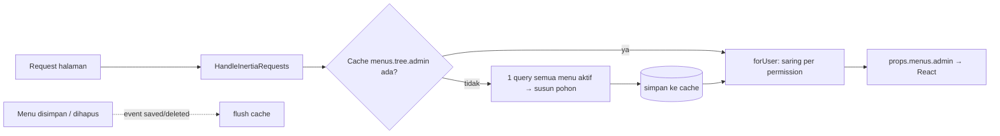

# 08b — Manajemen Menu & Submenu (Dashboard + Website)

> Tahap: 4 (tambahan) · Dibuat: 2026-11-11 · Status: selesai

## 1. Tujuan

Menu **sidebar dashboard** dan **navbar website** tidak lagi ditulis di kode React, tetapi disimpan di database dan dikelola dari **Administration → Menus**. Admin bisa:

- Menambah, mengubah, menyembunyikan, dan menghapus menu.
- Membuat **submenu** (maksimal 2 tingkat: menu → submenu).
- Mengatur urutan, ikon, dan (untuk sidebar) **role** yang boleh melihat menu.

> Visibilitas per role, drag & drop, pratinjau sidebar per role, dan matriks Access Control dibahas di [08c](08c-access-control-dan-visibilitas-menu.md).

Menu website juga tersedia lewat API publik `GET /api/v1/menus/website` untuk aplikasi mobile.

## 2. Konsep yang Perlu Dipahami

### Satu tabel, dua lokasi

```
menus
├── location = admin    → sidebar dashboard
│   ├── Dashboard            /dashboard
│   ├── Catalog              (tanpa URL → hanya membuka submenu)
│   │   ├── Products         /admin/products     permission: products.view
│   │   └── Categories       /admin/categories   permission: categories.view
│   └── Administration
│       ├── Users ... Menus
└── location = website  → navbar halaman depan
    ├── Home                 /
    ├── Features             /#features
    └── Resources
        └── Laravel Docs     https://laravel.com/docs   (tab baru)
```

Submenu cukup menyimpan `parent_id` (menunjuk ke menu induknya). Pola ini disebut **adjacency list**.

### Kenapa maksimal 2 tingkat?

Menu bertingkat 3+ sulit dipakai, terutama di HP. Batas ini dijaga di **Form Request**:

| Aturan                                         | Alasan                    |
| ---------------------------------------------- | ------------------------- |
| Induk harus menu **tingkat atas**              | Mencegah tingkat 3        |
| Induk harus di **lokasi yang sama**            | Menu website ≠ sidebar    |
| Menu yang punya submenu tidak boleh jadi child | Mencegah tingkat 3        |
| Menu tidak boleh jadi induk dirinya sendiri    | Mencegah lingkaran (loop) |

### Menyembunyikan menu ≠ mengamankan halaman

Pengaturan siapa yang melihat menu (role / permission) hanya mengatur **apakah tautan terlihat**. Jika user mengetik URL `/admin/users` langsung, yang menjaga tetap **middleware & Policy** di server. Ini sama seperti prinsip `useCan()` di React: UI hanya kenyamanan, keamanan ada di server.

### Cache pohon menu

Menu dibaca di **setiap halaman**, tetapi jarang berubah. Jadi pohonnya di-cache:



- **Yang di-cache**: pohon menu aktif, sama untuk semua user.
- **Yang tidak di-cache**: hasil penyaringan per permission, karena berbeda untuk tiap user.
- **Invalidasi otomatis**: Model `Menu` membuang cache pada event `saved` & `deleted`, jadi perubahan dari UI, seeder, maupun tinker langsung terlihat.

Saat ini cache memakai driver `database`. Di Tahap 6 cukup ganti ke Redis lewat `.env`, tanpa mengubah kode.

### Menu bawaan (`is_system`)

Menu sidebar dari seeder menunjuk ke fitur aplikasi. Jika URL-nya diubah atau dihapus, admin bisa "tersesat". Karena itu:

| Boleh                          | Dikunci                                  |
| ------------------------------ | ---------------------------------------- |
| Ganti judul, ikon, induk, urut | URL, permission, status aktif, **hapus** |

`is_system` sengaja **tidak** ada di `#[Fillable]`, sehingga tidak bisa diubah lewat request (mass assignment).

## 3. File yang Terlibat

| File                                             | Peran                                                            |
| ------------------------------------------------ | ---------------------------------------------------------------- |
| `database/migrations/..._create_menus_table.php` | Tabel `menus` + index `(location, parent_id, sort_order)`        |
| `app/Enums/MenuLocation.php`                     | `admin` / `website`                                              |
| `app/Models/Menu.php`                            | Relasi `parent`/`children`, flush cache otomatis                 |
| `app/Support/MenuIcons.php`                      | Whitelist nama ikon                                              |
| `app/Services/Menu/MenuTreeService.php`          | `tree()` (cache), `forUser()`, `flatList()`, `parentOptions()`   |
| `app/Http/Requests/Admin/SaveMenuRequest.php`    | Validasi: 2 tingkat, URL aman per lokasi                         |
| `app/Actions/Menu/*.php`                         | Create / Update (kunci menu bawaan) / Delete                     |
| `app/Policies/MenuPolicy.php`                    | Permission `menus.*`                                             |
| `app/Http/Controllers/Admin/MenuController.php`  | Halaman kelola (tab `?location=`)                                |
| `app/Http/Controllers/Api/V1/MenuController.php` | `GET /api/v1/menus/website`                                      |
| `app/Http/Middleware/HandleInertiaRequests.php`  | Share `menus.admin` & `menus.website` ke semua halaman           |
| `database/seeders/MenuSeeder.php`                | Menu awal (aman dijalankan berulang)                             |
| `resources/js/components/nav-main.tsx`           | Sidebar: link, submenu collapsible, dropdown saat mode ikon      |
| `resources/js/components/site-nav.tsx`           | Navbar website: dropdown (desktop), tombol ☰ (mobile)           |
| `resources/js/components/menu-link.tsx`          | `<Link>` Inertia untuk path internal, `<a>` untuk link eksternal |
| `resources/js/lib/menu-icons.ts`                 | Nama ikon → komponen lucide                                      |
| `resources/js/pages/admin/menus/*.tsx`           | Halaman daftar, tambah, ubah                                     |
| `tests/Feature/Admin/MenuManagementTest.php`     | 16 test                                                          |

## 4. Langkah Pembuatan

### Langkah 1 — Migration

```php
$table->string('location', 20);
$table->foreignId('parent_id')->nullable()->constrained('menus')->restrictOnDelete();
$table->string('title', 100);
$table->string('url', 500)->nullable();   // null = induk yang hanya membuka submenu
$table->string('icon', 50)->nullable();
$table->string('permission', 100)->nullable();
$table->boolean('open_in_new_tab')->default(false);
$table->unsignedSmallInteger('sort_order')->default(0);
$table->boolean('is_active')->default(true);
$table->boolean('is_system')->default(false);
$table->index(['location', 'parent_id', 'sort_order']);
```

### Langkah 2 — Membangun pohon tanpa N+1

Cara naif memanggil `$menu->children` untuk setiap induk, yang menghasilkan 1 query per induk. Cara di sini: **1 query**, lalu dikelompokkan di PHP:

```php
$byParent = Menu::query()->where('location', $location)->where('is_active', true)
    ->orderBy('sort_order')->orderBy('id')
    ->get()
    ->groupBy(fn (Menu $m) => $m->parent_id ?? 0);   // 0 = tingkat atas

foreach ($byParent->get(0, collect()) as $parent) {
    $node = $this->node($parent);
    $node['children'] = /* $byParent->get($parent->id) ... */;
    $tree[] = $node;
}
```

Submenu dari induk yang **nonaktif** otomatis ikut tersembunyi, karena hanya induk aktif yang ditelusuri.

### Langkah 3 — Menyaring per user (lihat juga 08c)

```php
$allowed = fn (array $node) => $node['permission'] === null
    || ($user !== null && $user->can($node['permission']));
```

Menu buatan sendiri disaring per **role** (lihat 08c). Induk tanpa URL yang semua submenunya tersaring ikut dibuang. Contohnya, user yang hanya punya `products.view` tidak melihat grup "Administration" kosong.

### Langkah 4 — URL yang aman

Nilai URL disimpan lalu dipakai sebagai `href`. Tanpa validasi, admin (atau akun admin yang dibobol) bisa menyimpan `javascript:alert(document.cookie)`, yang akan dijalankan di browser setiap pengunjung yang mengklik menu itu (**XSS tersimpan**). Karena itu URL di-whitelist dengan regex:

| Lokasi  | Diizinkan                                         | Ditolak                                    |
| ------- | ------------------------------------------------- | ------------------------------------------ |
| admin   | `/admin/reports`                                  | `https://...`, `#top`, `//evil.com`        |
| website | `/about`, `#features`, `/#features`, `https://..` | `javascript:...`, `data:...`, `//evil.com` |

`//evil.com` ditolak karena browser menganggapnya **link ke domain lain** (protocol-relative URL).

Link yang dibuka di tab baru diberi `rel="noopener noreferrer"`, agar halaman tujuan tidak bisa mengakses `window.opener` milik kita.

### Langkah 5 — Share ke semua halaman

```php
// HandleInertiaRequests::share()
'menus' => fn () => [
    'admin' => $user ? $this->menus->forUser(MenuLocation::Admin, $user) : [],
    'website' => $this->menus->forUser(MenuLocation::Website, $user),
],
```

Dibungkus closure `fn () =>`, sehingga saat **partial reload** (misalnya mengetik di kotak search tabel) menu tidak dihitung ulang.

### Langkah 6 — React

```tsx
// app-sidebar.tsx
const { menus } = usePage().props;
<NavMain items={menus.admin} />

// welcome.tsx
<SiteNav items={menus.website} />
```

Ikon disimpan sebagai teks (`"Package"`) lalu dipetakan lewat `MENU_ICONS`. Hanya ikon yang ada di daftar yang ikut di-bundle, bukan seluruh ±1.500 ikon lucide. Test `daftar ikon PHP sama dengan peta ikon React` memastikan daftar PHP dan TypeScript tidak berbeda.

## 5. Endpoint

| Method | URL                                        | Auth                 | Keterangan                       |
| ------ | ------------------------------------------ | -------------------- | -------------------------------- |
| GET    | `/admin/menus?location=admin\|website`     | Login + `menus.view` | Halaman kelola                   |
| GET    | `/admin/menus/create?location=&parent_id=` | `menus.create`       | `parent_id` → "Add submenu"      |
| POST   | `/admin/menus`                             | `menus.create`       |                                  |
| PUT    | `/admin/menus/{id}`                        | `menus.update`       |                                  |
| DELETE | `/admin/menus/{id}`                        | `menus.delete`       | Ditolak untuk bawaan / ada child |
| GET    | `/api/v1/menus/website`                    | – (publik)           | Pohon menu navbar (JSON)         |

## 6. Cara Mencoba

Database yang sudah ada cukup ditambah tabel & data menu (tanpa menghapus data lain):

```bash
php artisan migrate
php artisan db:seed --class=RolePermissionSeeder   # permission menus.*
php artisan db:seed --class=MenuSeeder
```

1. Login sebagai admin → **Administration → Menus**.
2. Tab **Website navbar** → menu `⋯` pada "Resources" → **Add submenu** → isi "GitHub", `https://github.com`, aktifkan "Open in a new tab".
3. Buka `/`: dropdown **Resources** kini berisi GitHub.
4. Tab **Dashboard sidebar** → **Add menu** → "Help" dengan URL `/settings/profile`, pilih **Everyone** → muncul di sidebar semua user.

```bash
curl http://localhost:8000/api/v1/menus/website
php artisan test --filter=MenuManagementTest
```

## 7. Kesalahan Umum

| Gejala                                            | Penyebab                                    | Solusi                                                                |
| ------------------------------------------------- | ------------------------------------------- | --------------------------------------------------------------------- |
| Sidebar kosong setelah `migrate`                  | Tabel `menus` belum diisi                   | `php artisan db:seed --class=MenuSeeder`                              |
| Menu baru tidak muncul                            | Status nonaktif, atau induknya nonaktif     | Aktifkan menu & induknya                                              |
| Menu sidebar tidak terlihat oleh staff            | Role staff tidak dipilih / tidak punya izin | Cek **Sidebar preview** → "View as staff" untuk melihat alasannya     |
| Menu disembunyikan tapi halaman tetap bisa dibuka | Menu hanya tampilan                         | Jaga halaman dengan middleware `can:` / Policy                        |
| Tombol Delete tidak ada                           | Menu bawaan (`Built-in`)                    | Sembunyikan dengan memindah/rename; tidak bisa dihapus                |
| Ikon tidak tampil                                 | Nama ikon tidak ada di `MENU_ICONS`         | Tambahkan di `MenuIcons.php` **dan** `menu-icons.ts`                  |
| Input di form 2 kolom tidak sejajar               | Grid meregangkan kolom yang lebih pendek    | Beri `items-start` pada grid: `grid items-start gap-5 sm:grid-cols-2` |

> **Kenapa input bisa turun?** Secara default, item grid diregangkan (`align-items: stretch`) setinggi kolom tertinggi. Kalau satu kolom punya teks bantuan atau pesan error, kolom sebelahnya ikut memanjang. Karena kolom itu sendiri berupa `grid gap-2`, ruang kosongnya dibagi ke baris label dan input, sehingga input bergeser ke bawah. `items-start` membuat setiap kolom setinggi isinya saja. Pola ini dipakai di semua form admin (users, products, menus).

## 8. Latihan

1. Tambahkan ikon `Gift` ke daftar ikon (PHP + TypeScript), lalu jalankan test sinkronisasi ikon.
2. Tambahkan lokasi ketiga `footer` di `MenuLocation`, lalu tampilkan di footer halaman depan.
3. Tambahkan tombol **Move up / Move down** di menu `⋯` sebagai alternatif drag & drop untuk pengguna keyboard (petunjuk: kirim ulang seluruh susunan ke `PUT /admin/menus/reorder`).

## 9. Referensi

- shadcn/ui Sidebar (collapsible submenu): https://ui.shadcn.com/docs/components/sidebar
- Radix Navigation Menu: https://www.radix-ui.com/primitives/docs/components/navigation-menu
- OWASP XSS Prevention: https://cheatsheetseries.owasp.org/cheatsheets/Cross_Site_Scripting_Prevention_Cheat_Sheet.html
- Laravel Cache: https://laravel.com/docs/cache
