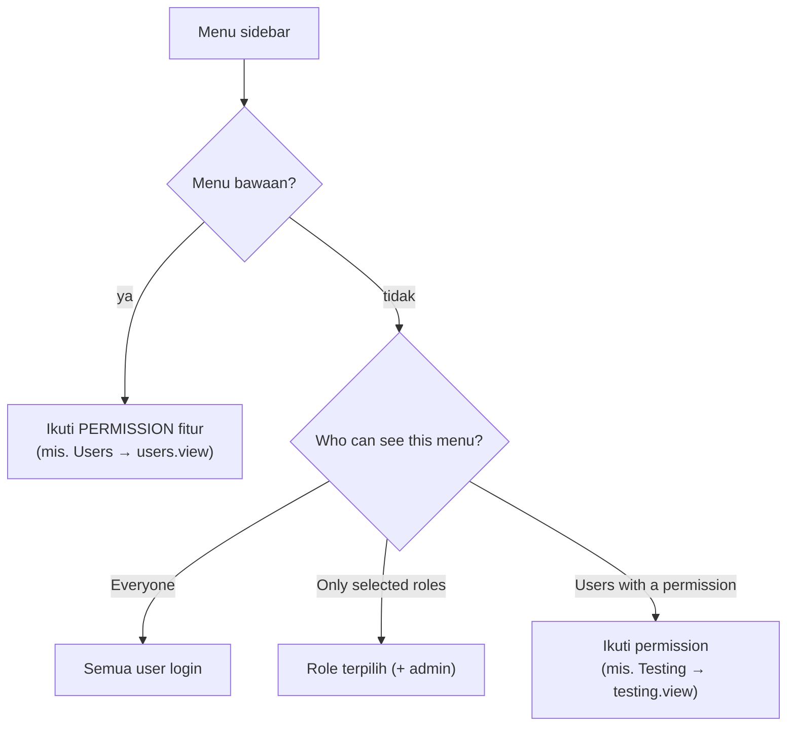

# 08c — Access Control, Visibilitas Menu per Role & Drag and Drop

> Tahap: 4 (tambahan) · Dibuat: 2026-11-12 · Status: selesai

## 1. Tujuan

Membuat pengaturan **menu, role, dan permission** mudah dipahami tanpa harus membaca kode:

| Sebelumnya                                                   | Sekarang                                                                 |
| ------------------------------------------------------------ | ------------------------------------------------------------------------ |
| Membatasi menu = memilih nama permission (mis. `roles.view`) | Pilih **"Everyone"** atau **"Only selected roles"** lalu centang role    |
| Halaman Permissions hanya bisa dibaca                        | **Matriks Access Control**: permission × role, klik langsung tersimpan   |
| Tidak tahu kenapa menu tidak muncul untuk staff              | **Sidebar preview**: "View as staff" + alasan tiap menu yang tersembunyi |
| Urutan diatur dengan mengetik angka                          | **Drag & drop**: geser naik/turun, geser kanan = jadikan submenu         |

## 2. Konsep yang Perlu Dipahami

### Tiga cara menentukan siapa yang melihat menu



| Pilihan                     | Kapan dipakai                                                | Diatur di                                      |
| --------------------------- | ------------------------------------------------------------ | ---------------------------------------------- |
| **Everyone**                | Menu umum (Help, link dokumentasi)                           | Form menu                                      |
| **Only selected roles**     | Menu yang cukup **disembunyikan** (halamannya tidak rahasia) | Form menu **atau** matriks **Menu visibility** |
| **Users with a permission** | Halaman yang **dikunci** permission di kode                  | Matriks permission (baris permission itu)      |

- **Menu bawaan** (Users, Roles, Products, …) selalu mengikuti **permission** fiturnya. Cukup centang `users.view` untuk staff di matriks, maka menu Users otomatis muncul untuk staff.
- **Admin selalu melihat semua menu**, sejalan dengan `Gate::before` (admin lolos semua izin).

### Menyembunyikan vs mengunci

"Only selected roles" hanya **menyembunyikan** menu. Kalau halamannya harus aman, kunci dengan permission di kode, lalu pilih **Users with a permission** agar menu dan akses halaman **selalu sejalan**:

```php
// routes/admin.php
Route::inertia('testing', 'admin/testing')
    ->middleware('can:testing.view')   // tanpa izin → 403, walau URL diketik
    ->name('testing');
```

| Staff punya `testing.view`? | Menu Testing | Buka `/admin/testing` |
| --------------------------- | ------------ | --------------------- |
| Tidak                       | Tersembunyi  | 403 Forbidden         |
| Ya (dicentang di matriks)   | Tampil       | Terbuka               |

### Halaman Permissions = satu tempat untuk semua akses

Halaman ini dibagi menjadi dua **tab** agar kedua tabel tidak ditumpuk:

1. **Tab Permissions** — matriks permission × role. Baris yang mengendalikan menu diberi keterangan _Shows menu: …_ (menu bawaan maupun menu "Users with a permission").
2. **Tab Menu visibility** — menu buatan sendiri yang diatur per role. Kolom **Everyone** dicentang = semua user login. Hapus centang Everyone → semua role tetap tercentang dulu (tidak ada yang tiba-tiba hilang), lalu hapus centang role yang tidak boleh melihat.

### Aturan "boleh lihat" ada di SATU tempat

Sidebar sungguhan dan pratinjau memakai fungsi yang sama (`MenuTreeService::evaluate()` + `hiddenReason()`), sehingga pratinjau **tidak mungkin berbeda** dengan yang benar-benar dilihat user. Alasan yang mungkin muncul:

| Alasan                           | Artinya                                                          |
| -------------------------------- | ---------------------------------------------------------------- |
| `Inactive`                       | Status menu dimatikan                                            |
| `Parent menu is hidden`          | Induknya tersembunyi, jadi submenunya ikut                       |
| `Needs permission users.view`    | Menu bawaan, role belum punya izin itu                           |
| `Only for: admin, staff`         | Menu buatan sendiri yang dibatasi role                           |
| `No URL and no visible submenus` | Tidak ada yang bisa dibuka (tanpa URL, submenu kosong/tersaring) |

### Tabel pivot `menu_role`

```
menus ──< menu_role >── roles
          menu_id
          role_id
```

Tidak ada baris = **Everyone**. Ada baris = hanya role tersebut. Saat migrasi, menu buatan sendiri yang sebelumnya memakai permission otomatis dipindah ke role yang memiliki permission itu (+ admin), lalu kolom `permission`-nya dikosongkan.

### Drag & drop: satu daftar + proyeksi kedalaman

Pohon 2 tingkat ditampilkan sebagai **satu daftar datar** dengan `depth` 0/1. Saat diseret:

- **Posisi vertikal** → urutan baru.
- **Jarak horizontal** (setiap 28px) → naik/turun satu tingkat, dibatasi aturan menu:
    - hanya menu **ber-URL tanpa submenu** yang boleh jadi submenu,
    - menu yang jadi submenu otomatis masuk ke **menu utama terdekat di atasnya**,
    - menu induk diseret **bersama submenunya**.

Setelah dilepas, **seluruh susunan** dikirim dalam satu request dan disimpan dalam satu transaksi. Server memeriksa ulang aturan yang sama (2 tingkat, submenu wajib ber-URL, daftar harus lengkap), karena request dari browser tidak boleh dipercaya begitu saja.

### Optimistic UI

Matriks dan drag & drop langsung menampilkan hasil **sebelum** server menjawab, supaya terasa instan. Jika server menolak, tampilan dikembalikan ke kondisi sebelumnya dan muncul toast error. Pola React yang dipakai untuk menyinkronkan state lokal dengan props baru dari server:

```tsx
const [items, setItems] = useState(rows);
const [prevRows, setPrevRows] = useState(rows);

if (rows !== prevRows) {
    // props baru dari server
    setPrevRows(rows);
    setItems(rows);
}
```

Pola ini (menyesuaikan state saat render) lebih tepat daripada `useEffect`, karena tidak menimbulkan render tambahan dengan data lama.

### Matriks: beri/cabut, bukan sync

Klik satu sel mengirim `{ permissions: ["users.view"], granted: true }`. Server memanggil `givePermissionTo` / `revokePermissionTo` **hanya** untuk izin itu, bukan `syncPermissions` seluruh daftar. Akibatnya dua admin yang mengklik sel berbeda pada saat bersamaan tidak saling menimpa.

### Matriks tetap ringkas walau menu bertambah

**Masalah awal:** setiap permission (view/create/update/delete) tampil sebagai satu baris, ditambah satu baris judul modul. Akibatnya 20 modul menghasilkan ±100 baris. Tabel Menu visibility juga ditumpuk di bawahnya, dan nama role di atas tabel ikut hilang saat halaman di-scroll.

**Solusi:**

| Perubahan                                 | Cara kerja                                                                                                                                                |
| ----------------------------------------- | --------------------------------------------------------------------------------------------------------------------------------------------------------- |
| Modul **tertutup secara default**         | Satu modul = satu baris. Klik nama modul (▸/▾) untuk membuka View/Create/Edit/Delete                                                                      |
| Checkbox modul + hitungan `x/y`           | Tetap bisa memberi/mencabut **seluruh** modul tanpa membukanya. Status sebagian ditandai _indeterminate_, dan `2/4` menunjukkan berapa izin yang dimiliki |
| Tombol **Expand all / Collapse all**      | Membuka/menutup semua modul sekaligus                                                                                                                     |
| Pencarian membuka hasil otomatis          | Selama kolom pencarian terisi, semua modul yang cocok terbuka (tombol expand dinonaktifkan)                                                               |
| Tinggi tabel dibatasi + header **sticky** | `max-h-[calc(100svh-19rem)] overflow-auto`. Baris nama role tetap di atas, kolom nama permission tetap di kiri                                            |
| Deskripsi permission jadi tooltip         | Teks deskripsi pindah ke atribut `title`, sehingga baris lebih rapat                                                                                      |
| **Tab** Permissions / Menu visibility     | Kedua tabel tidak lagi ditumpuk. Tiap tab menampilkan jumlah isinya                                                                                       |

State modul yang terbuka cukup berupa `Set` nama modul:

```tsx
const [expanded, setExpanded] = useState<Set<string>>(() => new Set());
const searching = search.trim() !== '';

// Saat mencari, semua hasil langsung terlihat.
const isOpen = (module: string) => searching || expanded.has(module);
```

Baris permission hanya dirender jika modulnya terbuka (`{open && group.permissions.map(...)}`), sehingga DOM juga lebih kecil.

**Header sticky di dalam tabel:** `position: sticky` tidak bekerja dengan baik pada `border-collapse: collapse` (garis batas header ikut ter-scroll). Karena itu tabel matriks memakai `border-separate border-spacing-0`, dan garis dipindah ke setiap sel (`border-b` pada `th`/`td`). Sel pojok kiri atas memakai `z-30` agar berada di atas header (`z-20`) maupun kolom kiri (`z-10`).

## 3. File yang Terlibat

| File                                                               | Peran                                                       |
| ------------------------------------------------------------------ | ----------------------------------------------------------- |
| `database/migrations/2026_11_12_000001_create_menu_role_table.php` | Pivot `menu_role` + pindahkan permission menu lama ke role  |
| `app/Models/Menu.php`                                              | Relasi `roles()`                                            |
| `app/Services/Menu/MenuTreeService.php`                            | `forUser()`, `previewForRole()`, aturan visibilitas tunggal |
| `app/Services/Access/AccessService.php`                            | Data matriks: role, grup permission, menu per permission    |
| `app/Actions/Menu/SyncMenuAudienceAction.php`                      | Simpan audience: everyone / roles (+ admin) / permission    |
| `app/Actions/Menu/ReorderMenusAction.php`                          | Simpan hasil drag & drop dalam satu transaksi               |
| `app/Actions/Role/SetRolePermissionsAction.php`                    | Beri / cabut permission dari matriks                        |
| `app/Http/Requests/Admin/ReorderMenusRequest.php`                  | Validasi bentuk data drag & drop                            |
| `app/Http/Requests/Admin/SetRolePermissionsRequest.php`            | Validasi klik matriks                                       |
| `app/Providers/AppServiceProvider.php`                             | Buang cache menu saat role diubah / dihapus                 |
| `resources/js/components/admin/menu-sortable-list.tsx`             | Daftar drag & drop (`@dnd-kit`)                             |
| `resources/js/components/admin/menu-preview-panel.tsx`             | Panel "View as role"                                        |
| `resources/js/components/admin/menu-form.tsx`                      | Pilihan "Who can see this menu?"                            |
| `resources/js/pages/admin/permissions/index.tsx`                   | Tab, matriks Access Control (modul bisa dibuka/tutup)       |
| `resources/js/components/admin/menu-visibility-matrix.tsx`         | Tab Menu visibility (tinggi dibatasi, header sticky)        |

## 4. Langkah Pembuatan

### Langkah 1 — Aturan visibilitas

```php
private function hiddenReason(array $node, Closure $can, array $roleNames, bool $isAdmin): ?string
{
    if ($node['permission'] !== null && ! $can($node['permission'])) {
        return "Needs permission {$node['permission']}";
    }

    if ($node['roles'] !== [] && ! $isAdmin && array_intersect($node['roles'], $roleNames) === []) {
        return 'Only for: '.implode(', ', $node['roles']);
    }

    return null;   // boleh lihat
}
```

`$can` berbeda untuk user sungguhan (`$user->can(...)`) dan untuk pratinjau (daftar permission milik role), tetapi aturannya sama.

### Langkah 2 — Cache tetap benar

Pohon menu di-cache beserta **nama role** tiap menu. Cache dibuang ketika:

| Kejadian                    | Siapa yang membuang                                         |
| --------------------------- | ----------------------------------------------------------- |
| Menu disimpan / dihapus     | Event `saved` / `deleted` pada model `Menu`                 |
| Role menu diubah (pivot)    | `SyncMenuAudienceAction` (pivot tidak memicu event `saved`) |
| Drag & drop                 | `ReorderMenusAction` (update tanpa event, flush sekali)     |
| Role diganti nama / dihapus | Listener `Role::saved` / `Role::deleted`                    |

Prefix cache dinaikkan ke `menus.tree.v2.` karena bentuk node berubah; cache lama tidak akan terbaca.

### Langkah 3 — Route reorder sebelum resource

```php
Route::put('menus/reorder', [MenuController::class, 'reorder'])->name('menus.reorder');
Route::resource('menus', MenuController::class)->except('show');
```

Jika urutannya dibalik, `PUT /admin/menus/reorder` akan ditangkap `menus.update` dengan `{menu} = "reorder"` → 404.

## 5. Endpoint

| Method | URL                               | Auth           | Body                                                       |
| ------ | --------------------------------- | -------------- | ---------------------------------------------------------- |
| GET    | `/admin/permissions`              | `roles.view`   | – (matriks)                                                |
| PATCH  | `/admin/menus/{id}/visibility`    | `menus.update` | `{ audience: everyone\|roles, roles[] }` (Menu visibility) |
| GET    | `/admin/testing`                  | `testing.view` | Contoh halaman yang dikunci permission                     |
| PATCH  | `/admin/roles/{role}/permissions` | `roles.update` | `{ permissions: string[], granted: bool }`                 |
| PUT    | `/admin/menus/reorder`            | `menus.update` | `{ location, items: [{ id, parent_id }] }` (urut tampil)   |
| POST   | `/admin/menus`                    | `menus.create` | `+ audience: everyone\|roles, roles[]` (sidebar)           |
| PUT    | `/admin/menus/{id}`               | `menus.update` | sama seperti POST                                          |

## 6. Cara Mencoba

```bash
php artisan migrate   # membuat menu_role
```

1. **Menu khusus admin**: Menus → Edit "Testing" → _Who can see this menu?_ → **Only selected roles** → biarkan hanya `admin` tercentang → Save.
2. **Cek tanpa logout**: di halaman Menus, panel **Sidebar preview** → _View as_ `staff` → "Testing" dicoret dengan alasan _Only for: admin_.
3. **Beri akses lewat matriks**: Permissions → klik modul **Menus** untuk membukanya (atau **Expand all**) → kolom `staff`, baris **View** → centang. Kembali ke pratinjau: menu "Menus" kini terlihat untuk staff.
4. **Drag & drop**: seret ikon ⠿ "Testing" ke bawah "Products", geser sedikit ke kanan → lepaskan → Testing menjadi submenu Catalog.

```bash
php artisan test --filter="MenuManagementTest|RoleManagementTest"
```

## 7. Kesalahan Umum

| Gejala                                      | Penyebab                                        | Solusi                                                      |
| ------------------------------------------- | ----------------------------------------------- | ----------------------------------------------------------- |
| Tidak bisa menyeret menu ke kanan           | Menu tidak punya URL atau masih punya submenu   | Isi URL dulu / pindahkan submenunya                         |
| Toast "The menu list has changed…"          | Admin lain mengubah menu setelah halaman dibuka | Reload halaman lalu ulangi                                  |
| Kolom admin di matriks tidak bisa diklik    | Admin selalu punya semua izin (dikunci)         | Memang disengaja                                            |
| Menu bawaan tidak bisa diatur per role      | Menu bawaan mengikuti permission fitur          | Atur lewat matriks Permissions                              |
| Role baru tidak muncul di pilihan form menu | Halaman form dibuka sebelum role dibuat         | Reload form                                                 |
| Perubahan UI tidak muncul setelah diedit    | Browser memuat build lama di `public/build`     | `npm run build` / jalankan `npm run dev`, lalu Ctrl+Shift+R |

## 8. Latihan

1. Tambahkan tombol **"Grant all"** di header kolom role pada matriks (petunjuk: kirim semua nama permission dengan `granted: true`).
2. Tampilkan jumlah menu yang terlihat per role di halaman **Roles** (petunjuk: hitung dari `previewForRole()`).
3. Simpan modul yang sedang terbuka dan tab aktif di `localStorage`, supaya tetap sama setelah reload (petunjuk: bungkus baca/tulis dengan `try/catch`).
4. Dukung **keyboard** untuk mengubah tingkat menu: panah kanan/kiri saat drag (petunjuk: `coordinateGetter` kustom pada `KeyboardSensor`).

## 9. Referensi

- dnd-kit Sortable: https://docs.dndkit.com/presets/sortable
- React — menyesuaikan state saat props berubah: https://react.dev/learn/you-might-not-need-an-effect#adjusting-some-state-when-a-prop-changes
- spatie/laravel-permission: https://spatie.be/docs/laravel-permission
