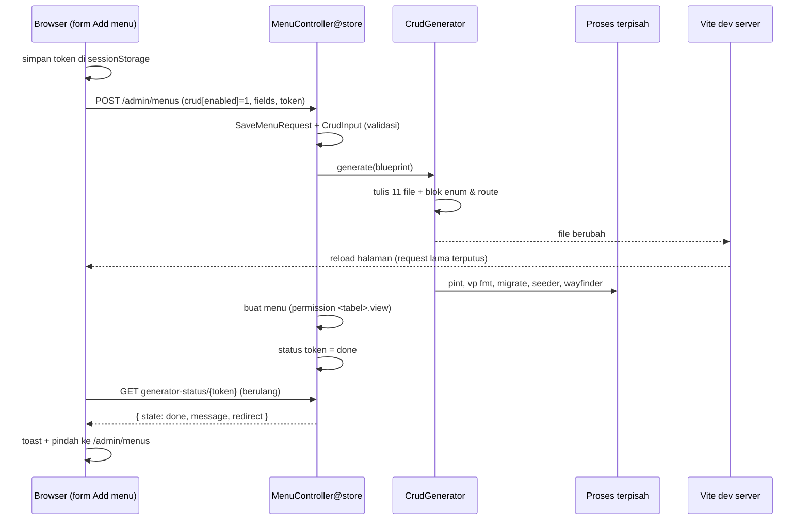

# 8d — CRUD Generator (dari menu & terminal)

> Tahap: 4 (tambahan) · Dibuat: 2026-11-13 · Status: selesai

## 1. Tujuan

Saat membuat menu sidebar baru, Anda bisa sekaligus meminta aplikasi **membuat kode CRUD-nya**:
migration (tabel), Model, Factory, Policy, Form Request, Controller, halaman React (daftar, tambah, edit),
dan feature test. Menunya otomatis menunjuk ke halaman itu dan mengikuti permission baru `<tabel>.view`.

> **Tambahan (8h):** generator juga bisa membuat **REST API** (`--api`, `--api-only`, atau
> `php artisan crud:api <tabel>` untuk modul yang sudah ada). Lihat [8h](08h-generator-rest-api-dan-rbac.md).

Hasilnya **kode Laravel & React biasa** yang bisa Anda baca, ubah, commit, dan deploy, bukan
"halaman ajaib" dari database. Karena menulis file kode, generator ini **hanya aktif di development**.

## 2. Konsep yang Perlu Dipahami

**Scaffolding / code generator.** Program yang menulis kode awal dari template. Laravel sendiri punya
`php artisan make:model`, `make:controller`, dan lain-lain. Generator ini menggabungkan semuanya dan
mengikuti pola project ini (Policy + permission, tabel admin, form dengan `InputError`, dan seterusnya).

**Stub.** Template teks di folder `stubs/crud/` dengan penanda seperti `{{ model }}` dan `{{ table }}`.
Ubah stub bila ingin semua CRUD berikutnya bergaya lain. File yang sudah dibuat tidak ikut berubah.

**Manifest.** Catatan di `storage/app/crud/<tabel>.json` berisi daftar file yang dibuat beserta
**hash SHA-1**-nya. Saat menghapus, generator membandingkan hash: file yang hash-nya berubah berarti
**sudah Anda edit**, jadi tidak dihapus.

**Penanda blok (marker).** Generator menyisipkan teks ke dua file yang sudah ada: `app/Enums/PermissionName.php`
dan `routes/generated.php`. Teks itu dibungkus `// crud:<tabel>` … `// end crud:<tabel>` dan diletakkan
di atas baris `// @crud:...`. Saat dihapus, blok itu dibuang lagi sehingga file kembali seperti semula.
**Jangan hapus baris `// @crud:...`.**

**Kenapa hanya di development?**

| Alasan                       | Penjelasan                                                                                               |
| ---------------------------- | -------------------------------------------------------------------------------------------------------- |
| Halaman React harus di-build | Di production, halaman baru tidak ada sebelum `npm run build` dan deploy ulang.                          |
| Keamanan                     | Server production yang bisa menulis file PHP dari request web = celah eksekusi kode bila disalahgunakan. |
| Git                          | File yang dibuat di server tidak masuk repository dan hilang/bentrok saat deploy berikutnya.             |

Aturannya ada di `CrudGenerator::enabled()`: aktif bila `config('crud.enabled')` (default: `APP_ENV=local`)
**dan** bukan production. Di production generator **selalu mati**, apa pun isi `.env`.

## 3. File yang Terlibat

| File                                                        | Peran                                                                                 |
| ----------------------------------------------------------- | ------------------------------------------------------------------------------------- |
| `config/crud.php`                                           | Saklar `CRUD_GENERATOR`, lokasi `php`/`node` untuk langkah lanjutan                   |
| `stubs/crud/*.stub`                                         | Template 11 file yang dibuat                                                          |
| `app/Services/Crud/CrudBlueprint.php`                       | Semua nama turunan dari satu nama (tabel, model, URL, permission)                     |
| `app/Services/Crud/CrudField.php`                           | Satu field: nama, tipe, wajib/tidak, pilihan (select)                                 |
| `app/Services/Crud/CrudInput.php`                           | Aturan validasi input generator (juga pagar keamanan)                                 |
| `app/Services/Crud/CrudRenderer.php`                        | Mengisi stub sesuai tipe field                                                        |
| `app/Services/Crud/CrudGenerator.php`                       | `generate()`, `remove()`, manifest, penanda blok, status                              |
| `app/Services/Crud/ProcessCrudPostProcessor.php`            | Menjalankan migrate, seeder permission, Wayfinder, Pint & `vp fmt` di proses terpisah |
| `app/Console/Commands/MakeCrudCommand.php`                  | `php artisan make:crud`                                                               |
| `app/Console/Commands/RemoveCrudCommand.php`                | `php artisan crud:remove`                                                             |
| `routes/generated.php`                                      | Route hasil generator (di-require dari `routes/admin.php`)                            |
| `app/Enums/PermissionName.php`                              | Tempat permission hasil generator disisipkan                                          |
| `app/Http/Requests/Admin/SaveMenuRequest.php`               | Validasi `crud[...]` saat "Generate CRUD page" dicentang                              |
| `app/Http/Controllers/Admin/MenuController.php`             | `store` (generate), `destroy` (hapus kode), `generatorStatus`                         |
| `resources/js/components/admin/crud-generator-section.tsx`  | Bagian "Generate CRUD page" + penyusun field di form menu                             |
| `resources/js/components/admin/crud-generating-overlay.tsx` | Layar "Generating…" yang tahan reload Vite                                            |
| `resources/js/pages/admin/menus/index.tsx`                  | Dialog Delete dengan pilihan hapus kode / drop tabel                                  |
| `tests/Feature/Admin/CrudGeneratorTest.php`                 | 28 test (folder sementara, tidak menyentuh project asli)                              |
| `app/Services/Crud/CrudTableInspector.php`                  | Membaca struktur tabel yang sudah ada → field (mode "Use an existing table")          |
| `resources/js/components/admin/existing-table-picker.tsx`   | Pilih tabel & kolom yang tampil di form                                               |
| `tests/Feature/Admin/CrudExistingTableTest.php`             | 22 test mode tabel lama (SQLite di memori, tidak menyentuh MySQL)                     |

### Yang dibuat untuk nama "Suppliers"

| File                                                         | Isi                                                                  |
| ------------------------------------------------------------ | -------------------------------------------------------------------- |
| `database/migrations/…_create_suppliers_table.php`           | Tabel `suppliers` + `id` + timestamps                                |
| `app/Models/Supplier.php`                                    | `#[Fillable]`, `casts()`, docblock `@property`                       |
| `database/factories/SupplierFactory.php`                     | Data palsu per tipe field                                            |
| `app/Policies/SupplierPolicy.php`                            | Tiap aksi = `suppliers.view/create/update/delete`                    |
| `app/Http/Requests/Admin/SaveSupplierRequest.php`            | Aturan validasi per field                                            |
| `app/Http/Controllers/Admin/SupplierController.php`          | index (search, sort, per_page), create, store, edit, update, destroy |
| `resources/js/components/admin/supplier-form.tsx`            | Tipe TypeScript `Supplier` + form tambah/edit                        |
| `resources/js/pages/admin/suppliers/{index,create,edit}.tsx` | Halaman daftar (DataTable) & form                                    |
| `tests/Feature/Admin/Generated/SupplierCrudTest.php`         | Test akses, daftar, CRUD, field wajib                                |

### Tipe field

| Tipe di form    | Kolom database            | Validasi                 | Input React                 |
| --------------- | ------------------------- | ------------------------ | --------------------------- |
| Short text      | `string(N)`, default 255  | `string`, `max:N`        | `Input maxLength={N}`       |
| Long text       | `text`                    | `string`, `max:5000`     | `Textarea`                  |
| Whole number    | `integer`                 | `integer`, batas INT     | `Input type=number`         |
| Decimal (money) | `decimal(15,2)`           | `numeric`, `decimal:0,2` | `Input step=0.01`           |
| Yes / No        | `boolean` default `false` | `boolean`                | `ToggleSwitch`              |
| Date            | `date`                    | `date`                   | `Input type=date`           |
| Date & time     | `dateTime`                | `date`                   | `Input type=datetime-local` |
| Choice list     | `string(50)`              | `in:pilihan1,pilihan2`   | `Select`                    |

Field yang tidak dicentang **Required** menjadi kolom `nullable`. Field "Short text" ikut dicari
lewat kotak Search; semua kecuali "Long text" bisa diurutkan dan tampil di tabel.

**Length (Short text).** Kolom **Length** di penyusun field menentukan panjang `varchar(N)`, dan
otomatis dipakai juga untuk validasi `max:N` dan `maxLength` di input. Kosong = 255 (bawaan
Laravel). Batasnya 1–1000; teks yang lebih panjang sebaiknya **Long text**, karena `varchar`
panjang menghabiskan batas ukuran baris MySQL (65.535 byte; utf8mb4 = 4 byte per karakter) dan
sulit diberi index. Contoh: kode `20`, nomor telepon `20`, nama `100`, email `150`.
Dari terminal: `--field="phone:string(20)"`.

### Memilih database tujuan (MySQL, PostgreSQL, SQL Server, …)

Di atas pilihan tabel ada **Database**. Pilihan ini berlaku untuk **dua mode**: tabel baru dibuat di
database itu, dan "Use an existing table" membaca tabel dari database itu. Data aplikasi
(users, roles, menus) tetap di database aplikasi.

| Database tujuan      | Yang berubah di kode hasil generate                                                         |
| -------------------- | ------------------------------------------------------------------------------------------- |
| App database (MySQL) | Seperti biasa                                                                               |
| Koneksi lain         | Model: `protected $connection = '...'`; migration: `Schema::connection('...')->create(...)` |
|                      | Policy juga mengecek izin akun database (SQL Server); test bawaan di-skip                   |

Pilihan yang muncul diambil dari `config/crud.php` → `connections`, dan **hanya yang siap pakai**:
host di `.env` terisi **dan** driver PHP-nya aktif. Sebelum menulis file, generator mengecek apakah
akun database boleh membuat tabel (SQL Server: `CREATE TABLE`; PostgreSQL: `CREATE` di schema).
Kalau tidak boleh, muncul pesan di bawah pilihan Database dan tidak ada file yang dibuat.

**Menambah PostgreSQL:**

1. Aktifkan `extension=pdo_pgsql` di `php.ini` **dan** `phpForApache.ini` (sudah dilakukan di
   laptop ini), lalu restart `composer dev` / Apache.
2. Isi `.env`:

    ```dotenv
    POSTGRES_DB_HOST=127.0.0.1
    POSTGRES_DB_PORT=5432
    POSTGRES_DB_DATABASE=nama_database
    POSTGRES_DB_USERNAME=...
    POSTGRES_DB_PASSWORD=...
    POSTGRES_DB_SCHEMA=public
    ```

3. **PostgreSQL** otomatis muncul di pilihan Database.

**Menambah database lain** (mis. MySQL kedua): buat koneksi baru di `config/database.php` (salin
contoh `postgres` atau `wmsreports`), lalu daftarkan namanya di `config/crud.php` → `connections`.

Dari terminal: `php artisan make:crud Gadgets --connection=postgres --field="title:string(80):required"`.

### Memakai tabel yang sudah ada

Di bagian **Database table** pilih **Use an existing table**, lalu pilih tabelnya. Field dibaca dari
struktur tabel (`Schema::getColumns()`), dan Anda tinggal memilih kolom mana yang tampil di form.

| Kolom MySQL                      | Jadi field                                    |
| -------------------------------- | --------------------------------------------- |
| `varchar(N)`, `char(N)`          | Short text, validasi `max:N`                  |
| `text`, `mediumtext`, `longtext` | Long text                                     |
| `int`, `bigint`, `smallint`, …   | Whole number, batas mengikuti tipe & UNSIGNED |
| `tinyint(1)`                     | Yes / No                                      |
| `decimal`, `float`, `double`     | Decimal                                       |
| `date`                           | Date                                          |
| `datetime`, `timestamp`          | Date & time                                   |
| `enum('a','b')`                  | Choice list (a, b)                            |
| `json`, `blob`, `time`, …        | Dilewati (ditampilkan di "Not included")      |

Perbedaannya dengan tabel baru:

- **Required** otomatis bila kolom `NOT NULL` tanpa nilai default. Kolom seperti ini **tidak bisa
  di-uncheck**, karena INSERT tanpa kolom itu pasti ditolak database.
- **Tidak ada migration.** Tabelnya bukan milik generator.
- **Model menyesuaikan tabel.** `protected $table = 'supplier';` ditambahkan bila nama tabel tidak
  mengikuti konvensi Laravel (model `Supplier` ↔ tabel `suppliers`), dan `public $timestamps = false;`
  bila tidak ada `created_at`/`updated_at`. Daftar lalu diurutkan berdasarkan `id`.
- **Nama resource tetap dari form.** Tabel `supplier` + nama "Suppliers" → URL `/admin/suppliers` dan
  permission `suppliers.view`.
- **Tabelnya tidak pernah di-drop.** Di dialog Delete opsi drop table tidak muncul;
  `crud:remove --drop-table` juga tidak menyentuhnya.
- **Syarat:** primary key auto-increment bernama `id`. Tabel tanpa itu (mis. tabel pivot) ditolak.
- **Tidak ditawarkan:** tabel aplikasi (users, products, menus, …), tabel Laravel (jobs, cache, …),
  dan tabel yang sudah punya halaman hasil generate.
- **Foreign key** (mis. `category_id`) untuk sementara tetap input angka, dengan petunjuk tabel
  tujuannya. Dropdown relasi (`belongsTo`) belum didukung.
- **Test bawaan** di-skip bila tabelnya tidak ada di database test. Tabel lama tidak dibuat oleh
  migration, jadi `RefreshDatabase` tidak mengenalnya. Buat migration untuk tabel itu bila ingin
  test-nya berjalan. Test tambah/ubah/hapus juga di-skip bila ada foreign key, sampai Anda mengisi
  nilainya di factory.

## 4. Langkah Pembuatan (cara kerja di balik layar)

### Langkah 1 — Satu nama, semua nama turunan

```php
$bp = new CrudBlueprint('Purchase orders', $fields);
$bp->table;            // purchase_orders   (tabel, modul permission)
$bp->model;            // PurchaseOrder
$bp->slug();           // purchase-orders   (URL & folder halaman)
$bp->url();            // /admin/purchase-orders
$bp->permission('view'); // purchase_orders.view
```

Nama ditunggalkan dulu lalu dijamakkan, jadi "Supplier" dan "Suppliers" sama-sama menjadi `suppliers`.

### Langkah 2 — Validasi (juga pagar keamanan)

Nilai input akan **ditulis ke file kode**, jadi `CrudInput` hanya mengizinkan huruf, angka, spasi,
`_` dan `-`. Upaya seperti pilihan `x'); system('calc` ditolak (ada test-nya). Generator juga menolak:

- nama yang dipakai aplikasi atau dicadangkan (`users`, `products`, `orders` untuk Tahap 5, dan lain-lain),
- tabel baru yang namanya sudah ada di database (pesannya menyarankan **Use an existing table**),
- model / controller / folder halaman yang sudah ada,
- nama kata kunci PHP (`Class`, `List`, …),
- nama kolom otomatis (`id`, `created_at`, …).

### Langkah 3 — Tulis file, sisipkan blok

`CrudGenerator::generate()` menulis 11 file, lalu menyisipkan blok permission ke enum dan blok route
ke `routes/generated.php`. Bila ada yang gagal di tengah jalan, **semua perubahan dibatalkan**
(file baru dihapus, enum & route dikembalikan).

### Langkah 4 — Langkah lanjutan di proses terpisah

```text
php vendor/bin/pint <file PHP>          ← rapikan format
node node_modules/vite-plus/bin/vp fmt  ← rapikan TSX
php artisan migrate --path=<migration>
php artisan db:seed --class=RolePermissionSeeder
php artisan wayfinder:generate --with-form
```

Kenapa tidak `Artisan::call()`? Proses PHP yang sedang berjalan sudah memuat enum `PermissionName`
dan daftar route yang **lama**. Seeder & Wayfinder harus membaca file yang baru, jadi dijalankan
sebagai proses baru. Kalau salah satunya gagal, generator tetap selesai dan menampilkan peringatan
(detailnya di `storage/logs/laravel.log`). Jalankan perintah itu manual.

### Langkah 5 — Menu dibuat & dihubungkan

Setelah kode jadi, menu dibuat dengan URL `/admin/<slug>`, ikon `FolderOpen` (bila belum dipilih),
dan visibilitas **"Users with a permission" → `<tabel>.view`**. Awalnya hanya admin yang melihatnya.
Beri izin ke role lain di halaman **Permissions** (modul baru muncul otomatis di matriks).

### Langkah 6 — Vite me-reload browser di tengah proses

Di mode `npm run dev`, Vite me-reload halaman begitu file route atau halaman baru ditulis, jadi
respons request generate tidak pernah sampai ke halaman lama. Solusinya:

1. Saat submit, form menyimpan **token** di `sessionStorage` dan mengirimnya (`crud[token]`).
2. Server menulis status `running` → `done`/`failed` ke `storage/app/crud-status/<token>.json`.
   `ignore_user_abort(true)` membuat proses tetap selesai walau browser memutus koneksi.
3. Halaman yang ter-reload menemukan token, menampilkan **"Generating…"**, dan bertanya ke
   `GET /admin/menus/generator-status/{token}` tiap 1,5 detik sampai selesai, lalu pindah ke daftar menu.

### Langkah 7 — Hapus

`remove()` membaca manifest dan menangani tiap jenis file seperti ini:

| Yang dihapus                                | Kapan                                                             |
| ------------------------------------------- | ----------------------------------------------------------------- |
| File yang hash-nya masih sama               | Selalu                                                            |
| File yang sudah Anda ubah                   | **Tidak pernah**, hanya dilaporkan ("Kept … file(s) you changed") |
| Blok enum & route (+ baris `use` dari Pint) | Selalu                                                            |
| Permission di database                      | Lewat seeder (permission yang tidak ada di enum dihapus)          |
| Tabel + file migration                      | Hanya bila **"Also drop the table"** / `--drop-table` dipilih     |

Tanpa drop table, tabel & migration-nya tetap ada, jadi data Anda aman.

## 5. Alur Request



## 6. Cara Mencoba

**Dari UI:**

1. Pastikan `APP_ENV=local` dan `composer dev` (atau `npm run dev`) berjalan.
2. **Menus → Add menu** (tab Dashboard sidebar). Isi Title, misalnya `Suppliers`.
3. Nyalakan **Generate CRUD page**. Susun field, contoh:
   `name` (Short text, Required), `email` (Short text), `balance` (Decimal),
   `is_active` (Yes / No), `status` (Choice list: `active, blocked`).
4. **Create menu** → tunggu layar "Generating…" (biasanya belasan detik).
5. Klik **Suppliers** di sidebar. Tambah, ubah, dan hapus data.
6. **Permissions** → modul **Suppliers** sudah ada. Centang `suppliers.view` untuk staff agar menunya
   muncul bagi staff.
7. Hapus: **Menus → ⋯ → Delete** pada menu Suppliers. Centang **Also delete the generated code**
   (dan bila mau **Also drop the suppliers table**).

**Dari terminal:**

```bash
# Format --field: nama:tipe[:required][:pilihan1|pilihan2]
php artisan make:crud Suppliers \
    --field=name:string:required \
    --field=email:string \
    --field=balance:decimal \
    --field=is_active:boolean \
    --field="status:select:required:active|blocked" \
    --menu

# Tanpa --field: field ditanyakan satu per satu
php artisan make:crud Suppliers

# Hapus (kode saja / beserta tabel)
php artisan crud:remove suppliers
php artisan crud:remove suppliers --drop-table

# Dari tabel yang SUDAH ADA (tanpa migration). Default: semua kolom yang didukung.
php artisan make:crud Suppliers --table=supplier --menu
php artisan make:crud Suppliers --table=supplier --column=code --column=name
```

**Sebelum deploy:** commit file hasil generate, lalu `npm run build` di laptop/CI. Di server cukup
`php artisan migrate --force` dan `php artisan db:seed --class=RolePermissionSeeder --force`.

**Test:**

```bash
php artisan test --filter=CrudGenerator          # generator (folder sementara)
php artisan test tests/Feature/Admin/Generated   # test bawaan modul hasil generate
```

## 7. Kesalahan Umum & Cara Mengatasinya

| Gejala                                              | Penyebab                                                         | Solusi                                                                                                  |
| --------------------------------------------------- | ---------------------------------------------------------------- | ------------------------------------------------------------------------------------------------------- |
| Bagian "Generate CRUD page" tidak muncul            | Bukan `APP_ENV=local`, atau tab Website navbar, atau sedang edit | Set `APP_ENV=local` / `CRUD_GENERATOR=true`, buka **Add menu** di tab Dashboard sidebar                 |
| Toast "… failed. Run it manually"                   | `php`/`node` tidak ditemukan dari web server (mis. Apache WAMP)  | Isi `CRUD_PHP_BINARY` / `CRUD_NODE_BINARY` di `.env`, lalu jalankan perintah di Langkah 4 secara manual |
| Halaman baru putih / "Page not found" di production | Belum `npm run build` setelah generate                           | Build ulang lalu deploy                                                                                 |
| `Marker "// @crud:cases" not found`                 | Baris penanda di enum/route terhapus                             | Kembalikan baris `// @crud:cases`, `// @crud:descriptions`, `// @crud:labels`, `// @crud:routes`        |
| Setelah hapus, masih ada file `…Policy.php` dll.    | File itu sudah Anda edit (hash berbeda), sengaja tidak dihapus   | Hapus manual bila memang tidak dipakai                                                                  |
| "… is a reserved name"                              | Nama bentrok dengan modul bawaan / yang dicadangkan Tahap 5      | Pakai nama lain                                                                                         |

## 8. Latihan (opsional)

1. Tambahkan tipe field `email` (kolom `string`, validasi `email`, input `type="email"`):
   ubah `CrudField::TYPES`, `CrudRenderer` (migration, rules, fake, input), dan label di
   `crud-generator-section.tsx`.
2. Ubah `stubs/crud/controller.stub` agar memakai Action class seperti modul Products.
3. Generate modul, ubah satu file, lalu hapus. Perhatikan file itu dilaporkan "kept".

## 9. Referensi

- [Artisan console (membuat command)](https://laravel.com/docs/artisan#writing-commands)
- [Stub customization](https://laravel.com/docs/artisan#stub-customization)
- [Process (menjalankan proses)](https://laravel.com/docs/processes)
- [Authorization: Policies](https://laravel.com/docs/authorization#creating-policies)
