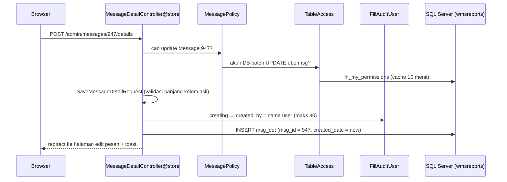

# 8e — Integrasi ERP SQL Server & CRUD Master–Detail

> Tahap: 4 (tambahan) · Dibuat: 2026-11-13 · Status: selesai

## 1. Tujuan

Aplikasi memakai **dua database sekaligus**:

| Koneksi           | Database                       | Isi                                                    |
| ----------------- | ------------------------------ | ------------------------------------------------------ |
| `mysql` (default) | MySQL                          | Data aplikasi: users, roles, permissions, menus, cache |
| `wmsreports`      | SQL Server (ERP / WMS Reports) | Data kritikal milik ERP, mis. `msg` & `msg_det`        |

Dokumen ini menjelaskan cara menyambungkan SQL Server, memeriksanya, dan membuat halaman CRUD
untuk tabel ERP (termasuk pola **master–detail**: satu pesan `msg` punya banyak baris `msg_det`)
lewat CRUD generator ([08d](08d-crud-generator.md)).

## 2. Konsep yang Perlu Dipahami

**Koneksi kedua.** Laravel bisa punya banyak koneksi di `config/database.php`. Model memilih
koneksinya sendiri dengan `protected $connection = 'wmsreports';`. Model lain tetap di MySQL.

**Tidak ada transaksi lintas database.** `DB::transaction()` hanya melindungi SATU koneksi. Proses
yang menulis ke MySQL **dan** SQL Server sekaligus tidak bisa dibatalkan bersama; pisahkan, atau pakai
pola _outbox_ / _idempotency key_ (dibahas di Tahap 5).

**Master–detail.** Tabel induk (header) & tabel anak (detail) yang dihubungkan foreign key:
`msg_det.msg_id → msg.id`. Di Laravel: `Message::details()` (`hasMany`) dan
`MessageDetail::message()` (`belongsTo`).

**Route bertingkat & scoped.** `/admin/messages/{message}/details/{detail}` dengan `->scoped()`:
Laravel memastikan detail itu memang milik pesan di URL. Detail milik pesan lain → **404**.

**Kolom audit.** Tabel ERP memakai `created_by / created_date / updated_by / updated_date`, bukan
`created_at / updated_at`. Waktu diisi Laravel lewat `const CREATED_AT = 'created_date'`, nama user
diisi observer `App\Observers\FillAuditUser`.

**Dua lapis izin.** (1) Permission aplikasi (`messages.update`, diatur di halaman Permissions), dan
(2) izin **akun database** (`GRANT UPDATE ON dbo.msg`). `App\Support\TableAccess` membaca izin akun
lewat `fn_my_permissions`, jadi tombol yang tidak boleh dipakai disembunyikan dan server menjawab
403, bukan error SQL.

## 3. File yang Terlibat

| File                                                                | Peran                                                                  |
| ------------------------------------------------------------------- | ---------------------------------------------------------------------- |
| `C:\wamp64\bin\php\php8.5.0\ext\php_pdo_sqlsrv_85_ts_x64.dll`       | Driver PDO SQL Server 5.13.3 (PHP 8.5, Thread Safe, x64)               |
| `php.ini` & `phpForApache.ini` (WAMP)                               | `extension=pdo_sqlsrv_85_ts_x64`                                       |
| `config/database.php`                                               | Koneksi `wmsreports` (env `WMSREPORTS_DB_*`)                           |
| `config/crud.php`                                                   | `connections` (koneksi yang boleh dipakai generator), `audit_columns`  |
| `app/Console/Commands/CheckSqlServerCommand.php`                    | `php artisan wmsreports:check`                                         |
| `app/Support/TableAccess.php`                                       | Izin akun database per tabel (cache 10 menit)                          |
| `app/Observers/FillAuditUser.php`, `app/Contracts/HasAuditUser.php` | Isi `created_by` / `updated_by` dengan nama user login                 |
| `app/Services/Crud/CrudTableInspector.php`                          | Baca kolom, PK, FK, kolom audit & tabel detail (query SQL Server 2014) |
| `stubs/crud/detail-*.stub`, `details-section.stub`                  | Template master–detail                                                 |
| `tests/Feature/Admin/SqlServerIntegrationTest.php`                  | Uji baca-saja ke SQL Server training (`--group=sqlsrv`)                |

### Hasil generate untuk `msg` + `msg_det`

| File                                                       | Isi                                                                           |
| ---------------------------------------------------------- | ----------------------------------------------------------------------------- |
| `app/Models/Message.php`                                   | `$connection = 'wmsreports'`, `$table = 'msg'`, `CREATED_AT`, `details()`     |
| `app/Models/MessageDetail.php`                             | `$table = 'msg_det'`, `message()` (`belongsTo`)                               |
| `app/Policies/MessagePolicy.php`                           | Permission aplikasi **&&** `TableAccess::allows(...)`                         |
| `app/Http/Controllers/Admin/MessageController.php`         | Daftar, tambah, ubah, hapus (hapus detail + induk dalam transaksi)            |
| `app/Http/Controllers/Admin/MessageDetailController.php`   | Tambah/ubah/hapus detail (route scoped)                                       |
| `resources/js/pages/admin/messages/…`                      | Daftar, tambah, edit (+ bagian **Details**), `details/create`, `details/edit` |
| `resources/js/components/admin/message-detail-section.tsx` | Tabel Details di halaman edit pesan                                           |

## 4. Langkah Pembuatan

### Langkah 1 — Driver SQL Server untuk PHP (sekali saja)

1. Unduh `Windows_5.13.3RTW.zip` dari rilis resmi
   [microsoft/msphpsql](https://github.com/microsoft/msphpsql/releases/tag/v5.13.3).
2. Salin `php_pdo_sqlsrv_85_ts_x64.dll` (PHP **8.5**, **TS** karena WAMP thread-safe, **x64**) ke
   `C:\wamp64\bin\php\php8.5.0\ext\`.
3. Tambahkan `extension=pdo_sqlsrv_85_ts_x64` di **dua** file: `php.ini` (CLI/artisan) dan
   `phpForApache.ini` (Apache).
4. Butuh **Microsoft ODBC Driver 17 atau 18 for SQL Server** (laptop ini sudah punya versi 17).
5. Cek: `php -r "print_r(PDO::getAvailableDrivers());"` → harus ada `sqlsrv`.
6. Restart `composer dev` / Apache.

### Langkah 2 — Isi `.env` (database **training/dev**, bukan production)

```dotenv
WMSREPORTS_DB_HOST=nama-server
WMSREPORTS_DB_PORT=1433
WMSREPORTS_DB_DATABASE=wmsreports_training
WMSREPORTS_DB_USERNAME=...
WMSREPORTS_DB_PASSWORD=...
WMSREPORTS_DB_TRUST_SERVER_CERTIFICATE=true   # sertifikat self-signed (dev)
```

Izin akun yang dibutuhkan (diminta ke DBA), per tabel:

```sql
GRANT SELECT, INSERT, UPDATE, DELETE ON dbo.msg     TO [akun_aplikasi];
GRANT SELECT, INSERT, UPDATE, DELETE ON dbo.msg_det TO [akun_aplikasi];
```

### Langkah 3 — Cek koneksi

```bash
php artisan wmsreports:check --table=msg --table=msg_det
```

Hasil di server training:

```
Connected to "wmsreports" in 0.21 s
Server ............... SQL Server 12.0.6174.8 (Standard Edition (64-bit))
Database ............. wmsreports_training
Login ................ wpc
Database roles ....... db_datareader, db_datawriter
Table msg ............ SELECT, INSERT, UPDATE, DELETE
Table msg_det ........ SELECT, INSERT, UPDATE, DELETE
WARN SQL Server older than 2017: Laravel's Schema::getIndexes()/getForeignKeys() do not work here.
```

### Langkah 4 — Generate dari UI

**Menus → Add menu** → Title `Messages` → nyalakan **Generate CRUD page** →
**Use an existing table** → Database **WMS Reports (SQL Server)** → Table `msg` →
Detail table `msg_det` → **Create menu**.

Atau dari terminal:

```bash
php artisan make:crud Messages --connection=wmsreports --table=msg --detail=msg_det --menu
```

### Langkah 5 — Beri akses

Menu **Messages** awalnya hanya untuk admin. Halaman **Permissions** → modul **Messages** → centang
`messages.view` (dan create/update/delete) untuk role yang perlu.

## 5. Alur Request (simpan detail)



## 6. Cara Mencoba

- **Web:** `/admin/messages` → daftar 927 pesan dari SQL Server (search `whs_code`/`owner_code`,
  sort, pagination). Edit pesan → bagian **Details** di bawah form.
- **Uji yang sudah dijalankan di database training** (data uji dibuat lalu dihapus lagi):
  tambah pesan (`created_by` & `created_date` terisi otomatis), tambah detail (`msg_id` otomatis),
  ubah detail (`updated_date` berubah, `created_date` tetap), detail milik pesan lain → 404,
  hapus pesan → pesan **dan** detailnya terhapus (jumlah kembali 927).
- **Test otomatis:**

```bash
php artisan test --filter=CrudExistingTable      # generator & master–detail (SQLite memori)
php artisan test --filter=AuditUserAndTableAccess
php artisan test --group=sqlsrv                  # baca-saja ke SQL Server training
```

Test bawaan modul ERP (`tests/Feature/Admin/Generated/MessageCrudTest.php`) **sengaja di-skip**:
koneksi `wmsreports` tidak di-reset `RefreshDatabase`, jadi test itu akan menulis data sungguhan.

## 7. Kesalahan Umum & Cara Mengatasinya

| Gejala                                                         | Penyebab                                                        | Solusi                                                                                             |
| -------------------------------------------------------------- | --------------------------------------------------------------- | -------------------------------------------------------------------------------------------------- |
| `could not find driver`                                        | `pdo_sqlsrv` belum dimuat / server belum direstart              | Langkah 1, lalu restart `composer dev` / Apache                                                    |
| `The function 'string_agg' may not have a WITHIN GROUP clause` | Fitur Laravel untuk SQL Server 2017+ dipakai di SQL Server 2014 | Jangan pakai `Schema::getIndexes()/getForeignKeys()` di koneksi ini; generator punya query sendiri |
| `VIEW SERVER STATE permission was denied`                      | Query butuh izin server (mis. `sys.dm_exec_connections`)        | Wajar untuk akun non-admin; jangan pakai query itu                                                 |
| Toast "... failed. Run it manually" saat generate (Windows)    | Proses anak dari `php artisan serve` kehilangan `SystemRoot`    | Sudah ditangani `ProcessCrudPostProcessor::windowsEnv()`; bila masih gagal jalankan manual         |
| Tombol Add/Edit/Delete hilang padahal role punya permission    | Akun database tidak punya INSERT/UPDATE/DELETE pada tabel       | Minta GRANT ke DBA; tunggu cache 10 menit atau `php artisan cache:clear`                           |
| Nama di `created_by` terpotong                                 | Kolom `varchar(30)`                                             | Disengaja: dipotong ke panjang kolom agar INSERT tidak gagal                                       |

## 8. Latihan (opsional)

1. Tampilkan `photo1–5` sebagai link/gambar di halaman edit (`message-form.tsx`).
2. Ganti input `whs_code` menjadi dropdown dari tabel master gudang di SQL Server.
3. Tambahkan audit log di MySQL (siapa mengubah apa di ERP) lewat observer.

## 9. Referensi

- [Laravel: multiple database connections](https://laravel.com/docs/database#using-multiple-database-connections)
- [Eloquent: relationships (hasMany / belongsTo)](https://laravel.com/docs/eloquent-relationships)
- [Routing: scoped resource routes](https://laravel.com/docs/controllers#restful-scoping-resource-routes)
- [Microsoft Drivers for PHP for SQL Server](https://learn.microsoft.com/en-us/sql/connect/php/microsoft-php-driver-for-sql-server)
