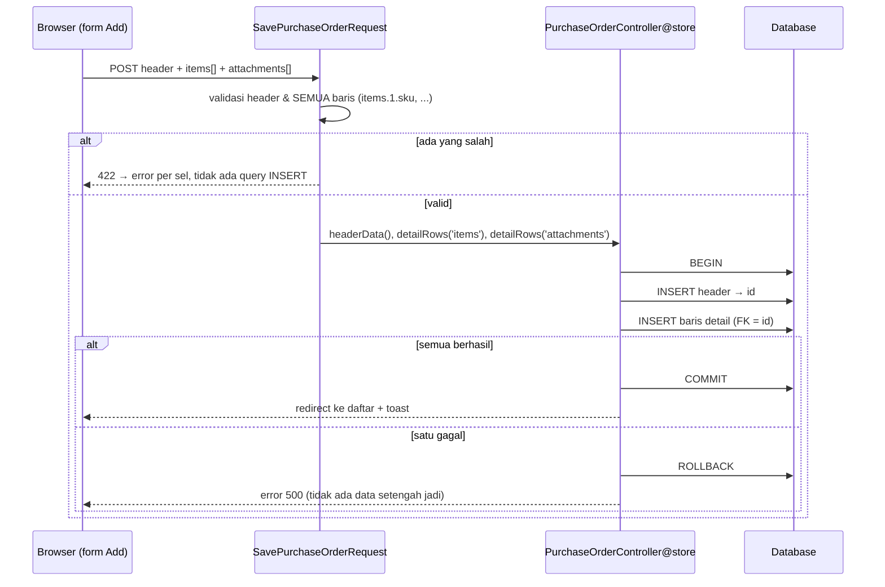

# 8f — CRUD Master–Detail: Banyak Tabel Detail & Simpan dalam Satu Transaksi

> Tahap: 8 · Dibuat: 2026-11-16 · Status: selesai

## 1. Tujuan

Versi pertama CRUD generator ([8e](08e-integrasi-erp-sql-server.md)) hanya mendukung **satu** tabel detail, dan baris detail baru bisa diisi **setelah** header disimpan (lewat halaman Edit). Tahap ini menambahkan dua hal:

1. **Satu header, banyak tabel detail** (maks. 5), mis. `po_hdr` → `po_det` (items) + `po_attach` (attachments).
2. **Form Add berisi baris detail.** Header dan semua baris detail dikirim sekali dan disimpan dalam **satu transaksi database**: berhasil semua atau batal semua.
3. **Tabel detail baru** (tambahan 2026-11-17). Mode **Create a new table** juga bisa mendefinisikan tabel detail, lengkap dengan kolom penghubung dan foreign key, dalam satu migration. Tidak perlu menulis migration sendiri.

Batasannya sengaja **satu tingkat** (header → detail). Detail yang punya sub-detail lagi tidak didukung generator, karena form & validasinya jauh lebih rumit. Buat manual bila benar-benar dibutuhkan.

## 2. Konsep yang Perlu Dipahami

| Istilah                        | Penjelasan singkat                                                                                                                                                                                                        |
| ------------------------------ | ------------------------------------------------------------------------------------------------------------------------------------------------------------------------------------------------------------------------- |
| **Transaksi**                  | Sekumpulan query yang diperlakukan sebagai satu paket. Bila satu gagal → **ROLLBACK**, semua dibatalkan. Bila semua lancar → **COMMIT**. `DB::transaction(fn () => ...)` mengurus keduanya otomatis.                      |
| **IDENTITY / auto-increment**  | `id` header dibuat database saat `INSERT`. Laravel langsung membacanya ke `$header->id`, lalu relasi `$header->items()->create($row)` mengisi foreign key (`po_id`) otomatis. User tidak pernah mengetik id induk.        |
| **Nama detail**                | Nama yang diberikan untuk tiap tabel detail, mis. "items". Dari nama ini diturunkan relasi `items()`, URL `/items`, input form `items[0][sku]`, prop halaman edit `items`, dan model `PurchaseOrderItem`.                 |
| **Scoped route binding**       | `/purchase-orders/{purchase_order}/items/{item}` dengan `->scoped()`. Laravel mencari `{item}` lewat relasi `items()` milik induk di URL, jadi baris milik induk lain → **404**. Nama relasi ditebak dari nama parameter. |
| **Validasi sebelum transaksi** | Semua baris divalidasi dulu (Form Request). Transaksi hanya pengaman untuk kegagalan yang tak bisa diprediksi (koneksi putus, constraint database).                                                                       |

**Contoh rollback.** Header + 2 note + 2 item, item ke-2 melanggar `UNIQUE(sku)`:

```
BEGIN
  INSERT po_hdr            → id 950
  INSERT po_note (po_id 950)
  INSERT po_det  (po_id 950)   ← item 1
  INSERT po_det  (po_id 950)   ← item 2 GAGAL (duplicate)
ROLLBACK                   → header, note & item 1 ikut batal. Nomor 950 tetap "terpakai" (normal untuk IDENTITY).
```

## 3. File yang Terlibat

| File                                                       | Peran                                                                                            |
| ---------------------------------------------------------- | ------------------------------------------------------------------------------------------------ |
| `app/Services/Crud/CrudBlueprint.php`                      | `details` (daftar blueprint detail), `detailKey` + nama turunan (`relation()`, `detailParam()`…) |
| `app/Services/Crud/CrudGenerator.php`                      | `blueprintForTable(..., $details)`, `detailKey()`, `parseDetailSpec()`, `detailProblem()`        |
| `app/Services/Crud/CrudInput.php`                          | Validasi `details[]` = `[{table, name?}]` dari form "Add menu" & terminal                        |
| `app/Services/Crud/CrudRenderer.php`                       | `masterDetailVars()`: penanda stub induk; `rowColumn()`: kolom tabel isian baris                 |
| `stubs/crud/detail-rows.stub`                              | **Baru.** Tabel isian baris detail di form Add induk                                             |
| `stubs/crud/request.stub`, `detail-request.stub`           | Aturan baris `items.*.kolom` (hanya saat tambah) diambil dari `fieldRules()` request detail      |
| `stubs/crud/controller.stub`                               | `store()` dalam transaksi; `create()` mengirim `maxDetails`                                      |
| `stubs/crud/detail-*.stub`, `details-section.stub`         | Nama route/variabel/judul mengikuti nama detail (bukan lagi selalu "details")                    |
| `resources/js/components/admin/existing-table-picker.tsx`  | Form "Add menu": centang beberapa tabel detail + nama masing-masing                              |
| `tests/Feature/Admin/CrudExistingTableTest.php`            | Test multi-detail, validasi nama, terminal                                                       |
| `CrudBlueprint::fromInput(..., $details)`                  | Mode tabel baru: detail baru `[{name, fields[]}]` → tabel `<induk>_<nama>` + `foreignKeyName()`  |
| `CrudInput::newDetailSpecs()`, `newDetailRules()`          | Validasi detail baru: nama wajib, kolom per detail, kolom penghubung tidak boleh diketik         |
| `stubs/crud/migration.stub`                                | `{{ detailTables }}` / `{{ detailDrops }}`: tabel detail baru + foreign key, drop terbalik       |
| `stubs/crud/test.stub`                                     | `{{ detailTest }}`: test simpan header + satu baris tiap detail                                  |
| `resources/js/components/admin/crud-fields-editor.tsx`     | **Baru.** Editor kolom, dipakai tabel header & tiap tabel detail baru                            |
| `resources/js/components/admin/crud-generator-section.tsx` | `NewDetailTables`: tombol _Add detail table_ di mode "Create a new table"                        |
| `tests/Feature/Admin/CrudGeneratorTest.php`                | Test tabel baru + detail baru (file, migration, validasi, terminal)                              |

## 4. Langkah Pemakaian

Ada dua cara, sesuai mode **Database table** di form Add menu:

| Mode                      | Kapan dipakai                                                    | Tabel dibuat oleh                                      |
| ------------------------- | ---------------------------------------------------------------- | ------------------------------------------------------ |
| **Create a new table**    | Tabel header & detail **belum ada**. Paling mudah.               | Generator (satu migration untuk header + semua detail) |
| **Use an existing table** | Tabel sudah ada, mis. tabel ERP `msg` + `msg_det` di SQL Server. | Anda / sistem lain (generator tidak membuat migration) |

### Cara A: Tabel baru ("Create a new table")

**Dari dashboard:**

1. **Menus → Add menu**, isi **Title** (mis. _Purchase orders_), lalu nyalakan **Generate CRUD page**.
2. **Database:** pilih koneksi tujuan (bawaan: database aplikasi).
3. **Database table:** biarkan **Create a new table**, lalu isi **Fields** untuk tabel header (mis. `po_no`, `order_date`).
4. Di bagian **Detail tables**, klik **Add detail table** (maks. 5). Untuk tiap detail:
    - isi **Detail name**, mis. `items` (wajib);
    - isi kolomnya, mis. `sku`, `qty`. Kolom penghubung **tidak perlu** ditulis.
5. Klik **Create menu**.

**Dari terminal:** `--detail=<nama>`, dan kolom detail ditulis `<nama>.<kolom>:<tipe>`:

```bash
php artisan make:crud "Purchase orders" \
    --field=po_no:string(30):required --field=order_date:date:required \
    --detail=items --field=items.sku:string(30):required --field=items.qty:integer:required \
    --detail=notes --field=notes.body:text:required --menu
```

**Yang dibuat otomatis:** satu migration berisi tabel header lalu tabel detail. Tiap tabel detail diberi kolom penghubung dengan foreign key ke header. `down()` men-drop tabel detail dulu, baru header.

```php
Schema::create('purchase_orders', ...);                                  // header
Schema::create('purchase_order_items', function (Blueprint $table) {     // detail "items"
    $table->id();
    $table->foreignId('purchase_order_id')->constrained('purchase_orders'); // otomatis
    $table->string('sku', 30);
    $table->integer('qty');
    $table->timestamps();
});
```

| Nama detail | Tabel                  | Kolom penghubung    | Model               | URL                                     |
| ----------- | ---------------------- | ------------------- | ------------------- | --------------------------------------- |
| `items`     | `purchase_order_items` | `purchase_order_id` | `PurchaseOrderItem` | `/admin/purchase-orders/{id}/items/...` |
| `notes`     | `purchase_order_notes` | `purchase_order_id` | `PurchaseOrderNote` | `/admin/purchase-orders/{id}/notes/...` |

Test hasil generate (`tests/Feature/Admin/Generated/PurchaseOrderCrudTest.php`) juga berisi test "tambah beserta baris items & notes dalam satu simpan".

Saat modul dihapus dengan centang **drop table**, semua tabel (detail lalu header) ikut di-drop lewat `down()` migration tersebut.

### Cara B: Tabel yang sudah ada ("Use an existing table")

Generator mengenali tabel detail dari **foreign key** yang sudah ada di database, jadi tabel header & detail harus ada **lebih dulu**.

#### Langkah 1: Siapkan tabel header & detail

Bila tabelnya sudah ada (mis. `msg` + `msg_det` di SQL Server ERP), lewati langkah ini. Pastikan saja tabel detail punya **constraint foreign key** ke header. Kolom `po_id` tanpa constraint tidak cukup.

Bila belum ada, buat lewat migration (contoh untuk database aplikasi):

```bash
php artisan make:migration create_purchase_order_tables
```

```php
public function up(): void
{
    Schema::create('purchase_orders', function (Blueprint $table) {      // HEADER
        $table->id();
        $table->string('po_no', 30);
        $table->date('order_date');
        $table->timestamps();
    });

    Schema::create('purchase_order_items', function (Blueprint $table) { // DETAIL 1
        $table->id();
        $table->foreignId('purchase_order_id')->constrained();           // ← foreign key wajib
        $table->string('sku', 30);
        $table->integer('qty');
        $table->timestamps();
    });

    Schema::create('purchase_order_notes', function (Blueprint $table) { // DETAIL 2 (opsional)
        $table->id();
        $table->foreignId('purchase_order_id')->constrained();
        $table->string('body');
        $table->timestamps();
    });
}
```

```bash
php artisan migrate
```

#### Langkah 2a: Generate dari dashboard

1. **Menus → Add menu**, isi **Title** (mis. _Purchase orders_), lalu nyalakan **Generate CRUD page**.
2. **Database:** pilih koneksi tempat tabel dibuat.
3. **Database table:** klik **Use an existing table**.
4. **Table:** pilih tabel **header** (`purchase_orders`).
5. Bagian **Detail tables** muncul di bawah daftar kolom. Centang tabel detail (`purchase_order_items`, `purchase_order_notes`, maks. 5) dan isi **Detail name** bila perlu (mis. `items`, `notes`).
6. Klik **Create menu**.

#### Langkah 2b: Generate dari terminal

```bash
# Satu detail (seperti sebelumnya): nama default "details"
php artisan make:crud Messages --connection=wmsreports --table=msg --detail=msg_det --menu

# Beberapa detail, masing-masing diberi nama (tabel:nama)
php artisan make:crud "Purchase orders" --table=po_hdr \
    --detail=po_det:items --detail=po_attach:attachments --menu
```

Tanpa nama: satu detail → `details`; lebih dari satu → dari nama tabel (`po_attach` → `po_attaches`). Disarankan selalu memberi nama yang jelas.

### Hasil generate (contoh "Purchase orders" + items + attachments)

| Bagian           | Isi                                                                                                                          |
| ---------------- | ---------------------------------------------------------------------------------------------------------------------------- |
| Model induk      | `items(): HasMany`, `attachments(): HasMany`                                                                                 |
| Model detail     | `PurchaseOrderItem`, `PurchaseOrderAttachment` (+ `belongsTo` ke induk)                                                      |
| Halaman **Add**  | Form header + tabel isian **Items** & **Attachments** (tombol _Add row_, hapus baris). Semua tersimpan dalam satu transaksi. |
| Halaman **Edit** | Form header + bagian **Items** & **Attachments** (daftar, tambah/ubah/hapus per baris)                                       |
| Route            | `purchase-orders.items`, `purchase-orders.attachments` (bertingkat & scoped)                                                 |
| Hapus header     | Semua baris items & attachments lalu header, dalam satu transaksi                                                            |

Potongan `store()` hasil generate:

```php
DB::connection()->transaction(function () use ($request) {
    $purchaseOrder = PurchaseOrder::create($request->headerData());

    foreach ($request->detailRows('items') as $row) {
        $purchaseOrder->items()->create($row);      // po_det.po_id otomatis
    }

    foreach ($request->detailRows('attachments') as $row) {
        $purchaseOrder->attachments()->create($row);
    }
});
```

Aturan validasi kolom detail hanya ditulis **sekali**, di `SavePurchaseOrderItemRequest::fieldRules()`. Request induk memakainya untuk `items.*.kolom`, request detail memakainya untuk form tambah/ubah satu baris.

## 5. Alur Request (Add + baris detail)



## 6. Cara Mencoba

- Generate dari tabel yang punya 2+ tabel detail, buka `/admin/<slug>/create`, tambah beberapa baris, simpan.
- Isi satu sel salah (mis. kolom wajib kosong) → error muncul tepat di bawah sel itu; header belum tersimpan.
- Test: `php artisan test --filter=CrudExistingTable`

Saat dibuat, modul contoh (`demo_po` + `demo_po_item` + `demo_po_note`) diuji end-to-end di MySQL: simpan header + baris, error per sel, rollback saat `UNIQUE` dilanggar di baris ke-2, scoped 404, hapus induk + semua detail. Lalu dihapus lagi dengan `crud:remove`.

## 7. Kesalahan Umum & Cara Mengatasinya

| Gejala                                                         | Penyebab                                                                                         | Solusi                                                                                      |
| -------------------------------------------------------------- | ------------------------------------------------------------------------------------------------ | ------------------------------------------------------------------------------------------- |
| `The detail name "x" is used twice`                            | Dua tabel detail menghasilkan nama yang sama (mis. "line" & "lines")                             | Beri nama berbeda                                                                           |
| `"abilities" is a reserved name`                               | Nama bentrok dengan props halaman edit / method Eloquent                                         | Pilih nama lain                                                                             |
| `This table has no foreign key to the chosen table.`           | Tabel detail tidak punya FK ke header                                                            | Tambahkan foreign key di database, atau jangan pilih tabel itu                              |
| `"purchase_order_id" is added automatically`                   | Kolom penghubung diketik sendiri di detail baru                                                  | Hapus kolom itu; migration membuatnya otomatis                                              |
| `A database table named "..._items" already exists`            | Tabel detail baru bentrok dengan tabel yang sudah ada                                            | Pilih nama detail lain, atau pakai mode **Use an existing table**                           |
| Tabel detail tidak muncul di daftar **Detail tables**          | Tidak ada constraint FK, tabel sudah pernah di-generate, atau tabel aplikasi (`users`, `menus`…) | Tambahkan FK; hapus modul lama dengan `crud:remove`; tabel aplikasi memang tidak ditawarkan |
| Baris detail kosong ikut terkirim & gagal validasi             | Baris ditambah tetapi tidak diisi                                                                | Hapus baris (ikon tempat sampah) sebelum simpan                                             |
| Test buatan sendiri: `SAVEPOINT trans2 does not exist`         | `Schema::create` di dalam test MySQL = implicit commit transaksi test                            | Buat tabel lewat migration, bukan di dalam test                                             |
| Modul lama (dibuat sebelum tahap ini) tidak punya baris di Add | Generator tidak mengubah file yang sudah dibuat                                                  | Tambahkan manual (contoh: modul Messages), atau hapus & generate ulang                      |

## 8. Latihan (opsional)

1. Generate header dengan dua detail, lalu sengaja buat kolom detail `UNIQUE`. Isi dua baris dengan nilai sama dan pastikan header tidak ikut tersimpan.
2. Ubah `MAX_DETAILS` di request induk menjadi 3 dan lihat tombol _Add row_ berhenti di baris ke-3.

## 9. Referensi

- Database transactions: https://laravel.com/docs/database#database-transactions
- Validasi array: https://laravel.com/docs/validation#validating-arrays
- Scoped resource routes: https://laravel.com/docs/controllers#restful-scoping-resource-routes
