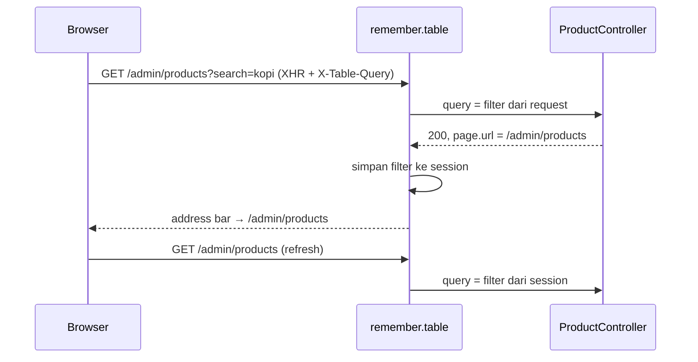

# 08g — URL Admin Bersih: Filter di Session & ULID

> Tahap: 8 · Dibuat: 2026-11-19 · Status:
> - **ULID**: Products, Users, Roles, Menus, Categories
> - **Filter di session**: Products
> - **CRUD generator**: ULID opsional & dinamis (2026-11-20), lihat [Langkah 3](#langkah-3--ulid-di-modul-crud-generator)

| Modul | URL edit |
| --- | --- |
| Products | `/admin/products/{ulid}/edit` |
| Users | `/admin/users/{ulid}/edit` (+ `/admin/users/{ulid}/logout-devices`) |
| Roles | `/admin/roles/{ulid}/edit` (+ `/admin/roles/{ulid}/permissions`) |
| Menus | `/admin/menus/{ulid}/edit` (+ `/admin/menus/{ulid}/visibility`, "Add submenu" = `?parent={ulid}`) |
| Categories | `/admin/categories/{ulid}/edit` (API `/api/v1/categories/{id}` tetap memakai id) |

**Role:** model `App\Models\Role` (turunan Spatie) didaftarkan di `config/permission.php`. Selalu import `App\Models\Role`. Kalau memakai `Spatie\Permission\Models\Role::create()` langsung, kolom `ulid` tidak terisi dan insert gagal.

**Model:** cukup `use HasPublicUlid;` (`app/Models/Concerns/HasPublicUlid.php`). Kolom dibuat oleh migration `2026_11_19_000002_add_ulid_to_admin_tables.php`.

## 1. Tujuan

Address bar halaman admin tidak lagi menampilkan detail filter dan id berurutan:

| Sebelum | Sesudah |
| --- | --- |
| `/admin/products?per_page=25&sort=-created_at&search=kopi` | `/admin/products` |
| `/admin/products/153/edit` | `/admin/products/01jd8q3x7k2m9vz4p6r8t0w2yb/edit` |

Dengan begitu, riwayat browser, screenshot, dan link yang dibagikan tidak lagi memperlihatkan isi pencarian atau jumlah data. Id berurutan juga tidak bisa ditebak dengan menambah satu.

## 2. Konsep yang Perlu Dipahami

### Yang disembunyikan adalah address bar, bukan request

Filter tetap dikirim ke server lewat request XHR Inertia. User yang sedang login masih bisa melihatnya di DevTools → Network, dan memang harus begitu karena server perlu datanya. Itu aman, sebab hak akses tetap diperiksa server lewat `can:products.view` dan `ProductPolicy`. **Menyembunyikan URL bukan pengganti otorisasi.**

### Bagaimana address bar bisa bersih?

Inertia menulis ke address bar **URL yang dikirim server di response** (`page.url`), bukan URL request. Middleware `remember.table` mengganti `page.url` menjadi path saja.

### Kenapa ULID, bukan Hashids?

| | Hashids | ULID |
| --- | --- | --- |
| Sifat | Encoding id, bisa dibalik jika salt diketahui | Acak, tidak berhubungan dengan id |
| Perlu kolom baru | Tidak | Ya (`ulid`, `CHAR(26)`, unique) |
| Link permanen | Ya | Ya |

Primary key dan foreign key **tetap `id`** (integer, cepat untuk JOIN). ULID hanya dipakai untuk URL admin.

## 3. File yang Terlibat

| File | Peran |
| --- | --- |
| `app/Http/Middleware/RememberTableQuery.php` | Menyimpan dan memulihkan filter di session. Mengganti URL halaman menjadi path saja. Membuat link halaman hanya berisi `?page=N` |
| `bootstrap/app.php` | Alias middleware `remember.table` |
| `routes/admin.php` | `->middlewareFor('index', 'remember.table')` dan `->scoped(['product' => 'ulid'])` |
| `resources/js/hooks/use-table-query.ts` | Mengirim header `X-Table-Query: 1` setiap filter berubah |
| `database/migrations/2026_11_19_000001_add_ulid_to_products_table.php` | Menambah kolom `ulid` dan mengisi baris lama |
| `app/Models/Product.php` | `HasUlids` + `uniqueIds(): ['ulid']`, sehingga ULID terisi otomatis saat dibuat |
| `app/Http/Resources/V1/ProductResource.php` | Mengirim field `ulid` |
| `resources/js/pages/admin/products/*.tsx` | Link Edit, Update, dan Delete memakai `product.ulid` |
| `tests/Feature/Admin/CleanUrlTest.php` | Test kedua fitur |

## 4. Langkah Pembuatan (untuk modul lain)

### Langkah 1 — Filter di session

Di route, pasang middleware pada `index` saja:

```php
Route::resource('categories', CategoryController::class)
    ->except('show')
    ->middlewareFor('index', 'remember.table');
```

Halaman React tidak perlu diubah selama memakai `useTableQuery`, karena header sudah dikirim dari hook tersebut.

Aturan middleware:

| Request | Filter yang dipakai |
| --- | --- |
| Ada header `X-Table-Query` (filter diubah di UI, termasuk saat dikosongkan) | Dari query → disimpan |
| Ada `search`/`filter`/`sort`/`per_page` di query (bookmark lama) | Dari query → disimpan |
| Hanya `?page=N` (klik nomor halaman) | Filter dari session, halaman dari query |
| Tanpa query (refresh, menu sidebar, redirect setelah simpan/hapus) | Semua dari session |

Filter **hanya disimpan setelah response sukses**, artinya sudah lolos validasi Form Request. Kalau filter di session sudah tidak valid lagi (mis. whitelist sort berubah), filter itu dilupakan agar tidak terjadi redirect berulang.

### Langkah 2 — ULID

```bash
php artisan make:migration add_ulid_to_categories_table
```

Salin pola dari migration products: tambah kolom `nullable`, isi baris lama dengan `Str::lower((string) Str::ulid())`, lalu ubah menjadi `NOT NULL` + `unique`.

Model:

```php
use App\Models\Concerns\HasPublicUlid;

use HasPublicUlid; // HasUlids + uniqueIds() = ['ulid']; primary key tetap "id"
```

Route: `->scoped(['category' => 'ulid'])`. Resource: tambahkan `'ulid' => $this->ulid`. Jika query memakai `select([...])`, tambahkan `'ulid'`. Di React, ganti `x.id` menjadi `x.ulid` pada link Edit, Update, dan Delete.

Jalankan `php artisan migrate` dan `php artisan wayfinder:generate --with-form`. `npm run build` juga menjalankan Wayfinder.

### Langkah 3 — ULID di modul CRUD generator

Modul hasil generator **mendeteksi kolom `ulid` saat runtime**. Kode modul sama persis dengan atau tanpa ULID:

| Bagian | Isi |
| --- | --- |
| Model | `use HasOptionalPublicUlid;` → `getRouteKeyName()` = `ulid` bila tabel punya kolomnya, selain itu `id`. ULID diisi otomatis saat create |
| Route | Tanpa `->scoped([...])`: route model binding memakai `getRouteKeyName()` |
| React | `Controller.edit(routeKey(item))` (`resources/js/lib/route-key.ts`): `item.ulid ?? item.id` |
| Test | `"/admin/x/{$item->getRouteKey()}/edit"` |

**Saat generate (tabel baru):** toggle **ULID in URLs** (default aktif, atau `make:crud ... --ulid`) menambah `$table->ulid()->unique()` di migration induk & detail.

**Lupa, atau tabel sudah ada:**

```bash
php artisan make:ulid-migration kwitansis
php artisan make:ulid-migration supplier --connection=wmsreports   # tabel di database lain
php artisan migrate
```

Migration yang dibuat: tambah kolom `nullable` → isi semua baris lama dengan `Str::lower(Str::ulid())` → `NOT NULL` + `unique`. Aman dijalankan ulang (dilewati bila tabel tidak ada / kolom sudah ada). Setelah `migrate`, URL modul langsung berganti ke ULID; Wayfinder (Vite dev atau `wayfinder:generate`) memperbarui tipe parameternya menjadi `string`.

Catatan:
- `ulid` tidak bisa dipakai sebagai nama field, dan dilewati saat membaca tabel yang sudah ada.
- `routeKey()` sengaja bertipe `never` agar cocok dengan tipe Wayfinder `string` (ulid) maupun `number` (id).
- Hasil cek kolom disimpan per proses PHP. Worker yang berjalan lama (queue, Octane) perlu di-restart setelah menambah kolom.
- Menghapus modul dengan **drop table** juga menghapus migration `add_ulid_to_<tabel>` miliknya.
- Modul generator lama (sebelum 2026-11-20) masih memakai `item.id`. Tambahkan trait & `routeKey()` secara manual, atau hapus lalu generate ulang.

## 5. Alur Request



## 6. Cara Mencoba

- Buka `/admin/products`, cari "kopi", lalu ubah sort dan rows per page. Address bar tetap `/admin/products`.
- Tekan F5: filter tetap terpasang. Klik **Reset** untuk mengosongkan.
- Klik **Edit**: URL berisi ULID. Mengetik `/admin/products/1/edit` → 404.
- API tidak berubah: `/api/v1/products/{id}` tetap memakai id, ditambah field `ulid`.
- Test: `php artisan test --filter=CleanUrlTest`

## 7. Kesalahan Umum & Cara Mengatasinya

| Gejala | Penyebab | Solusi |
| --- | --- | --- |
| Filter kembali lagi setelah dikosongkan | Request tidak membawa header `X-Table-Query` | Pakai `useTableQuery`, atau kirim `headers: { 'X-Table-Query': '1' }` |
| Selalu kembali ke halaman 2 atau lebih | Halaman juga diingat | Mengubah filter otomatis kembali ke halaman 1 |
| Error TypeScript `edit(product.id)` | Wayfinder sekarang meminta `ulid` | Ganti dengan `product.ulid` |
| `ulid` bernilai `undefined` di tabel | Kolom tidak ikut di `select([...])` | Tambahkan `'ulid'` |
| Migration gagal di NOT NULL | Ada baris yang belum terisi ULID | Pastikan langkah pengisian berjalan sebelum `->change()` |

## 8. Latihan

Pasang `remember.table` di halaman daftar **Categories** atau **Users** (ULID-nya sudah terpasang).

## 9. Referensi

- Laravel — Unique IDs (ULID): https://laravel.com/docs/eloquent#uuid-and-ulid-keys
- Laravel — Route model binding dengan kolom kustom: https://laravel.com/docs/routing#customizing-the-key
- Inertia — Manual visits & headers: https://inertiajs.com/manual-visits
