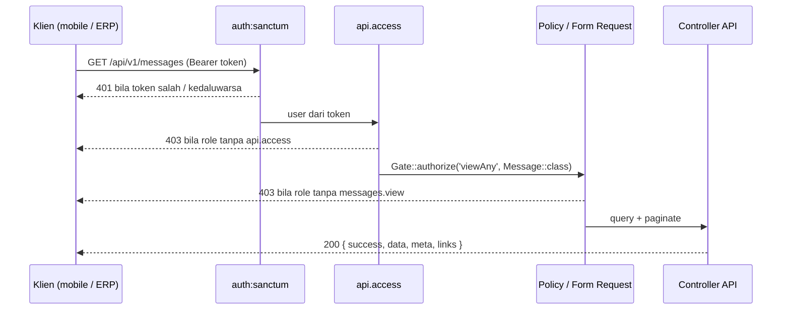

# 8h — Generator REST API & RBAC API

> Tahap: 4 (tambahan) · Dibuat: 2026-11-24 · Status: Fase 1 selesai (Fase 2: API Clients & batasan token — belum)

## 1. Tujuan

1. **RBAC untuk REST API** yang diatur dari halaman **Permissions** yang sudah ada. Tidak ada permission API
   terpisah: endpoint memakai permission modul yang **sama** dengan halaman web, ditambah satu permission
   `api.access` per role sebagai "pintu masuk".
2. **Generator REST API**:
    - CRUD baru + API sekaligus (`--api`, atau toggle **Also generate REST API** di form menu);
    - **API saja** untuk modul baru (`--api-only`), tanpa halaman admin;
    - API untuk modul yang **sudah** di-generate (`php artisan crud:api <tabel>`).
3. Semua endpoint katalog (`categories`, `products`) **wajib token**.

## 2. Konsep yang Perlu Dipahami

### Tiga lapis RBAC API

```
Request + Bearer token
   │
   ├─ 1. auth:sanctum            token valid?                         → 401
   ├─ 2. api.access              role boleh memakai API?              → 403 "Your role is not allowed to use the API."
   └─ 3. Policy / Form Request   role punya izin modul (messages.view)? → 403
```

Lapis 2 dan 3 diatur di **Admin → Permissions**. Admin selalu lolos (`Gate::before`).

| Keputusan                                      | Alasan                                                                                     |
| ---------------------------------------------- | ------------------------------------------------------------------------------------------ |
| Satu set permission untuk Web **dan** API      | Matriks tidak menjadi dua kali lipat; admin tidak bingung mana yang berlaku                |
| `api.access` per role                          | Bisa membedakan "boleh login web" dengan "boleh memakai API" tanpa menggandakan permission |
| Pemetaan endpoint → permission ada di **kode** | Lewat Policy (konvensi resource), mudah dites. Tidak disimpan di database                  |
| Katalog wajib token                            | Data tidak terbuka untuk umum; aplikasi mobile tetap bisa membaca dengan token customer    |
| Modul buatan tangan **tidak** dibuatkan API    | API hasil generate akan melewati Action/Service (slug, stok, aturan hapus)                 |

### Konvensi endpoint → permission

| Method & URL                     | Controller | Permission       |
| -------------------------------- | ---------- | ---------------- |
| `GET /api/v1/<modul>`            | `index`    | `<modul>.view`   |
| `GET /api/v1/<modul>/{id}`       | `show`     | `<modul>.view`   |
| `POST /api/v1/<modul>`           | `store`    | `<modul>.create` |
| `PUT/PATCH /api/v1/<modul>/{id}` | `update`   | `<modul>.update` |
| `DELETE /api/v1/<modul>/{id}`    | `destroy`  | `<modul>.delete` |

Halaman Permissions menampilkan endpoint ini di bawah setiap permission (`API: GET /messages …`). Daftar itu
**dibaca dari route** (`AccessService::apiEndpoints()`), bukan ditulis manual. Endpoint yang cukup dengan
`api.access` (profil sendiri, membaca katalog) dicantumkan di baris **REST API → api.access**.

### Role yang sudah ada tidak terputus

Migration `2026_11_24_000001_grant_api_access_to_existing_roles` memberi `api.access` ke **semua role yang ada**,
karena sistem lain sudah memanggil API. Cabut per role di halaman Permissions bila tidak perlu. Untuk database
baru, nilai awalnya dari `RolePermissionSeeder`: staff & customer mendapat `api.access`.

### Manifest: API untuk modul lama tanpa bertanya ulang

Generator mencatat setiap modul di `storage/app/crud/<tabel>.json` (field, tabel asli, koneksi, detail).
`crud:api` membaca catatan itu (`CrudBlueprint::fromManifest()`) lalu hanya membuat file API. Model, Policy,
Request & permission yang sudah ada **dipakai ulang**, jadi aturan izin & validasi Web dan API selalu sama.

Kunci baru di manifest:

| Kunci       | Isi                                                             |
| ----------- | --------------------------------------------------------------- |
| `web`       | `false` untuk modul "API saja" (tanpa halaman admin)            |
| `api`       | `true` bila REST API-nya sudah dibuat                           |
| `api_url`   | mis. `/api/v1/messages`                                         |
| `api_files` | file API (dipakai `crud:api --remove` untuk menghapus API saja) |

## 3. File yang Terlibat

| File                                                                           | Peran                                                                     |
| ------------------------------------------------------------------------------ | ------------------------------------------------------------------------- |
| `app/Enums/PermissionName.php`                                                 | Permission baru `api.access` (grup **REST API**)                          |
| `database/migrations/2026_11_24_000001_grant_api_access_to_existing_roles.php` | Beri `api.access` ke semua role yang sudah ada                            |
| `database/seeders/RolePermissionSeeder.php`                                    | Nilai awal: staff & customer mendapat `api.access`                        |
| `app/Http/Middleware/EnsureApiAccess.php`                                      | Lapis 2: alias `api.access`                                               |
| `app/Actions/Auth/IssueApiTokenAction.php`                                     | Login API ditolak 403 bila role tanpa `api.access`                        |
| `routes/api/v1.php`                                                            | Grup `auth:sanctum` + `api.access`; katalog wajib token                   |
| `routes/api/generated.php`                                                     | Route API hasil generator (penanda `// @crud:api-routes`)                 |
| `app/Http/Controllers/Api/V1/ProductController.php`                            | GET tidak lagi publik                                                     |
| `stubs/crud/api-controller.stub`, `api-resource.stub`, `api-test.stub`         | Template file API                                                         |
| `app/Services/Crud/CrudRenderer.php`                                           | `apiFiles()`, `apiRoutes()`, mode `files(..., web: false)`                |
| `app/Services/Crud/CrudGenerator.php`                                          | `generate($bp, web, api)`, `addApi()`, `removeApi()`, `modules()`         |
| `app/Services/Crud/CrudBlueprint.php`, `CrudField.php`                         | `fromManifest()`                                                          |
| `app/Console/Commands/MakeCrudCommand.php`                                     | Opsi `--api` & `--api-only`                                               |
| `app/Console/Commands/CrudApiCommand.php`                                      | `php artisan crud:api [tabel] [--remove]`                                 |
| `app/Services/Access/AccessService.php`                                        | `apiEndpoints()`: endpoint per permission untuk matriks                   |
| `resources/js/components/admin/crud-generator-section.tsx`                     | Toggle **Also generate REST API** di form menu                            |
| `resources/js/pages/admin/permissions/index.tsx`                               | Baris `API: …` di setiap permission (ikut dicari)                         |
| `app/Http/Controllers/Admin/ApiGeneratorController.php`                        | Halaman **API Generator**: daftar modul, tambah/hapus API, API dari tabel |
| `app/Http/Requests/Admin/GenerateApiRequest.php`                               | Validasi "New API from an existing table" (aturan CrudInput, tabel wajib) |
| `resources/js/pages/admin/api-generator/index.tsx`                             | Halaman API Generator                                                     |
| `database/migrations/2026_11_24_000002_add_api_generator_menu.php`             | Menu sidebar Administration → API Generator (database yang sudah ada)     |
| `tests/Feature/Admin/ApiGeneratorPageTest.php`                                 | Test halaman API Generator                                                |
| `tests/Feature/Api/V1/ApiAccessTest.php`                                       | Test lapis `api.access`                                                   |
| `tests/Feature/Admin/CrudApiGeneratorTest.php`                                 | Test generator API (folder sementara)                                     |

### Yang dibuat untuk nama "Suppliers" + `--api`

| File                                                 | Isi                                                                             |
| ---------------------------------------------------- | ------------------------------------------------------------------------------- |
| `app/Http/Controllers/Api/V1/SupplierController.php` | index (search, sort, per_page ≤ 100), show, store, update, destroy              |
| `app/Http/Resources/V1/SupplierResource.php`         | Kolom yang dikirim ke klien (kolom baru di tabel **tidak** otomatis bocor)      |
| `tests/Feature/Api/Generated/SupplierApiTest.php`    | 401 tanpa token, 403 tanpa permission, izin dari matriks, CRUD, 422 field wajib |
| `routes/api/generated.php` (blok `crud:suppliers`)   | `Route::apiResource('suppliers', …)`                                            |

Dengan `--api-only`: Model, Factory, Policy, Request & permission tetap dibuat; controller admin, halaman React,
form, route web & menu **tidak**.

## 4. Langkah Pembuatan (cara kerja di balik layar)

### Langkah 1 — Middleware `api.access`

```php
// app/Http/Middleware/EnsureApiAccess.php
if ($user instanceof User && ! $user->can(PermissionName::ApiAccess)) {
    abort(403, 'Your role is not allowed to use the API.');
}
```

Didaftarkan sebagai alias di `bootstrap/app.php`, lalu dipasang di grup route:

```php
Route::middleware(['auth:sanctum', 'api.access'])->group(function () {
    Route::apiResource('categories', CategoryController::class);
    Route::apiResource('products', ProductController::class);
    require __DIR__.'/generated.php';   // endpoint hasil generator
});
```

`logout` & `logout-all` sengaja **di luar** `api.access`, agar pemilik token tetap bisa membuang tokennya setelah
izinnya dicabut.

### Langkah 2 — Controller API hasil generate memakai Policy di SEMUA endpoint

```php
public function index(Request $request): JsonResponse
{
    Gate::authorize('viewAny', Supplier::class);        // suppliers.view
    ...
}

public function store(SaveSupplierRequest $request): JsonResponse   // authorize() → suppliers.create
{
    $supplier = Supplier::create($request->validated());

    return ApiResponse::created(SupplierResource::make($supplier), 'Supplier created.');
}
```

GET juga dijaga Policy, jadi modul baru **tidak** pernah terbuka tanpa izin. Response memakai format standar
`ApiResponse` (lihat 05), error memakai `ApiExceptionRenderer` (422 `VALIDATION_ERROR`, 403 `FORBIDDEN`, dst.).

### Langkah 3 — Master–detail dalam satu request

Untuk modul dengan tabel detail (8e/8f), API menerima header + baris detail sekaligus, disimpan dalam **satu
transaksi** (sama seperti form tambah di web):

```json
POST /api/v1/purchase-orders
{
  "po_no": "PO-001",
  "items": [ { "sku": "KOP-001", "qty": 2 }, { "sku": "TEH-001", "qty": 1 } ]
}
```

`show`, hasil `store` & `update` menyertakan detailnya (`"items": [...]`). `update` hanya mengubah header.
Mengubah satu baris detail lewat API (endpoint bertingkat) belum dibuat; lihat Latihan.

### Langkah 4 — Matriks Permissions membaca route

`AccessService::apiEndpoints()` membaca semua route `api/v1/*` yang memakai middleware `api.access`, lalu
memetakan method controller (`index/show/store/update/destroy`) ke permission modul. Endpoint baru hasil
generator otomatis tampil di matriks tanpa kode tambahan.

## 5. Alur Request



## 6. Cara Mencoba

```bash
php artisan migrate        # api.access untuk role yang sudah ada

# Modul baru: halaman admin + API
php artisan make:crud Suppliers --field=name:string:required --field=phone:string --api --menu

# Modul baru: API saja (mis. tabel ERP)
php artisan make:crud Vendors --connection=wmsreports --table=vendor --api-only

# Modul yang sudah ada
php artisan crud:api                    # daftar modul & status API-nya
php artisan crud:api kwitansis          # buat /api/v1/kwitansis
php artisan crud:api kwitansis --remove # hapus API saja (halaman admin tetap)
```

Dari UI:

- Modul **baru** + API: **Menus → Add menu → Generate CRUD page → Also generate REST API**.
- **Administration → API Generator** (halaman khusus, untuk banyak tabel dari project lama):
    - **Generated modules**: semua modul hasil generator + status API-nya. Tombol **Generate API** /
      **Remove API** (= `crud:api`). Modul "API saja" punya tombol **Remove module** (tabel tidak pernah di-drop).
    - **New API from an existing table**: pilih Database (MySQL / SQL Server), tabel, kolom & tabel detail
      → **Generate REST API** (= `make:crud … --table=… --api-only`).
    - Butuh izin `menus.create` dan hanya aktif di development. Di production halaman hanya menampilkan
      pemberitahuan.

Mengatur akses: **Permissions** → buka modul (mis. Suppliers) → centang `View` untuk role `staff`. Baris
`API: GET /suppliers …` menunjukkan endpoint yang ikut terbuka.

```bash
curl -X POST http://localhost:8000/api/v1/auth/login -H "Content-Type: application/json" \
     -d '{"email":"staff@example.com","password":"password","device_name":"postman"}'

curl http://localhost:8000/api/v1/suppliers?search=abc -H "Authorization: Bearer <token>"
```

```bash
php artisan test --filter="ApiAccessTest|CrudApiGeneratorTest|CatalogApiTest"
```

## 7. Kesalahan Umum & Cara Mengatasinya

| Gejala                                           | Penyebab                                                    | Solusi                                                           |
| ------------------------------------------------ | ----------------------------------------------------------- | ---------------------------------------------------------------- |
| Login API → 403 "Your role is not allowed…"      | Role tanpa `api.access`                                     | Permissions → REST API → centang `api.access` untuk role itu     |
| `GET /api/v1/products` → 401 (dulu bisa)         | Katalog kini wajib token                                    | Kirim `Authorization: Bearer <token>`                            |
| `GET /api/v1/<modul>` → 403                      | Role belum punya `<modul>.view`                             | Centang di matriks Permissions                                   |
| `crud:api products` ditolak                      | Products dibuat manual (tidak ada manifest)                 | Disengaja: API modul buatan tangan ditulis manual                |
| `… already exists` saat `--api`                  | Sudah ada `Api\V1\<Model>Controller` / `<Model>Resource`    | Pilih nama lain, atau hapus file lama bila memang tidak dipakai  |
| Test API hasil generate di-skip                  | Tabel di koneksi lain (SQL Server) / tidak dibuat migration | Sama seperti test web (lihat 8d); uji manual di database latihan |
| File API tidak terhapus oleh `crud:api --remove` | File itu sudah Anda ubah                                    | Disengaja; hapus manual bila memang tidak dipakai                |

## 8. Latihan (opsional)

1. Tambahkan endpoint bertingkat untuk baris detail: `POST/PUT/DELETE /api/v1/<induk>/{id}/<detail>/{baris}`
   (petunjuk: `Route::apiResource('<induk>.<detail>', …)->scoped()`, izin `<induk>.update`).
2. Tambahkan `?pagination=cursor` di controller API hasil generate (contoh: `ProductController`).
3. Fase 2 (direncanakan): **API Clients** — akun layanan + token yang dibatasi ke sebagian permission
   (Sanctum _abilities_), sehingga izin efektif = izin role ∩ batasan token, termasuk untuk admin.

## 9. Referensi

- Sanctum: https://laravel.com/docs/sanctum
- API Resources: https://laravel.com/docs/eloquent-resources
- Authorization (Policy & Gate): https://laravel.com/docs/authorization
- spatie/laravel-permission: https://spatie.be/docs/laravel-permission
